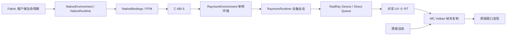

> - 适用: 定位已实现子系统、当前能力边界和文档
> - 权威: 本文维护当前实现地图与文档索引；详细契约由所属页面维护
> - 锚点: `AGENTS.md`, `native/CMakeLists.txt`, `native/radray.lock.json`, `src/client/java/dev/raynium/client/RayniumClient.java`, `src/client/resources/raynium.client.mixins.json`

# Raynium 架构地图

Raynium 是面向 Minecraft 26.3 的 Fabric 客户端模组，当前 native 产物为 Windows x86_64 DLL。
Java 25 通过 FFM 和 C ABI 加载 DLL，native runtime 通过 RadRay RHI 创建设备及 Direct 队列。

## 当前实现与边界

构建与分发、payload 定位和内容缓存、ABI 6 检查、设备创建/销毁及客户端生命周期已实现。
Windows MC Vulkan 通过 Mixin 在帧末复制 native 共享 UV 小 RT 到右上角，原版世界绘制和呈现继续运行。
预览含 GPU shader 绘制、跨设备 timeline 交接和同步重建；没有通用资源服务、场景适配或窗口接管。
构建与运行验证的日期、环境、证据及限制见[构建与测试](../guide/build-test.md#当前验证范围)。

## 职责与源码地图

| 已有部分 | 当前职责 | 源码入口 |
| --- | --- | --- |
| 客户端入口 | 注册 CLIENT_STARTED/CLIENT_STOPPING，选择 payload 和后端，处理启动失败 | `src/client/java/dev/raynium/client/RayniumClient.java` |
| Java bridge | payload 定位、内容缓存、FFM 布局和绑定、DLL/环境/runtime 所有权 | `src/client/java/dev/raynium/bridge/` |
| C bridge | ABI 查询、参数校验、诊断字符串和不透明 runtime 句柄 | `native/include/raynium/bridge.h`、`native/src/bridge.cpp` |
| native 环境 | 持有单例 factory/instance 和诊断配置，不创建设备 | `native/include/raynium/environment.h`、`native/src/environment.cpp` |
| native runtime | 创建 RHI 设备及 Direct 队列，关闭时等待队列并释放设备 | `native/include/raynium/runtime.h`、`native/src/runtime.cpp` |
| native 预览 | 共享小 RT、UV shader、单命令槽和两条 timeline | `native/src/preview.cpp`、`native/shaders/uv.hlsl` |
| MC 预览适配 | 导入原始 Vulkan 对象、帧末复制、resize/退出排空 | `src/client/java/dev/raynium/client/preview/`、`src/client/java/dev/raynium/client/mixin/` |
| RadRay 依赖 | 锁定源码版本；当前链接 render/core，由设备创建消费 D3D12/Vulkan 后端 | `native/radray.lock.json`、`native/CMakeLists.txt` |
| 工程工具 | 显式依赖准备、CMake 构建、stage、分发和验证 | `tools/`、`gradle/native.gradle` |

## 文档索引

| 主题 | 权威入口 |
| --- | --- |
| native 设备会话、所有权、关闭及能力边界 | [Native runtime](native-runtime.md) |
| 当前 C ABI、FFM、payload 与加载 | [互操作与加载](interop.md) |
| Fabric 生命周期和当前 MC 接入范围 | [Minecraft 接入](minecraft-integration.md) |
| MC 26.3 原版渲染、纹理 API 与源码节点 | [Minecraft 渲染流程](minecraft-rendering.md) |
| 已有模组注明日期和版本的源码调查 | [接入参考](integration-references.md) |
| 依赖、构建、测试、启动、stage 和分发 | [构建与测试](../guide/build-test.md) |
| 工具链、IDEA 与 MC 源码生成 | [开发环境](../guide/dev-environment.md) |
| 文档归属、事实边界、引用和历史规则 | [文档维护](../guide/documentation.md) |
| 项目文档维护流程 | [raynium-doc](../../.agents/skills/raynium-doc/SKILL.md) |

## 思考历史索引

| 日期 | 记录内容 |
| --- | --- |
| 2026-10-26 | [渲染方向与实现方案思考记录](../history/2026-10-26-rendering-design-notes.md)：窗口接管到原版保留的方向变化，runtime/互操作/MC 接入草案及 RT 显示候选 |

历史记录保存当时的目标和推演，不构成当前实现或接口契约。
