> - 适用: 定位已实现子系统、当前能力边界和文档
> - 权威: 本文维护当前实现地图与文档索引；详细契约由所属页面维护
> - 锚点: `AGENTS.md`, `native/CMakeLists.txt`, `native/radray.lock.json`, `src/client/java/dev/raynium/client/RayniumClient.java`, `src/client/resources/raynium.client.mixins.json`

# Raynium 架构地图

Raynium 是面向 Minecraft 26.3 的 Fabric 客户端模组，当前 native 产物为 Windows x86_64 DLL。
Java 25 通过 FFM 和 C ABI 加载 DLL；DLL 消费上游 `RadRay::runtime` 静态库，再由该库使用 RadRay RHI。

## 当前实现与边界

构建与分发、payload 定位和内容缓存、ABI 17 检查、独立设备与 HWND 交换链已实现。
MC 不创建原版 GPU 设备，由 Raynium 的 BGRA8 交换链呈现全分辨率地形和 GUI。
CPU 上传路径覆盖独立贴图、字形、动态图、全部图集和光照图；GUI 保留文字准备、节点排序与裁剪。
已实现范围及缺失能力见[Minecraft 接入](minecraft-integration.md)。
地形使用驻留绘制模板、每槽可见记录/参数数组和双槽 FrameScheduler。
SolidFramePipeline 基于 RenderGraphFramePipeline，通过 RDG 和 RHI 提交专用 direct/indirect 绘制；Raynium 负责队列提交。
Java 复用扁平采集和堆外帧缓冲，按事件同步驻留状态，传递原始 quad 流和 section 可见项；Native 完成分组与保守剔除；上传预算和回退回收契约见[地形渲染](terrain-rendering.md)。
游戏和 nativeTest 均使用窗口交换链呈现；GPU 测试不读回像素。操作与测试入口见[构建与测试](../guide/build-test.md)。

## 职责与源码地图

| 已有部分 | 当前职责 | 源码入口 |
| --- | --- | --- |
| 客户端入口 | 在 Fabric 入口加载 payload、创建环境并安装接管生命周期 | `src/client/java/dev/raynium/client/RayniumClient.java` |
| Java bridge | payload 定位、内容缓存、FFM 布局和绑定、DLL/环境/runtime 所有权 | `src/client/java/dev/raynium/bridge/` |
| C bridge | ABI 查询、参数校验、状态码和不透明 runtime 句柄 | `native/include/raynium/bridge.h`、`native/src/bridge.cpp` |
| MC native 管线 | ABI 转换、SolidFramePipeline、专用绘制参数与批次、shader 与单队列提交 | `native/src/renderer.cpp`、`native/src/solid_pipeline.cpp`、`native/src/mesh_pass.cpp` |
| 地形驻留 | 驻留增量更新、runtime 顶点/索引池、材质绑定、专用绘制批次与跨槽资源退役 | `native/src/terrain_residency.cpp`、`native/src/terrain_draw.cpp`、`native/src/renderer.cpp` |
| 输出资源 | HWND 交换链与 RDG 每槽动态后备缓冲视图 | `native/src/render_resources.cpp` |
| MC 地形适配 | 三层原始地形快照、整 section 预算/回退与成功消费后顶点释放，上传预算、纹理变化 | `src/client/java/dev/raynium/client/terrain/` |
| MC 接管适配 | 无原版设备的身份句柄、CPU 像素、GUI 采集、关卡维护与窗口呈现 | `src/client/java/dev/raynium/client/takeover/`、`src/client/java/dev/raynium/client/mixin/takeover/` |
| RadRay runtime | 环境/设备、Scene 容器、Mesh Drawing Pipeline、FrameScheduler/FrameSlot/PMR、GpuBuffer/GpuTexture/UploadArena、RenderGraphFramePipeline/RDG；DLL 从锁定源码编译并链接 `RadRay::runtime` | `native/radray.lock.json`、`native/CMakeLists.txt` |
| 工程工具 | 显式依赖准备、CMake 构建、stage、分发和验证 | `tools/`、`gradle/native.gradle` |

```mermaid
flowchart LR
    Lifecycle[Fabric 客户端生命周期] --> Java[NativeEnvironment / NativeRuntime]
    Java --> FFM[NativeBindings / FFM]
    FFM --> ABI[C ABI 17]
    ABI --> Env[radray::Environment 单例环境]
    Env --> Runtime[radray::DeviceContext 设备会话]
    Runtime --> Scheduler[FrameScheduler / 双 FrameSlot]
    Scheduler --> Adapter[SolidFramePipeline / RenderGraphFramePipeline]
    Adapter --> Mesh[TerrainResidency / 绘制参数与批次]
    Mesh --> RDG[RDG / 每槽瞬态资源池]
    RDG --> RHI[RadRay Device / Direct Queue]
    RHI --> Swapchain[BGRA8 HWND 交换链]
    Swapchain --> Surface[窗口呈现]
```

## 文档索引

| 主题 | 权威入口 |
| --- | --- |
| native 设备会话、所有权、关闭及能力边界 | [Native runtime](native-runtime.md) |
| shader pack、离线编译与资源来源 | [Shader pack](shader-pack.md) |
| 当前 C ABI、FFM、payload 与加载 | [互操作与加载](interop.md) |
| 完整地形数据、纹理上传与绘制 | [地形渲染](terrain-rendering.md) |
| Fabric 生命周期和当前 MC 接入范围 | [Minecraft 接入](minecraft-integration.md) |
| MC 26.3 原版渲染、纹理 API 与源码节点 | [Minecraft 渲染流程](minecraft-rendering.md) |
| 依赖、构建、测试、启动、stage 和分发 | [构建与测试](../guide/build-test.md) |
| 工具链、IDEA 与 MC 源码生成 | [开发环境](../guide/dev-environment.md) |
| 文档归属、事实边界、引用和历史规则 | [文档维护](../guide/documentation.md) |
| 历史计划、开发验证与采样记录 | [历史索引](../history/README.md) |
| 项目文档维护流程 | [raynium-doc](../../.agents/skills/raynium-doc/SKILL.md) |
