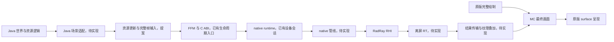

> - 适用: 回看 2026-10-26 渲染目标调整、runtime/互操作/MC 接入方案与调查取舍
> - 权威: 这是当时的思考与方案快照，包含未实现、未确认和已被替代的内容，不是当前接口或实施依据
> - 锚点: `AGENTS.md`, `native/include/raynium/bridge.h`, `native/src/runtime.cpp`, `src/client/java/dev/raynium/client/RayniumClient.java`, `doc/architecture/overview.md`

# 渲染方向与实现方案思考记录

日期：2026-10-26。
归档来源：本次整理前已提交文档中的旧方向，以及归档前的未提交文档工作树；后者包含本会话上一次 RT 调查和目标调整，不能仅用已提交文档还原。
用户在本次整理中明确授权将当前文档的建议、设想与未实施方案保存到 history，作为这一段时间的思考过程。

归档时实现仍只有构建/加载、ABI 3、RHI 设备与 Direct 队列和客户端创建/关闭生命周期；没有资源/帧接口、离屏绘制或 RT 叠加。本记录没有把方案当成实现或运行验证。
用户明确表达的是保留原版全部渲染路径、以自有结果纹理对照并力求 1:1 还原；模块、接口、同步方式及实施次序来自当时设计文本和助手调查建议，不代表用户逐项批准。

下文保留方案所需的职责、数据流、接口、所有权、寿命和取舍。为方便归档阅读，调整了标题层级与部分内部链接；源码事实以[当前架构地图](../architecture/overview.md)所链接页面为入口，历史正文不随实现回写。

## 方向变化

此前文档以 native 接管窗口呈现、逐步替换原版 GPU 路径为方向。用户随后要求原版所有渲染路径全部保留，在最终画面显示自有 RT，用于开发期间对照。两个方向先后出现，不是同时生效的要求。

### 之前的实施顺序

以下摘自目标调整前已提交的 overview，代表目标调整前的计划：

下表保留已有实施提案，作为后续验收设计；整理不表示这些设计已全部确认。
设备会话已实现，阶段 0 还未形成绘制闭环；阶段 1 的加载和生命周期部分提前完成。

| 阶段 | 实现内容 | 完成条件 | 当前进度 |
| --- | --- | --- | --- |
| 0 通用 runtime 最小闭环 | 设备/输出、纹理网格管线、资源表、两个帧槽、独立宿主 | 不依赖 MC 显示纹理网格，resize 与释放正确 | 仅设备/Direct 队列完成 |
| 1 ABI 和 Java 驱动 | DLL/ABI、资源批次、FramePacket、返回结果 | Java 驱动同一 runtime，返回后复用输入不破坏画面 | 加载、ABI 和生命周期完成；资源/帧未实现 |
| 2 MC 窗口与基础 GUI | SDL → HWND、原版 surface 接管、GUI 顶点和字形 | 菜单/加载画面可见，每帧只呈现一次 | 未实现 |
| 3 地形闭环 | atlas、编译结果、区块记录、相机、opaque/cutout | 走动、放置/破坏、卸载重建正确，移除对应原版 GPU 堆 | 未实现 |
| 4 动态世界 | 实体、方块实体、粒子、流体、动画纹理、基础透明 | 动态数据寿命正确，切世界不残留旧结果 | 未实现 |
| 5 效果与完整 GUI | 手持物、轮廓、光照/雾、预览、画中画、模糊、截图 | 常用视图和界面完整，对应原版 pass 停用 | 未实现 |
| 6 清除残余 GPU 路径 | 初始化、后台上传、计时和旧资源构造审计 | native 模式由 RHI 统一执行 GPU 绘制和呈现 | 未实现 |
| 7 性能与扩展管线 | 复用、批处理、上传优化、阴影/光追 | 以测量确定优化，通用接口保持独立于 MC | 未实施 |

阶段 2 的基础 GUI 不包含完整 3D 预览；地形可见也不表示游戏全部可用。
具体运行范围随各阶段验收更新，不能用重复原版绘制掩盖未支持内容。

### 下一步边界

按原计划先增加资源句柄表与两个帧槽，再接 mesh/texture 上传、状态跟踪、输出及最小纹理网格管线。
独立宿主传入 HWND、mesh、纹理、view 和 draw item，形成可观察的一帧；Java 再以同样数据驱动，随后接入 MC 窗口和基础 GUI。
具体模块与 P0/P1 范围见 [runtime 实施分级](#当时的-native-runtime-草案)，跨语言扩展见[接口提案](#当时的跨语言草案)。
首批不引入实体兼容、复杂透明、光追或完整帧图框架。

### 调整后的目标与计划

### 当前目标：保留原版的画面对照

已确认目标：原版全部渲染路径继续运行；Raynium 独立绘制离屏 Render Target（RT），
将其作为一块纹理叠加到最终屏幕，用于开发中对照结果，力求整套管线 1:1 还原。
窗口、原版 surface、原版 submit/present 和原版 GPU 资源继续由 MC 管理。
Java 采集数据时不能消费、替换或提前释放原版后续仍需要的数据。

旧提案中的窗口接管、原版 draw 抑制和清除原版 GPU 路径不再属于当前实施顺序。
双份渲染及资源在此阶段是对照条件。1:1 是还原目标，不是当前完成状态；
同帧输入、分辨率、颜色、透明顺序与画面覆盖范围均须逐项核对。
RT 叠加的源码调查、传输候选及首个验证闭环见 [Minecraft 接入](#当时的-minecraft-接入草案)。
### 实施顺序与完成条件

下表按已确认的新目标调整实施提案；具体接口和传输方案尚待实现验证。
设备会话、加载和生命周期已实现，尚未形成任何自有绘制闭环。

| 阶段 | 实现内容 | 完成条件 | 当前进度 |
| --- | --- | --- | --- |
| 0 RT 显示闭环 | native 离屏目标、测试图、最小提交/读回、FFM 取图、MC 最终纹理矩形 | 原版完整画面上出现 native 绘制的结果，resize、隐藏和释放正确 | 仅设备/Direct 队列及加载生命周期完成 |
| 1 通用资源与帧 | 资源表、纹理网格、两个帧槽、状态跟踪、资源批次与 FramePacket | Java 驱动离屏绘制，返回后复用输入不破坏结果；保留阶段 0 的显示链路 | 未实现 |
| 2 地形对照 | 旁路复制 atlas/编译结果、区块记录、同帧相机、opaque/cutout | 走动、放置/破坏、卸载重建可与原版对照，原版上传和绘制完整保留 | 未实现 |
| 3 动态世界对照 | 实体、方块实体、粒子、流体、动画纹理与透明 | 不破坏原版数据消费和排序，切世界不残留旧结果 | 未实现 |
| 4 效果与完整 GUI 对照 | 手持物、光照/雾、轮廓、预览、画中画、模糊和截图 | 自有结果逐项覆盖整套画面，原版作为参照继续执行 | 未实现 |
| 5 一致性与性能 | 同帧双图/差分、颜色与顺序核对、结果传输和资源复用优化 | 明确误差与未覆盖范围，以实测决定是否引入 GPU 共享 | 未实施 |

地形可见不表示自有管线已经还原整套画面。原版背景用于参照，不能把背景中正常显示的内容算作自有 RT 已支持。
改变原版视觉算法的阴影、光追或新透明方案另行评估，不作为 1:1 还原阶段的默认方向。

### 下一步边界

首先验证“native 离屏 RT → 结果传输 → MC 最终叠加”，不以 HWND、native swapchain 或完整场景资源系统为前置条件。
首个闭环先用测试图验证像素方向、通道、颜色、帧号和寿命，再扩展纹理网格与 MC 场景输入。
具体模块与 P0/P1 范围见 [runtime 实施分级](#当时的-native-runtime-草案)，跨语言扩展见[接口提案](#当时的跨语言草案)。
首批不引入实体兼容、复杂透明、光追或完整帧图框架。
### 职责与源码地图

| 层 | 职责与边界 | 当前入口 |
| --- | --- | --- |
| MC 与 Java 适配 | 世界、区块、资源包、模型求值、动画、应用侧裁剪；转换为通用数据 | `src/client/java/dev/raynium/client/`；场景适配器待实现 |
| Java bridge | payload 定位、内容缓存、FFM 布局、DLL/runtime 所有权 | `src/client/java/dev/raynium/bridge/` |
| C bridge | 参数校验与 C ABI 转换；不暴露 C++ 对象布局 | `native/include/raynium/bridge.h`、`native/src/bridge.cpp` |
| 通用 runtime | 已有设备会话；后续负责资源、上传、帧调度和寿命 | `native/include/raynium/runtime.h`、`native/src/runtime.cpp` |
| native 管线 | 解释材质、组织 pass、shader、光照与效果 | 待实现，依赖 runtime 服务 |
| RadRay RHI | 后端设备、资源、命令、提交和显式同步 | `native/radray.lock.json` 锁定上游；由 CMake 源码子工程引入 |
| 工程工具 | 显式拉取、CMake 构建、stage 与分发 | `tools/`、`gradle/native.gradle` |

MC 的方块 ID、区块对象、资源包规则和 Java 模型对象不进入通用 runtime 契约。
Raynium 的资源和管线代码面向 RadRay RHI，后端选择集中在设备创建；不另写两套图形后端。
当前 native 依赖为 `runtime → render/core`；后续 shader 支持由管线侧消费离线产物。



## 当时的 native runtime 草案

以下内容在归档时均未实现；其中提及的底层 RHI 能力不等于 Raynium 已有对应服务。

### 后续功能提案

下文描述未来资源与管线能力；除上述设备会话外，不能据此认为这些功能已经实现。
按[当前目标](#方向变化)，首个输出为离屏 RT，MC 保留窗口呈现。
读回显示先于完整场景系统形成最小闭环；GPU 共享仍是可选扩展，不是现有能力。

### 职责与边界

这里的 native 渲染系统由 runtime 基础服务和具体渲染管线组成。二者都在 native，但功能归属不同。

| 功能 | 宿主 Java | 通用 runtime | 具体 native 管线 |
| --- | --- | --- | --- |
| 世界、实体、区块和资源包 | 管理与解析 | 不感知这些概念 | 不直接读取 |
| 模型求值、动画、几何生成 | 生成通用结果 | 接收 mesh 和动态数据 | 使用数据绘制 |
| 应用侧裁剪与 LOD | 选择候选对象 | 校验并保留本帧输入 | 进行特定 pass 所需的筛选 |
| 纹理、网格、材质数据 | 创建/更新/释放请求 | 管理身份、GPU 对象和寿命 | 解释材质模型 |
| 光照、阴影、透明、后处理 | 提供输入和参数 | 提供执行设施 | 决定算法、pass 和 shader |
| GUI | 布局、排版和模型求值 | 接收有序几何及目标引用 | 绘制、模糊和合成 |
| 帧节奏、同步、资源状态 | 提交完整帧，原版独立呈现 | 上传、barrier、离屏 submit、结果完成同步 | 生成本帧执行计划 |

runtime 不建立 MC 场景图或 ECS，也不解析模型文件、图片文件、资源包和 shader 源码。它可以承载一般应用的场景输入，但第一版不提供持久实例数据库；宿主每帧给出完整候选列表。

FFM、JNI、C ABI 的字节解码属于 bridge。runtime 的主要接口是普通 C++ 数据结构和 span，独立 C++ 宿主无需构造跨语言 FramePacket 就能使用它。

### 最小公共对象模型

建议公开少量业务对象，把上传池和 command allocator 等机制封装在内部。

| 对象 | 定义和寿命 |
| --- | --- |
| `RayniumRuntime` | 现已拥有设备会话；后续扩展资源与执行环境，独占设备的 CPU 调用调度 |
| `OutputHandle` | 当前优先离屏输出；未来独立宿主的 swapchain 输出另行扩展 |
| `PipelineHandle` | 一个 native 管线实例，拥有其材质 schema、布局、PSO 和历史状态 |
| `MeshHandle` | 持久网格的公开身份，独立于绘制实例 |
| `TextureHandle` | 持久纹理的公开身份；尺寸、格式和 mip 数创建后固定 |
| `MaterialHandle` | 某个管线 schema 的不可变材质数据及资源依赖 |
| `FrameInput` | 调用期间借用的通用帧数据 |
| `FrameResult` | CPU 接受情况、GPU 提交序号、输出状态及诊断 |
| `ReadbackTicket` | 异步读回请求及其 CPU 可读取状态，首个 RT 显示闭环需要 |

首版一个 runtime 使用一条 direct/graphics queue，向自有离屏目标输出，并提供有界的结果读回。MC 主窗口不交给 runtime。独立宿主窗口输出、多个执行线程和多队列并行均后置。

设备创建已集中在 `RayniumRuntime::Create` 中，通过 RadRay 现有工厂选择适配器并创建设备；后续资源与管线代码面向 RHI，不散布后端分支，也不允许宿主绕过调度器操作同一设备。

```text
RayniumRuntime
  DeviceSession
  ResourceStore
  UploadService
  FrameScheduler
  ResourceStateTracker
  TransientResourcePool
  OutputStore
  PipelineStore
  Diagnostics

PipelineInstance
  MaterialSchema
  Shader/Layout/PSO owners
  Per-material prepared bindings
  History resources
  BuildFrame / RecordPass implementation
```

### 资源服务

#### 资源身份与依赖

runtime 必须区分公开句柄和实际对象。建议句柄由槽位与 generation 构成，并按资源类型和 runtime 归属使用。释放公开句柄后立即拒绝新的外部引用；仍有内部依赖的实际对象继续存活。

资源记录至少包含描述、生命周期状态、GPU 对象、内部依赖和最后一次 GPU 提交序号。公开槽位复用必须改变 generation，不能让旧句柄命中新资源。

例如材质创建时将 TextureHandle 解析为内部纹理引用。之后宿主释放该纹理的公开句柄，已有材质仍能合法使用它；当材质、帧和上传任务都不再引用该纹理时，才进入最终销毁。这样引用的有效性不会取决于宿主释放句柄的偶然顺序。

首版资源依赖采用受控的单向关系：material → texture，mesh → 内部 buffer，view → texture，PSO/parameter set → layout 和绑定对象。拒绝任意资源依赖环。内部对象引用由 runtime 或管线实例持有，不新增进程级全局注册表。

#### Mesh 功能

`MeshDesc` 包含 vertex streams、布局、拓扑、索引格式、submesh 范围和可选包围盒。宿主传入已求值的几何，runtime 负责：

- 检查 stride、offset、索引范围、字节数和设备限制。
- 创建 GPU buffer，安排上传，记录可被绘制使用的顺序。
- 暴露 submesh 的绘制范围，供管线绑定和组织 draw。
- 管理替换与释放，保留在途帧正在使用的旧版本。

第一版持久 mesh 采用创建后不可变的方式，变化时新建 mesh 并交换宿主句柄。动态几何走帧内顶点/索引区，不为每帧的小粒子和 GUI 元素反复创建持久对象。

初期可每个 mesh 使用独立 buffer；需要减少大量小 buffer 的开销时，再增加按用途分组的 GPU buffer page 和切片分配。该优化不改变 MeshHandle 或 DrawItem 契约，也不要求 runtime 自行实现一套显存 heap 后端。

#### Texture 功能

必须支持创建、完整上传、区域更新、多 mip/array layer 描述和显式释放。v1 优先实现普通 2D 采样纹理；深度和渲染目标由管线目标服务创建，复杂格式按需求扩展。

纹理区域更新必须描述源 row pitch、mip、layer、矩形与数据范围。runtime 把源数据整理成 RHI 要求的上传布局，处理 placement/pitch 对齐和非 coherent 映射内存的 flush。压缩纹理若加入支持，还需要块尺寸与块对齐校验，不能照搬普通像素路径。

尺寸或格式变化创建新纹理，不偷偷改变已有句柄的资源描述。普通像素区域更新允许复用同一 GPU 对象，按单队列顺序保证旧读取结束后再写入，新绘制随后读取新内容。

首版要求宿主提交所需 mip 数据。自动 mip 生成属于可选的 native utility pass，不能在缺失 mip 时假设 RHI 会自动补齐。

颜色空间是纹理及管线输入的明确属性。runtime 保留和校验这份信息；色调映射、曝光和最终颜色转换由管线负责。

#### Material 功能

runtime 保存 schema 标识、版本、参数数据，以及显式列出的纹理/采样依赖。具体管线负责验证参数意义并生成 shader 变体和绑定。

建议形状为：

```text
MaterialDesc
  pipelineSchemaId, schemaVersion
  typed parameter bytes
  textureBindings[]: semantic slot, TextureHandle, SamplerDescriptor
```

纹理引用必须是结构化字段，不能藏在任意参数 blob 中，否则 runtime 无法跟踪寿命。参数块只携带该 schema 定义的值，不包含 RHI 指针或宿主对象地址。

第一版材质不可变，修改时创建新材质。旧材质由已有帧继续持有；新帧使用新句柄。后续若增加 UpdateMaterial，应产生新内部版本，不能原地覆盖在途 descriptor。

不做一个支持任意 shader 自动反射、任意参数自动绑定的材质编辑系统。管线明确声明 schema、binding layout 和允许的变体；通用性来自可安装多种管线，而不是让一个参数字典承担全部语义。

#### 上传与背压

`ApplyResources` 返回前已经复制或消费宿主 CPU 字节。成功表示资源请求被接收，不表示上传已由 GPU 完成。内部状态可采用 `PendingUpload → UsableInQueueOrder → Resident`；逻辑释放单独记录，不与 GPU 就绪混为一谈。

待上传队列拥有 CPU 数据和资源引用。绘制引用待上传资源时，runtime 必须在它第一次使用之前提交所需上传；尚未准备好时明确返回 Deferred，不能让 shader 读取未初始化图像。

设置待上传字节和 staging 内存预算。容量不足返回背压结果，由宿主保留旧 mesh、减少任务生产或稍后重试。v1 对一帧必需的新资源采取“全部排入该帧之前，或整帧暂缓”的规则，不静默显示一半新场景。后台非必需上传可分批推进。

增加 `PumpResources`，让没有可呈现窗口时仍能按预算推进已接受的资源请求。它只执行资源工作，不持有 swapchain token，也不要求构造一份假 FrameInput。

### 完整帧输入与执行入口

#### FrameInput 的内容

runtime 接收只读的连续数据视图，不保留宿主对象指针：

| 内容 | 作用 |
| --- | --- |
| frame ID、pipeline、output | 标识本次请求和执行目标 |
| Views | 当前/上一帧矩阵、viewport、投影和历史失效标志 |
| DrawItems | mesh/submesh/material、当前/上一帧变换、稳定 ID 与候选标志 |
| TransientGeometry | 仅本帧有效的顶点和索引 |
| Lights / Environment | 管线声明的通用光源和环境参数 |
| OrderedDraws | GUI、叠加图形等顺序敏感批次及 scissor |
| PipelineInputs | 经该管线 schema 验证的附加输入，例如 preview 或特定效果参数 |

runtime 校验索引和句柄后，生成内部 `ResolvedFrame`：资源引用已经解析并保活，瞬态数据已复制到自有内存，管线不能再通过回调读取 Java。主视图和阴影视图的候选输入由宿主提供，runtime 不重新遍历世界。

#### 单次 RenderFrame 负责完整结束一帧

建议公开入口为 `RenderFrame(output, pipeline, input)`，当前完成离屏 recording/submit，并报告结果身份与进度；不 acquire 或 present MC surface。GPU 工作可以仍在运行，但调用返回后宿主 CPU 内存不再被借用。

```text
RenderFrame
  1. 校验输入和句柄，解析并固定本帧资源引用
  2. 检查输出、必需上传、管线状态和预算
  3. 等待或检查可复用帧槽，结束其旧 command epoch
  4. 准备 PSO、参数集、临时目标和 fallback 资源
  5. 取得可写离屏目标；没有空闲槽则释放本次临时引用并暂缓
  6. 由管线生成具体 pass，完成 GPU 命令录制
  7. 单队列提交：上传、绘制、需要的读回 copy、完成 fence
  8. 发布输出 frame ID、generation 与完成查询信息
  9. 返回 submission ID 与接受结果，GPU 异步继续
```

将多数可能失败的校验和资源准备放在录制/提交之前。`FrameResult` 分开报告 CPU 接受、GPU 是否提交和结果是否可读取；提交成功不代表 Java 已能访问像素。没有新结果时由显示器继续使用上一张有效纹理。

若未来增加独立宿主窗口输出，acquire/present 和 token 终结仍应封装在 runtime 内部；这是后置输出类型，不是 MC 对照模式的必需路径。

#### 帧槽与等待

首版两个在途帧槽，每个槽包含 command allocator/buffer、上传页、动态顶点区、参数集租借、瞬态目标引用、查询区和完成序号。读回槽还需等待 CPU 消费结束才能重用；GPU fence 完成与调用方取走结果是两个条件。

正常帧路径支持有界等待：利用 RHI `Fence::WaitFor` 或完成值查询判断可复用性，超时返回 Busy/Deferred。超时不是完成证明，不能继续 Reset。宿主据返回值维持窗口和游戏响应，不必把无限等待写进跨语言调用。

同一帧槽复用顺序为：GPU 完成 → Reset/释放旧录制使 command epoch 结束 → 归还参数集和临时资源 → 开始新录制。仅等待 fence 后就修改参数集还不够，旧录制引用也必须结束。

### Pass 执行与资源状态

#### 管线生成执行计划

runtime 需要一个轻量 `FramePlan`，首版按管线给定顺序执行，不实现自动调度到多队列的完整 render graph。

每个 pass 声明名称、graphics/compute/copy 类型、资源读取与写入、subresource range、shader stages、附件及 native 录制回调。录制回调只在当前 render thread 内执行，其数据由本帧持有。

```text
FramePlan
  Pass Upload          : write mesh/texture destinations
  Pass Opaque          : read meshes/materials, write intermediate color and depth
  Pass OutputColor     : read intermediate color, write offscreen color
  Pass Overlay         : read GUI textures, read/write output attachment
  Pass Readback        : copy final color to readback buffer
```

这个列表只是管线示例，runtime 本身不要求所有管线都有这些 pass，也不要求 HDR 或色调映射。原版还原管线按实际原版颜色与透明路径构造计划。

管线通过 `PassContext` 使用 RHI graphics/compute encoder，runtime 控制 pass begin/end、barrier 和提交。管线不自行调用 queue Submit/Wait/Present，也不绕过状态系统访问未声明资源。

#### 状态跟踪

RHI 当前不会自动追踪资源状态或补 barrier。因此 runtime 的 `ResourceStateTracker` 是必需功能，负责：

- 记录每个 buffer/texture 的已排队状态及首次使用条件。
- 按 pass 声明生成 before/after barrier，处理 copy、shader read、attachment、depth、UAV 和 present。
- 跟踪 texture 的 mip/layer/aspect；buffer 首版可保守按整资源状态管理。
- 对无状态变化但存在 UAV 写依赖的情况发出必要内存 barrier。
- 检查读取未初始化内容、非法同 pass 读写和缺失用途声明。

资源状态表示 GPU 队列按序执行后将达到的状态，不等于 CPU 此刻观察到的 GPU 进度。命令录制先更新本次候选状态表，实际提交后才合并到已排队状态；未提交录制被取消时不能留下假的状态变化。

GPU 完成状态由 submission fence 单独管理。不能用“已标为 ShaderRead”推断上传已经完成，也不能在重新借出池内纹理时直接把其状态重置成 Undefined。

新建资源及首次取得的输出图像按 RHI 初始状态契约初始化，复用对象沿用实际状态。初始状态的公共约定若不够明确，应补充 RHI 文档或薄接口，不能在各管线内散布后端猜测。

首版禁止在同一个 pass 中对同一子资源进行未明确支持的采样与写入反馈。只读深度与特殊混合权限依 RHI 能力约束校验；不能因为名称同为 DepthRead 就承诺所有 shader 访问方式都合法。

#### 瞬态目标池

管线按描述请求临时 color/depth/storage 图像，runtime 负责创建、复用、预算和延迟退役。池 key 包括尺寸、格式、samples、mip/layer、usage 和所需 view。

v1 只复用已结束全部引用的对象，不做不同逻辑图像共享同一显存区间的 aliasing。第一版把临时目标与帧槽关联，可先减少跨帧复用推理；后续再增加更细的存活区间分析。

空闲池使用容量预算和回收策略，GPU 在途对象不受 LRU 驱逐。resize 后旧尺寸对象立即失去新帧匹配资格，但实际销毁仍要等引用结束。

### 管线支持设施

#### 管线生命周期

`IRenderPipeline` 通过工厂创建完备实例；实例提供能力与 schema 查询、输入验证、资源准备、构造 FramePlan、输出变化通知和销毁入口，不提供构造后的 Init/Initialize。第一版使用编译进程序的 native 实现，不引入动态 DLL 管线插件 ABI。

runtime 向管线提供受控服务：资源解析、临时目标、上传切片、参数集、历史资源和诊断。管线保持自己的材质模型、draw 排序与 shader 选择，runtime 不为某种 forward/deferred/光追算法添加固定字段。

第一套管线只需纹理网格、深度和基础 overlay。加入阴影、OIT、雾或时序算法时扩展管线及其 schema，不把算法实现搬进 ResourceStore。

#### Shader、布局和 PSO

runtime 核心不依赖 DXC。管线加载离线 shader 产物，显式创建并持有 RHI `BindingGroupLayout`、`PipelineLayout`、shader 和 PSO。shader 产物解析可由依赖 `radrayshader` 的管线支持层完成，保持 `runtime → render/core` 的依赖方向。

当前 RHI 不替调用方共享布局，管线实例必须保存和复用同一布局对象。PSO 按 shader 变体、布局、顶点布局、附件格式、sample count 和固定状态复用；key 由完整描述确认，不能只比较 hash。

首次需要的 PSO 尽量在占用输出槽前创建。缓存属于管线实例生命周期，有预算且只淘汰无使用者的对象，不建立全局 PSO cache。

#### 参数集和常量

`ShaderParameterSet` 第一次绑定后视为不可变。runtime 提供按 layout 分组的借用池，完整写入 → FlushWrites → 绑定 → 等待 GPU 与 command epoch 结束 → ResetBindingsForReuse → 再次借出。

每帧常量使用按 RHI alignment 切分的 buffer 区域；多帧在途不能覆盖同一切片。材质的稳定绑定可以跨帧复用，但其资源依赖和 layout 必须一直存活。sampler 优先复用已有 RHI device sampler cache，不在 runtime 再建一个意义相同的缓存层。

#### 历史资源

时序历史作为管线实例下的资源组，以 pipeline instance、稳定 view ID、用途和输出代次标识。runtime 提供分配与寿命服务，管线决定历史内容及何时失效。

resize、projection/camera cut、scene discontinuity 和管线切换需要失效标志。v1 没有时序 pass 时无需建立历史池；接口只保留表达失效的空间。

历史是否推进取决于对应 GPU 写入是否已提交，不能只看 MC 是否成功呈现了上一张结果纹理。宿主提供的 previous transform 也必须与最后一次被接受执行的帧对应，跳帧不能无条件推进“上一帧”。

### 输出、取消和关闭

`OutputStore` 当前提案管理离屏 RT、尺寸、格式和输出代次；窗口创建、surface、呈现、输入和 DPI/GUI scale 全部留在 MC。输出帧身份与尺寸必须随传输结果一起返回。

resize 在完整帧调用之间创建新一代 RT/读回资源，旧资源等 GPU 与 CPU 消费结束后退役。Java 不把旧 generation 的结果上传到新尺寸纹理。最小化可暂停新增离屏帧，零尺寸不创建图像；已接受请求仍需正确退休。

正常输入错误和预算不足在提交前返回；已经提交的工作不能当作未发生而立即释放资源。未来若实现独立宿主 swapchain，另行处理 acquired token 与取消；当前 `DiscardAcquiredFrame` 并非所有 RHI 后端都支持。RHI 某些执行错误会直接终止进程，也没有统一设备丢失恢复协议，不承诺把所有失败转为可恢复状态。

正常关闭按依赖逆序进行：停止接受新工作，释放未提交 CPU 请求，排空已提交 GPU 工作，结束录制 epoch，释放帧/参数集/PSO/view，再释放资源、输出和设备会话。故障关闭遵循 RHI 可用能力，不在已知无法完成的 fence 上无限等待。第一版不做自动设备恢复。

### 预算、诊断和读回

runtime 至少需要以下生产级限制：持久资源数量与字节、待上传 CPU 字节、上传页峰值、瞬态目标池预算、每帧动态数据上限和可配置等待时间。达到限制时返回具体资源类别及请求量，不能无界扩容到进程失去响应。

RHI 当前提供的 budget/capability 信息不足以证明完整的实时显存驻留状态。runtime 首版做自身分配记账和预算控制，不承诺自动显存驻留管理或按重要性淘汰宿主仍在使用的纹理。

诊断分成输入错误、资源准备失败、管线错误、输出不可用和 RHI 原生诊断。消息带 frame/resource/pass 标识，native 回调写入由会话持有的线程安全有界接收器，由 Java 主动读取；驱动回调不能重入 RHI 或调用 Java。

运行指标包括上传字节、GPU 对象数量、池占用、队列积压、帧槽等待、CPU 准备/录制耗时和可用的 GPU pass 时间。使用 RadRay profiler，不在生产对象添加仅供测试的计数和轨迹。

首个 RT 显示闭环及截图使用异步 readback：请求 → copy → fence 完成 → map/必要的 invalidate → 调用方取走 CPU 结果。ticket 固定资源、输入 frame ID 和输出代次，resize 后旧结果可安全退休，但不能冒充新代输出。GPU 完成前不能读取，CPU 消费完成前不能复用对应槽。

当前提案允许把最终颜色读回作为对照开发的显示链路，代价与格式整理见 [RT 显示调查](#当时的-minecraft-接入草案)。必须限制槽数、内存和等待时间，满时暂缓新结果；GPU 共享是后续优化，不能凭空假设已有 import/export 或跨设备同步。

### 接口草案

以下是 C++ 语义接口清单，不是最终头文件；FFM/C ABI 仅对它做数据转换。

| 接口 | 语义 |
| --- | --- |
| `CreateRuntime(deviceSession, config)` | 建立单设备执行环境及预算 |
| `CreateOffscreenOutput(desc)` | 创建离屏输出；窗口输出后置 |
| `CreatePipeline(factory, config)` | 构造 native 管线实例及 schema |
| `CreateMesh` / `CreateTexture` / `CreateMaterial` | 同步消费 CPU 输入，返回公开句柄 |
| `UpdateTextureRegions` | 接受有序区域更新 |
| `ReleaseResource(handle)` | 释放外部身份，实际对象按内部引用退役 |
| `ApplyResources(batch)` | 批量执行上述操作，逐项返回结果 |
| `PumpResources(budget)` | 无画面输出时也可推进资源上传 |
| `RenderFrame(output, pipeline, input)` | 完成离屏录制与提交，返回结果身份/进度 |
| `ResizeOutput` / `DestroyOutput` | 在合法边界重建或销毁输出 |
| `RequestReadback` / `PollReadback` / `ReleaseReadback` | RT 显示与按需截图使用的有界异步读回 |
| `GetCapabilities` / `ReadDiagnostics` / `GetStatistics` | 能力、错误与生产运行状态 |
| `Shutdown` | 显式结束 GPU 使用并按顺序销毁 |

所有操作都由同一个调度线程串行调用。宿主其他线程可以准备 CPU 数据，但不直接调用这些会进入 RHI 的接口。无后台 native 线程是首版策略，并不限制 GPU 多帧在途。

### RHI 已提供与 runtime 必须补上的功能

| 已有 RHI 能力 | runtime 新增职责 |
| --- | --- |
| Device、资源创建、能力/纹理支持查询 | 会话、资源身份、请求校验、依赖与预算 |
| Buffer map、copy、region upload | 数据保有、行距整理、上传队列、staging 回收 |
| 显式 layout、parameter set、PSO | 由管线共享对象，安全借用和版本寿命 |
| Command allocator/buffer 和 encoder | 帧槽、统一录制、epoch 结束与复用 |
| 显式 resource barrier | 访问声明、状态跟踪与依赖生成 |
| Fence、Submit、有限等待 | 提交序号、CPU/GPU 进度和延迟释放 |
| Swapchain acquire/present/recreate | 后置的独立宿主输出能力；当前 MC 对照模式不用 |
| Query 与 profiler 支持 | 命名 pass、能力不足时的真实可用性与耗时展示 |

设计依据为 [RHI 与后端](https://github.com/ksgfk/RadRay)（`docs/architecture/render-rhi.md`） 和 [rhi.h](https://github.com/ksgfk/RadRay)（`modules/render/include/radray/render/rhi.h`）。这些功能大部分是 RHI 之上的组织工作，不需要另起一套图形后端。完整跨队列 ownership transfer、通用输出取消和统一可恢复设备丢失等能力不应被 runtime 假定已经存在。

### 实施分级

| 级别 | 功能 | 完成后的能力 |
| --- | --- | --- |
| P0a RT 显示基础 | 会话、离屏 RT、测试图、提交/fence、读回槽和结果提取、正确释放 | MC 可显示 native 的离屏结果，不依赖完整场景系统 |
| P0 最小执行基础 | 资源表、mesh/texture 上传、两帧槽、状态跟踪、延迟释放、离屏输出、完整 RenderFrame | Java 驱动 native 管线稳定绘制纹理网格 |
| P0 管线基本支持 | 明确 schema、layout/PSO 所有权、参数集安全复用、动态几何、最小 FramePlan | 不依赖 MC draw API，能扩展基础 overlay |
| P1 实际场景支持 | 上传背压/预算、纹理区域更新、多个 view、目标池、完整 material 和诊断 | 接入地形、动画纹理、实体和 GUI |
| P2 高级管线支持 | 历史资源、preview 缓存、更多格式和 resolve、GPU pass 计时、PSO 预热 | 承载完整效果与复杂界面 |
| P3 测量后扩展 | mesh buffer 分页、实例批处理、自动帧图优化、GPU culling、多队列、光追所需 RHI 扩展 | 按实际瓶颈和算法需求扩展 |

P0 也必须有基本容量上限、错误诊断和正确的资源退役；P1 的预算功能指更完善的调度与统计。首版不实现资产导入器、场景图、ECS、通用任务系统、shader 热编译、动态插件系统或自动设备恢复。

最先打通离屏输出、最小命令提交/状态、读回与 MC 显示，再扩展 `resource_store`、`upload_service`、`frame_scheduler`、`resource_state_tracker` 和纹理网格 pipeline。采用同名 `.h/.cpp`，状态由实例持有；失败创建遵守 `static Create` 与局部 RAII。逐步加入 pool、material、overlay 等功能，避免完整框架成为看见首张结果的前置条件。

总实施顺序与当前阶段只在[架构地图](#方向变化)维护；本节分级用于 runtime 功能范围。

## 当时的跨语言草案

下面混合了 FFM 调查背景与资源/帧接口设想；归档时实际导出仍只有两个查询函数和 create/destroy。

### 接口边界

边界为 `Java 场景适配 → FFM → 窄 C ABI → C++ runtime/管线 → RadRay RHI`。`bridge.h/.cpp` 承担跨语言入口，C++ runtime 在 DLL 内部使用自己的类型与模块，Java 只通过 C ABI 调用；场景适配与管线部分仍待实现。

JDK native linker 依据平台 ABI 和调用方提供的 `FunctionDescriptor` 建立调用。它不会从导出符号推导参数类型。Raynium 当前只导出 `extern "C"` 函数，不暴露 C++ 类、虚表、STL 容器、引用、重载或可变参数。类型宽度不能照抄其他平台：Windows x64 的 C `long` 是 32 位。见 [JDK 25 Linker](https://docs.oracle.com/en/java/javase/25/docs/api/java.base/java/lang/foreign/Linker.html)。

| C ABI 表达 | Java 表达 | Raynium 建议 |
| --- | --- | --- |
| `uint32_t` / `int32_t` | `JAVA_INT` / `int` | 状态、枚举和计数明确范围；需要时使用无符号转换 |
| `uint64_t` | `JAVA_LONG` / `long` | 资源句柄和版本号按位传递，不依赖有符号大小关系 |
| `float` / `double` | `JAVA_FLOAT` / `JAVA_DOUBLE` | 坐标和矩阵另行明确约定 |
| `rn_runtime*` | `ADDRESS` / `MemorySegment` | 不透明拥有对象，Java 不解引用其内部 |
| `const void*` + 字节数 | native segment + 明确长度 | 同时约定可访问范围和借用时长 |
| UTF-8 字符串 | 字节段 + 长度 | 不使用平台相关的 `wchar_t` 作为通用文本格式 |

固定宽度类型是本项目的接口选择，不是 FFM 只支持这些类型。必须使用 `size_t` 等平台类型时，从 `Linker.canonicalLayouts()` 取得对应布局；不要把所有 C 整数映射为 Java `long`。

### 布局与版本

`MemoryLayout.structLayout` 不替 C 编译器插入 padding。Java 必须明确内部和尾部填充，并使用有名字的字段、`byteOffset` 或 VarHandle；native 用 `sizeof`、`alignof`、`offsetof` 断言对应布局。见 [JDK 25 MemoryLayout](https://docs.oracle.com/en/java/javase/25/docs/api/java.base/java/lang/foreign/MemoryLayout.html)。

建议将小型控制结构与批量数据分开：控制结构使用匹配 C ABI 的自然对齐布局；ResourceBatch/FramePacket 使用明确定义的字节协议，规定小端、字段宽度、offset、count 和 stride。两者都不能直接等同于任意 C++ 内部结构。native 校验 offset/length、乘加溢出、对齐、枚举和句柄 generation。

公共描述结构可带 `struct_size` 与版本，兼容扩展需要定义旧字段含义、缺省值和可选特性。删除函数或改变参数语义属于不兼容修改，应升级 ABI。当前 ABI 为 3：`rn_query_abi` 增加诊断缓冲区参数，状态统一为 OK/FAILED；`rn_abi_info` 仍为 240 字节；schema 版本与 ABI 版本是不同概念。

现在有两个查询函数和 create/destroy，手写绑定规模可控。`NativeBindings` 已集中声明 ABI 与 runtime 描述结构布局，按字段名获取偏移；接口增多后再评估从公共 C 头生成绑定。OpenJDK 的 [jextract](https://github.com/openjdk/jextract) 可以从 native 头生成 FFM 绑定，但不会替项目定义所有权、线程和错误契约。若引入，固定工具版本及与 JDK 25 匹配的分支/构建，不默认跟随最新主线；不要将整个 RadRay C++ 头树作为输入。

### 内存所有权与借用

`Arena` 同时描述 Java 访问线程限制和释放时机；confined arena 由创建线程访问/关闭，shared arena 支持多线程访问/关闭，自动 arena 的回收时间由 GC 决定。对于需要及时释放的 runtime，优先显式关闭。见 [JDK 25 Arena](https://docs.oracle.com/en/java/javase/25/docs/api/java.base/java/lang/foreign/Arena.html)。

创建与诊断借用已经实现；以下表格中的资源与帧借用仍是扩展提案：

| 数据 | 所有者 | native 可使用到何时 |
| --- | --- | --- |
| 创建参数、资源批次、FramePacket | Java 调用方 | 本次 downcall 返回前 |
| 已接受上传的 staging 数据 | native runtime | native 自己管理，保留至 GPU 不再使用 |
| mesh/texture/material | native runtime | Java 请求逻辑释放后，按 GPU 完成进度延迟销毁 |
| 诊断输出缓冲区 | Java 调用方 | native 只在当前调用中写入 |
| runtime | native runtime | 通过对应销毁入口释放 |

核心要求是：资源上传或帧调用返回前，native 已完成对 Java 输入的读取，或已复制到 native 拥有的存储。调用返回不代表 GPU 完成，但此时 Java 可以重用 CPU 输入；native 不保留其裸指针。未来若实测需要跨调用借用，再增加显式 lease/完成通知，不静默延长借用期。

`MemorySegment` 的 Java 边界检查不会约束 C++ 对裸指针的使用。`MemorySegment.ofArray` 产生的 heap segment 也不是可长期保存的 native 地址。跨调用返回的地址没有自动附带真实容量和寿命；`reinterpret` 只建立访问视图，不能证明地址有效或转移所有权。见 [JDK 25 MemorySegment](https://docs.oracle.com/en/java/javase/25/docs/api/java.base/java/lang/foreign/MemorySegment.html)。

Java arena 分配的输入由 Java 释放；runtime/mimalloc 分配的对象由同一个 DLL 的销毁 API 释放。不能用 JVM 所见的默认 `free` 释放 mimalloc 指针，也不能把 Java 输入交给 C++ `delete`。这在当前 `/MT` 配置下尤其需要坚持；参见 [Microsoft：跨 DLL 传递 CRT 对象](https://learn.microsoft.com/en-us/cpp/c-runtime-library/potential-errors-passing-crt-objects-across-dll-boundaries?view=msvc-170)。

### 线程与调用粒度

首版建议由 MC 渲染线程串行调用 runtime 的创建、资源提交、渲染、resize 和销毁。区块工作线程先发布不可变结果，渲染线程再写入自己的 native 缓冲区。需要直接跨线程传递 native 数据时，显式定义 shared arena、发布协议和回收方；不能转交一个 confined segment 后让其他 Java 线程访问。

shared arena 仅解除访问线程限制，不会让 C++ runtime 或共享字段自动线程安全。Java 与 C++ 的无锁共享结构需要单独约定内存顺序和完成通知；首版使用同步调用和有所有者的队列，不引入跨语言共享原子协议。native 内存也不能直接套用普通 Java 对象的全部内存模型保证。见 [JDK 25 foreign 包说明](https://docs.oracle.com/en/java/javase/25/docs/api/java.base/java/lang/foreign/package-summary.html)。

绑定在库初始化时建立并缓存在会话对象中；使用签名准确的 `invokeExact`，不要逐帧查符号或重建 MethodHandle。性能优先优化为批量资源更新和一次完整帧提交，避免逐顶点、逐 draw 调用。先测量 CPU 时间、复制量与提交频次，不预设 FFM 一定比 JNI 更快。

渲染、上传、驱动调用、等待和销毁都使用普通 downcall。`Linker.Option.critical` 只适用于所有情况下都极短且不回调 Java 的函数；允许 heap access 时获得的地址只在调用期间有效。它不是通用的“更快调用”开关。见 [JDK 25 Linker.Option](https://docs.oracle.com/en/java/javase/25/docs/api/java.base/java/lang/foreign/Linker.Option.html)。

### 错误与回调

当前 C ABI 只返回 `RN_STATUS_OK=0` 或 `RN_STATUS_FAILED=1`。具体失败原因写入调用方提供的 UTF-8 字符串缓冲区；`rn_query_abi` 与 `rn_create_runtime` 使用相同诊断约定，不维护全局 last-error，不引入日志 upcall。未来资源与批次接口同样遵循当前状态约束，需要更细机器可读分类时再单独设计。

C++ 异常不跨 C ABI；`noexcept` 也不是异常到状态码的转换器，异常逃出会终止进程。可恢复失败使用显式结果，并审核实际调用路径的分配/异常策略；不要用 `catch (...)` 隐藏 OOM 或不变量破坏。Java 层可将可恢复状态转换为类型明确的结果或异常，native 内存错误不能靠 Java `catch` 恢复。

若以后必须 upcall，回调 stub 和它引用的 Java 状态必须活到 native 注销回调且排空在途调用之后。回调只做有界的记录/入队工作，不直接访问 MC 世界或递归调用 runtime。回调目标不能让异常逃出；JDK 明确指出这会使 JVM 突然终止，因此必须在回调边界完整处理异常并触发明确的失败策略。见 [JDK 25 upcallStub](https://docs.oracle.com/en/java/javase/25/docs/api/java.base/java/lang/foreign/Linker.html#upcallStub(java.lang.invoke.MethodHandle,java.lang.foreign.FunctionDescriptor,java.lang.foreign.Arena,java.lang.foreign.Linker.Option...))。

### 资源与帧接口提案

本节为后续扩展候选，不是当前导出列表。公共状态仍只使用 OK/FAILED，具体失败由诊断表达；
runtime 草案中的 Busy/Deferred、OutputSuspended 等是尚未实现的语义结果，不代表新增 C ABI 状态常量。

| 操作 | 输入与结果 | 语义 |
| --- | --- | --- |
| `rn_apply_resources` | 批量资源命令 → 每项状态、句柄 | 创建、区域更新、替换及逻辑删除 |
| `rn_pump_resources` | 上传预算 → 进度/背压结果 | 不渲染画面时也能推进已接受资源 |
| `rn_render_frame` | output、pipeline、FramePacket → 提交/输出结果 | 消费 CPU 数据，内部完成离屏录制/submit；MC 自行 present |
| 结果轮询/复制入口（名称待定） | ticket/frame ID、调用方像素缓冲与容量 → 就绪信息/像素元数据 | 仅复制 GPU 已完成的最终颜色，支持 RT 叠加；不把 RHI 对象指针交给 MC |
| `rn_read_diagnostics` | 调用方缓冲区 → 条目 | 错误、能力与运行统计 |
| `rn_resize_output` | 离屏尺寸 → 状态/输出代次 | 在完整帧调用之间改变输出，旧结果按 generation 识别 |

backend 不进入 Raynium 的材质、帧包或 Mixin 分支。runtime 的设备工厂集中调用 RadRay 现有设备创建接口，并消费 RadRay 的设备配置；不能假定当前 RHI 已经有一个无需实现的默认设备工厂。

首个结果传输提案采用调用方拥有的输出内存，native 在调用期间复制紧密排列的 RGBA8；返回宽高、格式、有效字节数、输入 frame ID 与输出 generation。未就绪是成功查询的结果字段，不新增 C ABI 状态常量；容量/尺寸及乘加溢出必须校验。GPU 等待与行距整理留在 native，MC 上传与矩形合成留在 Java 显示器。详细路线与限制见 [RT 显示调查](#当时的-minecraft-接入草案)。当前 ABI 3 尚无上述入口，实际落地时需更新版本与两侧布局。

#### ABI 约束

入口采用 C linkage、固定宽度整数、opaque runtime 和明确的输入输出容量，不传 C++ 容器、引用、异常或 Java 对象。批量数据采用一段内存加 offset/count；首版支持 Windows x64、小端。逐项定义字段宽度、对齐和 stride，不能直接把 C++ 编译器布局当成 wire 格式。

结构定义以一份 ABI 描述为权威，生成或集中维护两侧布局。资源与帧协议加入时需扩展版本/布局协商；当前 query 只提供现有 ABI/build 信息，不宣称已有帧布局指纹。序列化格式修改必须升级版本，不能静默改变同名结构大小。

资源句柄建议使用 64 位的 index + generation，0 表示空。句柄只在所属 runtime 内有效，按资源种类和代次检查；跨 runtime 传递不受支持。代次耗尽时退役槽位，避免旧句柄重新变为有效。

`rn_apply_resources` 返回逐项结果，第一版不承诺整个批次原子成功。新纹理先创建并取得句柄，再创建引用它的材质；Java 只发布成功且依赖完整的资源组合。创建失败时保留旧资源或使用明确的 missing material。

错误与异常继续遵从本文的[错误与回调](#错误与回调)契约。

资源批次成功表示接收，GPU 完成由 runtime 另行管理；复制、背压、资源退役和完整帧契约见[Native runtime](#当时的-native-runtime-草案)。
实现先后与验收见[架构地图](#方向变化)，不在本文重复维护任务清单。

#### 当时对私有 DLL 的扩展考虑

当前静态链接 RadRay、CRT 与第三方实现，保留 Windows/驱动系统依赖。stage 通过 `dumpbin /dependents` 拒绝动态 CRT 和未分类的私有 DLL。未来需要私有动态库时，再扩展 manifest 的依赖列表、按依赖顺序绝对路径预加载并保持寿命；复杂依赖图或运行时按名称加载的库，需要单独设计基于 `LoadLibraryExW` 明确搜索策略的 bootstrap。

## 当时的 Minecraft 接入草案

下面是保留原版目标下的适配、结果显示与验收方案。MC 类/方法调查提供候选依据；尚未运行自有 RT 叠加或共享图像实验。

### 适配组件与边界

现有 `NativeLibrary`、`NativeLibraryLocator`、`NativeBindings`、`NativeManifest` 承担加载/ABI 职责，`NativeRuntime` 持有 native handle 和 DLL。
后续建议按资源映射、TerrainAdapter、FeatureAdapter、GuiAdapter、FramePacketWriter 和结果纹理显示器划分 Java 职责；这些组件尚不存在。
Mixin 仅做旁路采集与末尾叠加，不取消原版绘制。Java 保留 MC 世界、模型求值、动画、裁剪和资源包语义；native 接收通用数据。
具体管线在 native 实现，runtime 不建立 MC 场景图或 ECS。资源/帧操作仍从 Java 渲染线程串行进入 RHI。

### MC 到通用输入的转换提案

#### 网格与实例分开

`MeshDesc` 描述顶点布局、顶点与索引数据、包围盒和 submesh 范围。`DrawItem` 引用 mesh、submesh、material，并携带变换、稳定实例 ID 和渲染属性。一个 mesh 可被多个实例复用，一个区块的不同材质层可对应不同 submesh。

runtime 只验证布局、范围和资源类型。具体管线声明支持哪些顶点语义与格式，并据此创建 RHI vertex binding。第一版限定三角形列表和 `uint16/uint32` 索引；Java 将 MC 的 quad、strip 等拓扑转换为三角形，不能把 MC 的枚举值直接传给 RHI。

建议提供两种入口：

| 入口 | 使用场景 | 生命周期 |
| --- | --- | --- |
| 持久 `MeshHandle` | 地形、可复用模型部件 | 显式创建、替换和释放 |
| `TransientMeshSlice` | 首版实体动画结果、粒子、文字、GUI | 只在所属 FramePacket 内有效 |

先复用 Java 已有模型求值，把动态结果写入连续顶点池。后续确认瓶颈后，再把稳定模型部件缓存为 mesh，并逐帧提交部件变换。默认不把实体动画或骨骼求值移入 native。

#### 顶点属性和坐标

第一套管线接受 Position、Color、UV0、Normal，以及可选的辅助 UV/颜色属性。MC 灯光坐标、覆盖层和 tint 的解释留在 Java 适配器与选定材质契约之间，runtime 公共 API 不出现 `BlockState`、`RenderType`、方块 ID 或区块坐标。

26.3 的 `DefaultVertexFormat.BLOCK` 没有 Normal。直接复制编译结果可以完成首版纹理和顶点光照显示；需要真实方向光或法线材质时，应在 `SectionCompiler` 的 quad 输出阶段保存模型法线，或为缺失法线的三角形生成几何法线。不能把重建出的几何法线当成原模型自定义法线。液体单独处理其斜面法线。

建议 native 管线采用右手、Y 向上、相机朝向负 Z 的规范空间，矩阵使用列向量与明确的列主序内存布局；深度范围为 0 到 1，反向深度清零并使用 Greater/GreaterEqual。Java 在适配边界转换 MC 的投影约定，后端所需的屏幕 Y 调整集中处理一次。

区块顶点保持局部坐标，Java 用 double 计算世界位置减去相机原点，再写入 float 变换。不能先把数千万级世界坐标转成 float。当前和上一帧变换分别相对于各自的帧原点，与各自的 view/projection 配对使用。

#### 纹理和材质

`TextureDesc` 至少包含尺寸、维度、格式、mip 数、采样用途和颜色空间；区域更新包含 mip、layer、矩形、row pitch 和字节范围。上传路径验证边界和整数溢出，runtime 负责满足 RHI 上传行距要求。

首版保留 MC 的图集及 UV，不按方块拆成海量纹理。Java 维护图集布局、动画帧和资源包代次；native 只接收普通纹理及更新。图集改变后，依赖旧 UV 的 mesh 必须与旧图集一起退役，不能只替换纹理句柄。

材质分两层：runtime 提供材质句柄、纹理引用、参数块和管线 schema ID；具体管线定义参数含义。建议首套 schema 覆盖：

- 基础颜色纹理和因子、顶点色、法线来源、可选自发光。
- Opaque、AlphaTest、AlphaBlend、Additive 等表面类型，以及 alpha cutoff、双面属性。
- 可选的烘焙光照查找纹理和辅助 UV；光照查找表的内容由 Java 准备。
- 独立的覆盖颜色、选择高亮等通用属性；MC 的伤害闪烁和发光规则由 Java 转换。

shader 变体、PSO、附件格式、blend/depth 状态由 native 管线根据 schema 选择。Java 不提交 MC shader 路径或原版 RenderPipeline 对象。

#### 每帧数据

通用字段见 [FrameInput](#当时的-native-runtime-草案)，wire 布局由 [C ABI 扩展](#当时的跨语言草案)定义。

Java 每帧提交完整的候选绘制列表。删除一个实例只需下帧不再提交它；删除实例不等于释放其 mesh。稳定 ID 用于运动历史和诊断，不要求 native 保存实体层级。

第一版 Java 提交上一帧变换，native 不维护一份并行的 MC 场景状态。瞬态变形网格若没有上一帧顶点，则明确标为无有效 motion vector；不能仅用物体变换假装支持完整时序运动。

应用侧视锥裁剪和 LOD 留在 Java。加入阴影后，输入必须同时包含主视图可见物体与阴影候选物体，不能只提交相机视锥内对象。Java 提供足够的候选范围，native 管线按具体光源和 shadow pass 做精确筛选。

世界、第一人称手持物、GUI 物品预览使用不同 view。不同投影的数据不能被合并为同一批世界几何。

### Windows 窗口与呈现

MC 继续拥有 SDL 窗口、原版 GPU 设备和 surface，并执行原有 configure/acquire/blit/submit/present。Raynium 只创建离屏 RT，不为 MC 主窗口创建第二个 swapchain，也不需要取得 HWND。VSync、全屏和窗口事件仍走原版。

native 输出的像素尺寸与屏幕上的预览矩形尺寸分开管理。严格画面对照使用与原版相同的相机、投影、帧输入和内部分辨率；小窗只缩放显示结果，不能为了小窗改变场景投影。GUI scale 只影响叠加矩形布局。

### RT 显示调查与首个闭环提案

调查基于本次重新执行 `genSources` 生成的 MC 26.3 官方名称源码，以及当时 `native/radray.lock.json` 指定的 RadRay。以下区分源码事实与推荐方案；尚未运行叠加或共享纹理实验。

#### 已确认的源码能力

| 入口 | 本次核对结果 |
| --- | --- |
| `Minecraft.renderFrame(boolean)` | `GameRenderer.render()` 后，从 `mainRenderTarget().getColorTextureView()` 取得完整画面，再调用 `windowSurface.blitFromTexture(...)`；之后统一 submit/present |
| `GameRenderer.render()` | 世界、手持物、后处理和 `GuiRenderer.render()` 已在最终 blit 之前执行；主菜单也走最终输出链路 |
| `MainTarget` | 颜色附件为 `GpuFormat.RGBA8_UNORM`，可从 `GameRenderer.mainRenderTarget()` 访问 |
| `GpuSurface` / `FrontendGpuSurface` | 公共接口不暴露 acquired image；每次 acquire 后只准调用一次 `blitFromTexture`，第二次会报错 |
| `GpuDevice` / `CommandEncoder` | 可创建 MC 自有纹理/view；`writeToTexture(GpuTexture, ByteBuffer, ...)` 接受 CPU 像素，`createRenderPass` 可向颜色附件追加绘制 |
| `FrontendGpuDevice.createCommandEncoder()` | 返回已有前端 encoder；追加 pass 后应交回原版帧末 submit，不额外提交/呈现 |
| `DynamicTexture` | 使用 `RGBA8_UNORM`、COPY_DST 与 TEXTURE_BINDING，`upload()` 走 `writeToTexture`；可作为便利包装，并非跨设备纹理导入 |
| `PreferredGraphicsApi.getBackendsToTry()` | MC 支持 OpenGL/Vulkan，默认优先 OpenGL；实际设备可能回退，不能只看配置推断后端 |
| RadRay `CommandBuffer` / `Buffer` / `Fence` | 已有 `CopyTextureToBuffer`、ReadBack buffer、Map/Invalidate 和完成同步；Raynium 尚未封装这些能力 |

RadRay 证据：[公共 RHI](https://github.com/ksgfk/RadRay)（`modules/render/include/radray/render/rhi.h`）、[D3D12 copy 实现](https://github.com/ksgfk/RadRay)（`modules/render/src/d3d12/d3d12_impl.cpp`）、[Vulkan copy 实现](https://github.com/ksgfk/RadRay)（`modules/render/src/vk/vulkan_impl.cpp`）。锁定版本的公共 RHI 未提供完整的共享图像/同步对象导入导出接口；`ResourceHint::External` 不能视作共享内存能力。MC 公共 `GpuDevice` 也没有外部图像导入接口，现有 GL/Vulkan texture 实现有各自的设备与释放约束。

#### 推荐插入点：最终 blit 之前

在 `Minecraft.renderFrame(Z)V` 中对下列调用做 `BEFORE` 注入（精确描述符，预期命中一次），追加绘制后继续执行原调用：

```text
Lcom/mojang/renderpearl/api/device/GpuSurface;blitFromTexture(
  Lcom/mojang/renderpearl/api/commands/CommandEncoder;
  Lcom/mojang/renderpearl/api/textures/GpuTextureView;)V
```

该调用已处于 `windowSurface.isAcquired()` 条件内。显示器仍须检查 runtime/纹理是否就绪及尺寸有效；启动早期和没有结果时直接跳过叠加。Mixin 不取消方法，不替换原版 surface。只挂游戏 HUD 事件不足以覆盖主菜单、加载界面和最终合成；挂整个 `renderFrame` 的 TAIL 则已经晚于 submit/present。

显示器用 MC 的 `CommandEncoder` 创建仅有主颜色附件的 pass：`clearColor=Optional.empty()` 保留原画面，不附带深度；绑定结果 texture view 和 sampler，以独立的简单显示 pipeline 绘制矩形。矩形之外像素不变，矩形内首版建议直接覆盖、alpha=1，不额外施加雾、光照、色调映射或 GUI tint。

`RenderPass.RenderArea` 和 scissor 限制写入区域，并不会把完整纹理自动缩放到小窗；GL/Vulkan 后端 viewport 仍覆盖整个附件。矩形位置/尺寸和完整 UV 必须由顶点或显示 shader 显式映射，不能把全屏三角形裁一角当成缩略图。

这条最小路线会把叠加写入 main target。F2 截图及帧末读取该目标的工具可能包含叠加；`GameRenderer` 内更早发生的截图不一定包含。用于差分的原版参考必须在叠加前复制/读回，并携带帧号。若以后要求 main target 始终保持原图，可复制到单独合成目标并只替换最终 blit 的输入；这是额外方案，首个闭环不必引入。

#### 结果传输路线比较

| 路线 | 条件和成本 | 当前判断 |
| --- | --- | --- |
| native RT → 异步 CPU 读回 → FFM → MC 纹理上传 | 使用双方现有公共 API；增加读回、CPU 拷贝和上传，存在帧延迟 | 推荐首个验证闭环；理论上覆盖 native D3D12/Vulkan × MC OpenGL/Vulkan，组合仍须实测 |
| 共享 GPU 图像与同步对象 | 要求兼容适配器/格式/共享句柄、双向 GPU 同步、双方导入封装与退役协议 | 后续优化候选；当前 RHI 和 MC 接口都需要扩展 |
| native 向同一 HWND 建 swapchain/present | 会与原版争夺窗口输出，不能自然得到原版画面上的纹理矩形 | 不符合当前保留原版呈现的目标 |

共享路线不能仅把 `ID3D12Resource*`、`VkImage` 或 GL texture ID 当作通用句柄传给 MC。Windows 的候选为 D3D12↔GL 的 EXT memory object/semaphore，Vulkan↔GL 的外部 Win32 memory/semaphore，以及 native↔MC Vulkan 的外部内存导入。即使两边都用 Vulkan，也各有 logical device，不能直接借用 VkImage。
规范提供相关机制：[GL Win32 外部对象](https://registry.khronos.org/OpenGL/extensions/EXT/EXT_external_objects_win32.txt)、[Vulkan 外部内存](https://docs.vulkan.org/refpages/latest/refpages/source/VK_KHR_external_memory_win32.html)、[Vulkan 外部同步](https://docs.vulkan.org/refpages/latest/refpages/source/VK_KHR_external_semaphore_win32.html)。这些是机制依据，不是本机驱动支持证明。

采用共享时需按 UUID/LUID 核对适配器；现有 runtime 自行选择高性能 GPU，并不保证与 MC 相同。每个图像槽必须有“native 写完 → MC 读取”和“MC 读完 → native 重写”两个方向的同步，并明确图像状态/ownership、句柄关闭责任及 resize generation。后端差异集中在显示互操作层和 RHI 扩展，不进入通用场景输入。

#### 首个闭环的具体范围

```text
native: 离屏绘制 → RT 转 CopySource → CopyTextureToBuffer → 提交并记录 fence
Java:   轮询已完成结果 → 取紧密排列 RGBA8 → writeToTexture(MC 自有纹理)
MC:     原版世界/后处理/GUI → 追加结果矩形 → 原版 blit/submit/present
```

1. 先仅用 MC 上传的测试图验证最终叠加位置、缩放和隐藏；这只能证明显示端，不能算 native RT 成功。
2. native 新增最小离屏目标与命令提交，用 GPU clear/测试图案产生可辨认的结果，再逐步加入纹理网格。无需先完成全部 mesh/material/FramePacket 系统，也不需要窗口输出。
3. 使用有界的多槽读回（建议从两个槽开始，满时跳过新结果），fence 完成后才能读取，必要时 invalidate。不能靠 `Map` 隐式等待 GPU。[D3D12 读回契约](https://learn.microsoft.com/en-us/windows/win32/direct3d12/readback-data-using-heaps)
4. 首版限定 2D、单 mip/layer、单采样 RGBA8。按 RHI `TextureDataPitchAlignment` 处理原始行距，再逐行打包为 `width * 4`；MC 的 ByteBuffer 上传入口没有源 row-pitch 参数。不要把 D3D12 的填充行直接交给 MC。
5. FFM 取图建议由调用方提供容量受检的缓冲区，native 只在调用期间复制已完成像素；返回 frame ID、output generation、宽高、格式及有效字节数。未就绪与 API 失败分开表达，继续只用 OK/FAILED 状态码。接口仍待设计，不增加当前 ABI 导出。
6. MC 侧复用纹理与直接内存缓冲，尺寸变化时重建。`writeToTexture` 在本次核对的 GL 后端直接上传客户端字节，Vulkan 后端先复制到 transient staging；调用返回后才能复用源缓冲，后续升级需重查。不要逐像素跨 FFM 或每帧注册新的 `DynamicTexture`。
7. 没有新完成结果时保留上一张有效纹理或隐藏；标出结果帧号/延迟，不能把旧帧与当前原版画面当作同帧差异。严格比较需要保存同一输入帧的原版参考，或使用受控的冻结场景。

RGBA8 每帧有效载荷为 `width × height × 4`：1080p60 单向约 498 MB/s，读回再上传约 996 MB/s，尚不含行填充和额外 CPU 拷贝；这只是字节量估算，不是实测带宽或帧率。初期可限制更新率/分辨率验证链路；像素一致性验收应恢复相同内部尺寸。

首轮验收用不对称四色/渐变图、方向标记和变化帧号检查 RGBA/BGRA、上下翻转、缩放、alpha 和颜色。主目标是 UNORM 并不能单独证明其内容的颜色空间；显示端先按约定直传，和原版采样/输出链共同核对，避免重复 gamma。另测菜单、加载界面、世界、F1、GUI scale、resize、最小化、关闭叠加及退出释放。所有这些都是后续验证项，本次未执行图形运行测试。

### MC 26.3 的具体接入

Mixin 只负责旁路转接和末尾叠加，业务逻辑放在 adapter 中。按职责集中到少量 Mixin，使用精确方法描述和预期命中数量；版本变化导致注入位置不匹配时应停止启用该路径，不能悄悄漏接。

#### 主帧循环

以下行号对应本机 `Minecraft.java`。

| 节点 | 当前行为 | Raynium 改动 |
| --- | --- | --- |
| 构造函数 552 | `device.createSurface(window.handle(), ...)` | 原样保留 |
| `renderFrame` 1293–1327 | surface 配置与 acquire | 原样保留，采集所需像素尺寸 |
| 1329–1353 | 时间、GUI/world update、pick、extract | 原样保留；旁路快照需标识同一输入帧 |
| 1374 | pending render tasks | 保留全部原版任务 |
| 1376 | `gameRenderer.render()` | 原样执行；在数据有效期内旁路采集 |
| 1393–1401 | mainRenderTarget → surface blit | 在 blit 调用前追加结果纹理 pass，然后继续原调用 |
| 1404–1423 | GPU timer、Tracy frame capture、submit、present | 原样保留；native 离屏另有自己的提交，计时需区分两套设备 |
| 1426–1448 | endFrame、限帧、FPS、耗时记录 | 原样保留 |

不取消整个 `Minecraft.renderFrame`，也不重写 frame controller。原版 CPU/GPU 调度完整执行；native 只增加独立离屏工作和末尾结果显示。

#### 世界维护与几何提交

`LevelRenderer.render` 同时做世界绘制与维护。203 行收集 feature，205 行 prepare，208–296 行主要是原版 GPU 帧图及收尾，298 行编译区块，305 行上传，314 行更新遮挡图，319–320 行触发玩家所在区块已编译的回调。

对照模式保留整个原版调用，包括 GPU prepare、帧图、上传和所有维护工作。Raynium 在有效数据出口旁路复制，维护独立的完成队列与资源表，不把原版 `SubmitNodeStorage` 重定向给单一消费者，也不复用原版 GPU 上传成功标记表示 native 就绪。

`submitFeatures` 会清空实体和方块实体 RenderState 列表。必须在当前调用内求值或复制所需数据，不能把这些可复用 Java 对象保存到下帧或 native 线程。

#### 地形编译和区块生命周期

`SectionCompiler.compile` 的 64–72 行是方块 quad 与液体顶点出口。首版建议复用原版 CPU 编译，取得 `Results` 后转换 mesh；需要法线等额外语义时，再把捕获位置前移到 quad 输出。

`SectionRenderDispatcher.CompileTask.doTask` 在 431–432 行得到结果，450 行构造 `CompiledSectionMesh`，481 行进入 UberBuffer，487 行关闭 MeshData。因此应在结果仍有效时旁路复制到自有 CPU 缓冲，再让原版继续构造、上传和释放；不能转移其所有权或提前关闭 MeshData。

区块记录建议为：

```text
SectionRecord
  worldEpoch, sectionPosition, slotGeneration, requestedRevision
  installedRevision, nativeMeshHandles, materialEpoch
  visibilitySet, blockEntityList, compile/fade metadata
```

worker 输出必须携带上述身份与 revision。渲染线程发布前再次确认世界、位置、槽代次和资源包代次仍一致。过期结果释放 CPU 内存，不上传 GPU。相同区块的重复标脏合并，只允许最新有效结果替换当前 mesh。

编译未完成时继续显示旧 mesh。新资源被 native 接受、其上传能按序先于绘制执行后，再原子发布新的区块记录。空区块也要发布合法的“已编译为空”状态，并保留方块实体和可见性信息。

Raynium 的区块记录独立于原版 `SectionMesh`；后者继续服务原版可见性、层绘制、GPU slice 查询和区块就绪通知。两边就绪时间可以不同，对照时记录已安装 revision，不能把资源延迟造成的差异归因于 shader。

原版 dispatcher 的 staging/UberBuffer、draw 和 upload 全部保留。双份资源是当前对照模式的预期成本，性能统计分别记录原版与 Raynium。

Raynium 完成队列按字节限制容量，上传预算按每帧字节数与耗时配置。队列拥堵时合并自有旧任务、推迟自有采集并记录待补状态，不阻塞或取消原版编译/上传；恢复后补齐最新有效结果。同步编译路径也必须遵守同一发布规则，不能在渲染线程自旋等待自己消费队列。

#### 实体与动态 feature

`ModelFeatureRenderer.prepareModel` 依次设置 pose、处理 UV/decal 包装、`model.setupAnim(state)`、`model.renderToBuffer(...)`。建议在原版求值出口用能继续转发的 `VertexConsumer` 旁路复制，原版消费者仍收到完整数据；捕获作用域和材质段须明确。

若从 typed submit 旁路读取，需要在原版清理前复制，并避免额外求值改变可变 model/state。不要为 native 再执行整个 `FeatureRenderDispatcher.prepareFrame`：它在 105 行上传 staged vertex buffer；`RenderTypeFeatureRenderer.Group` 还会调用 `RenderType.prepare()`，已包含 GPU 管线准备。原版这条路径仍正常执行一次。

具体拆分为 `ModelSubmitAdapter`、`BlockModelSubmitAdapter`、`TextSubmitAdapter`、`ParticleSubmitAdapter`、`PrimitiveSubmitAdapter`。它们把 RenderType 的纹理、透明、双面、overlay 等语义转换成管线材质，而不是传递原版 pipeline。

顺序敏感的透明组、see-through 和 always-on-top 属性要显式保留。原版单个 feature 可能产生多个材质段，不能按“一个实体一次 draw”假定其结构。自定义 feature 未有适配器时报告具体类型，不能默默丢失并宣称兼容所有模组。

#### 纹理动画与光照

资源入口以 `TextureAtlas.upload`、`TextureManager.register/release`、`DynamicTexture.upload` 等高层生命周期为主，维护像素/纹理身份和资源包代次；纹理上传调用可用作补漏和诊断，不承担全部语义。

26.3 的 `TextureAtlas.uploadAnimationFrames` 在 231–246 行开启 RenderPass，`SpriteContents.AnimationState.drawToAtlas` 在 372–389 行绘制或插值动画帧。只拦截 `writeToTexture` 会漏掉这些更新。

建议首版由 Java 复用原版同帧已求值的动画状态，并在需要时生成对应 mip 的像素区域更新，不为采集额外推进动画 tick。若 CPU 插值成为瓶颈，再增加通用的纹理区域复制/混合输入，由 native 管线执行；帧序列和动画时间仍由 Java 决定。

`Lightmap.render` 也会执行 GPU pass，原版照常保留。自有管线需按相同参数还原其计算或接收经过验证的等价查找纹理；不能以近似光照或物理光照替换后宣称 1:1。原版 GPU lightmap 不能当作已包含在 Java CPU 快照中的数据。

#### 手持物和屏幕效果

`GameRenderer.renderLevel` 在世界绘制之后还调用 `render3dHud`。手持物使用独立投影，并会清深度。取消整个 renderLevel 会一并取消这部分。

将手持物几何作为独立 view 提交，native 管线按原版还原深度和合成顺序。受伤、摇晃、恶心等相机变换由 Java 求值；自有颜色处理、雾、轮廓和全屏效果由 native pass 执行。原版 `applyPostEffects` 继续处理原版画面；native 最终结果在这些效果之后叠加，不重复应用效果。

#### GUI 和预览

`GuiRenderer` 的 `addElementToMesh` 在 219–234 行取得 pipeline、纹理、scissor 并调用 `GuiElementRenderState.buildVertices`。建议在该语义层旁路收集顶点、材质和裁剪矩形，保留原版 staged buffer 上传与绘制。

GUI 的布局、文字排版、字形选择、物品模型求值继续留在 Java。native 的 overlay pass 负责 GPU 绘制，保留排序边界和裁剪；不能任意按材质重新排序 alpha GUI。GUI 坐标按 framebuffer 和 GUI scale 显式换算。

`GuiRenderer.prepare` 先处理 picture-in-picture、物品 atlas 和文字，再区分 BEFORE_BLUR / AFTER_BLUR。自有管线完整还原需覆盖：

| 内容 | Java 输出 | native 执行 |
| --- | --- | --- |
| 基础图形、图片、文字 | 有序几何、纹理、scissor | Overlay pass |
| 物品 atlas、超大物品 | 模型几何、view 和预览资源请求 | 离屏 preview pass，再供 overlay 采样 |
| 实体等画中画 | 独立 view、几何和目标引用 | 对应离屏 pass |
| GUI 模糊 | 模糊边界与参数 | 在指定批次之间执行 blur |
| 标题背景全景 | 相机参数、纹理或通用背景输入 | native 背景 pass |

预览目标作为逻辑 `PreviewHandle` 由 Java 引用，native 持有实际图像。预览缓存按物品状态和资源包代次失效。不能跨语言提交 MC `RenderTarget` 或 GL texture ID。

### 第一套 native 管线

首套管线建议从最小光栅绘制开始，先证明通用输入、离屏输出和结果叠加。后续 pass 按原版还原；光追、复杂时序算法和大型 render graph 不作为第一帧的前提。

runtime 提供帧资源、上传、附件池、命令和同步基础设施；管线决定每个 pass 的输入输出、材质变体及排序。首版用固定 pass 序列和显式资源访问表，后续确有多管线共享需求时再扩展 frame graph。

以下是自有管线覆盖范围的提案；具体 pass 顺序、精度、混合和颜色处理须以对应原版路径为参照，按阶段逐项还原：

1. 资源上传与必要的纹理更新。
2. 背景/天空所需的准备与环境数据。
3. 背景/天空、opaque 和 alpha-test，颜色与深度精度按原版路径核对。
4. 透明与粒子，匹配当前原版所选透明路径、排序及混合；不能自行改用另一种 OIT 并接受视觉差异。
5. 雾、轮廓和所需屏幕效果，读取相应深度或对象属性。
6. 第一人称 view，使用独立深度策略与约定的效果顺序。
7. 原版路径所需的颜色处理，产生相同输出约定的世界颜色；不默认增加 HDR/色调映射。
8. GUI 预览资源、overlay 批次与其模糊边界；预览在第一次采样前完成，结果可缓存。
9. 产生自有离屏最终颜色，交给结果传输与 MC 叠加；native 不向 MC 窗口 present。

纹理采样、混合域、GUI/预览颜色和最终编码逐项对照原版，不能仅凭“物理正确”替换其颜色行为。显示传输首版只取最终颜色，不逐帧读回深度或全部中间目标；结果字节约定见前述显示闭环。

shader 使用 RadRay 的 shader 工具链离线生成产物。native 管线加载产物并构建明确的 binding layout 与 PSO；render 模块继续只消费字节码和布局。Java 不在运行时拼接 HLSL，不自动启动 DXC。[Shader pipeline](https://github.com/ksgfk/RadRay)（`docs/architecture/shader-pipeline.md`）

### 重载和故障状态

当前没有结果叠加。无 payload 且未要求 native 时保留原版；已选择 payload 后的加载/RHI 初始化失败仍会生成崩溃报告并退出，这一现有行为没有因文档目标调整而改变。

后续显示器只在 ABI、输出和首张结果准备完成后激活；隐藏叠加即可查看完整原版，无须重建被停用的原版 GPU 路径。停止自有绘制/关闭显示器还需正常退休 native 在途资源；可恢复的显示失败可跳过叠加，但不据此承诺驱动故障或 native 崩溃都能恢复。

| 事件 | Java 处理 | native 处理 |
| --- | --- | --- |
| 区块卸载/槽迁移 | 改代次、取消旧任务、移除实例和句柄引用 | 按最后使用 fence 延迟释放 |
| 切世界 | 增加 worldEpoch，清理场景，丢弃旧结果 | 接收释放，重置对应时序历史 |
| 资源包重载 | 构建新资源代次，匹配新图集的 mesh 完成后切换 | 新旧资源并存至旧引用退役 |
| resize | 原版照常 resize，单独更新自有输出尺寸与 generation | 等待旧 RT/读回使用结束再退役；拒绝用旧尺寸结果更新新纹理 |
| 相机瞬移/投影突变 | 设置 history reset、无效 motion 标志 | 清理时序缓冲 |
| 最小化 | 保留原版行为，暂停新增自有画面与叠加 | 不制造零尺寸图像，已提交读回正常退休 |
| 退出 | 停止生产任务，释放待提交 CPU 数据 | 正常设备排空后释放，再允许销毁窗口 |

资源包重载可先采用有 loading screen 的一致性切换，不必首版实现完全无停顿热重载。旧 atlas 与旧 mesh 成组保留到切换点，不能混用新图集和旧 UV。

### 验收关注点

按[总实施顺序](#方向变化)逐步还原。覆盖区块槽复用、切世界时任务完成、图集重载、最小化、GUI scale 与透明/预览顺序。
审计 `RenderBuffers`、`StagedVertexBuffer`、lightmap、uniform ring、GPU timer、图集动画和 GUI preview 等路径仍完整运行；采集不得改变其所有权、顺序和数据。比较自有 RT 与叠加前的原版参考，使用相同输入帧/资源代次并区分缩放预览和像素差分。
需要保留 MC 类型身份时用有明确语义的适配对象，不使用吞掉任意操作的假 GPU 设备。
测量 CPU 求值/打包时间、FFI 次数、上传字节、队列积压、帧槽等待、GPU pass 与资源峰值，观测由 fixture/profiler 持有，不增加生产测试字段。

## 阅读与调查取舍

### 阅读顺序

1. Remix 的 SectionBuilderMixin、WorldRendererMixin、CuboidMixin：理解如何在 Java 模型求值与原版 draw 之间捕获数据。
2. Radiance 的 EntityProxy → MCVR JNI EntityProxy → JavaBuildBufferLease：理解描述数据、几何内存与异步使用的生命周期。
3. 两者的共享图像合成与 present：识别保留原版 UI 所需的设备和同步边界。
4. wgpu-mc 的 backend 注入与 FFM 绑定：作为另一条低层接入路线对照。
5. VulkanMod 和 C2ME：分别补充 MC 兼容改动、通用 native 调用机制的参考。

对 Raynium 有直接价值的是这些接入位置和生命周期问题。其 native API 的场景模型并非必须照搬；当前目标是在 Java 转换为通用资源和帧输入，再由自己的 native 管线执行。
### 对当前设计的意义

当前目标是保留原版全部渲染路径，Java 旁路准备通用输入、native 独立绘制离屏 RT，再将结果作为纹理叠加，以原版为参照逐项还原。

本次重新生成源码确认：`GameRenderer.render()` 已在最终 surface blit 前完成 GUI；`FrontendGpuSurface.blitFromTexture` 限制每帧只 blit 一次，公共 `GpuSurface` 不暴露 acquired image。因此优先在 `Minecraft.renderFrame` 的最终 blit 调用前向 main target 追加一个纹理 pass，保留原版 submit/present。MC 公开纹理上传和 render pass API 已能承担显示端，具体插入描述符、读回/共享路线和未验证项统一见 [RT 显示调查](#当时的-minecraft-接入草案)。

## 其他扩展考虑

以下段落来自迁移前的 `doc/architecture/minecraft-rendering.md`，记录当时对接入路径的推演，未实现或验证这些适配方案：

> 如果以后选择自定义 RenderPearl backend，必须在依赖原设备的 GPU 资源建立之前接入。当前场景数据接入方向不要求先完整实现该 backend。

> 捕获位置决定 Java 侧保留多少模型语义：较早捕获可以保留模型部件与变换，较晚捕获更接近通用网格和材质数据。需要结合模组兼容性、动态几何规模以及 runtime 输入契约选择。

> 前端 shader 流程涉及 GLSL、SPIR-V、反射与绑定处理；pipeline 构建包含 executor 工作和后续 `finishCompile`。若适配到 RadRay，需要把这些 CPU 调用整理为符合 RHI 串行契约的执行顺序。

> MC 的 uniform 类别含 combined image sampler，而当前 RadRay RHI 的纹理和 sampler 分开描述。完整 backend 适配还需要逐项处理绑定、拓扑、实例步进、格式与设备能力等差异，不能只包一层同名方法。

迁移前的 `doc/architecture/interop.md` 还保留了以下依赖消费设想；当时使用锁定源码子工程，没有安装包消费实现：

> 未来若切换 RadRay 安装包，也仍需兼容的第三方包，当前未实现该消费模式。

## 文档归属调整

用户随后要求：除 history 外，文档只记录事实；建议、设想和未实施方案作为思考过程保存在 history。此次据此迁移了上述内容，并同步 AGENTS、文档维护指南和项目文档技能。已经确认的目标或设计也不因确认而成为实现事实；当前文档中的缺失能力只写现状，不附未来实现路线。
