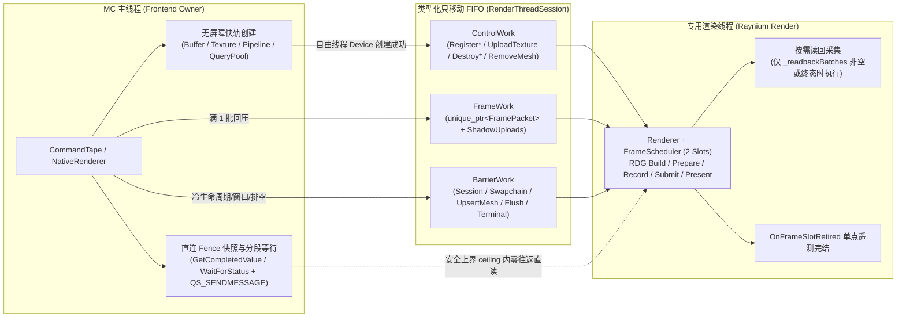

> - 适用: 执行或评审基于 2026-11-25 升级版 RadRay（三级并发 RHI、创建期常驻映射、显式线程安全 Fence、交换链原地自愈与单轨帧槽退役）的 Raynium 渲染线程深度收敛重构
> - 权威: 经用户授权保存的架构设计与分阶段实施计划，不构成当前已实现契约；当前实现见 [架构地图](../architecture/overview.md)、[Native runtime](../architecture/native-runtime.md)、[互操作与加载](../architecture/interop.md) 与 [构建与测试](../guide/build-test.md)
> - 锚点: `native/radray.lock.json`, `native/cmake/native-build.json.in`, `native/include/raynium/bridge.h`, `native/include/raynium/render_thread_session.h`, `native/include/raynium/frame_packet.h`, `native/include/raynium/frame_queue.h`, `native/include/raynium/renderer.h`, `native/include/raynium/modular_frame_pipeline.h`, `native/include/raynium/buffer_registry.h`, `native/include/raynium/frame_readbacks.h`, `native/include/raynium/timestamp_queries.h`, `native/include/raynium/texture_registry.h`, `native/include/raynium/immediate_pipeline.h`, `native/include/raynium/render_program.h`, `native/include/raynium/render_resources.h`, `native/include/raynium/surface_submission.h`, `native/src/bridge.cpp`, `native/src/render_thread_session.cpp`, `native/src/frame_queue.cpp`, `native/src/renderer.cpp`, `native/src/modular_frame_pipeline.cpp`, `native/src/buffer_registry.cpp`, `native/src/frame_readbacks.cpp`, `native/src/timestamp_queries.cpp`, `native/src/texture_registry.cpp`, `native/src/immediate_pipeline.cpp`, `native/src/render_program.cpp`, `native/src/render_resources.cpp`, `native/src/device_info.cpp`, `native/src/surface_submission.cpp`, `native/tests/test_terrain_draw.cpp`, `native/tests/test_surface_submission.cpp`, `native/tests/vulkan_surface_layer.cpp`, `tools/native.py`, `src/client/java/dev/raynium/bridge/NativeManifest.java`, `src/client/java/dev/raynium/bridge/NativeDeviceInfo.java`, `src/client/java/dev/raynium/bridge/NativeRenderer.java`, `src/client/java/dev/raynium/client/renderpearl/RayniumGpuDeviceBackend.java`, `src/client/java/dev/raynium/client/renderpearl/RayniumTransientMemory.java`, `src/test/java/dev/raynium/bridge/VulkanSurfaceFaultTest.java`

# 渲染线程与新版 RadRay RHI 协同收敛重构计划

- 原记录日期：2026-11-25
- 状态：经用户授权由助手完整设计的架构收敛与分阶段重构计划；归档时生产源码尚未实施本计划，当前工作树仅将 [radray.lock.json](../../native/radray.lock.json) 及本机受管 `external/RadRay` 推进至 2026-11-25 上游最新锁定版本
- 范围：承接 [专用渲染线程实施与验证](2026-11-25-dedicated-render-thread-implementation.md) 暴露的跨线程框架耦合与尾延迟问题，全面接入 2026-11-25 锁定版 `RadRay` 的三级并发 RHI、创建期常驻映射、`GpuUploadBuffer`、线程安全显式 `Fence`、交换链 `SurfaceLost` 原地自愈、`ReadbackStatus` 及单轨必达 `OnFrameSlotRetired`；推进 ABI 23 → ABI 24（暴露 `host_coherent_atom_size`），重构 `RenderThreadSession`、`FrameQueue`、资源注册表、遥测管线与故障注入测试层，并评估 `RadRay` 后续基础设施完备性
- 来源：2026-11-25 会话交叉审计、[专用渲染线程实施与验证](2026-11-25-dedicated-render-thread-implementation.md)、[专用 Native 渲染线程架构审计与实施计划](2026-11-24-dedicated-render-thread-plan.md)、[C++ SRP 渲染管线基座计划](2026-11-24-cpp-srp-and-hlsl-shader-system-plan.md)、当前 Raynium 工作树源码及 [radray.lock.json](../../native/radray.lock.json) 锁定的上游 `RadRay` 源码
- 决策与内容归属：用户要求将 `RadRay` 拉取至目标锁定版本后，在现有 `RadRay` 基础上由助手全权设计 Raynium 的改进计划并归档历史，同时评估 `RadRay` 是否仍需新增基础设施；下文技术方案、ABI 24 扩展、队列与锁序重构及分阶段验收均属助手基于源码契约制定的详细设计。所有 C++ 改动严守根 [AGENTS.md](../../AGENTS.md) 硬约束：禁止默认构造加 `Init` 二段式初始化，显式使用 `radray::` 容器与智能指针，C ABI 状态仅返回 `RN_STATUS_OK` / `RN_STATUS_FAILED`，健康设备内部违约直接 `RADRAY_ABORT`。

---

## 0. 上轮实施痛点复盘与新版 `RadRay` 契约映射

### 0.1 必须同步迁移的 5 处上游破坏性接口变更

在 2026-11-25 锁定版 `RadRay` 上，以下 5 处上游契约已发生破坏性收敛，是本计划编译与运行的前置基础：

| 序号 | 上游 `RadRay` 契约变更（模块定位） | Raynium 现行受影响代码 | 不迁移的后果 |
| --- | --- | --- | --- |
| **B1** | `gpu::Buffer` 移除会话式 `Map`/`Unmap`，改为创建期整块映射 + `Nullable<void*> GetMappedData() noexcept`；`CreateBuffer` 拒绝 `ResourceHint::PersistentMap` / `OwnerMapped`；`FlushMappedRange` 与 `InvalidateMappedRange` 改为返回 `bool`（`modules/gpu/include/radray/gpu/types.h`） | [buffer_registry.cpp](../../native/src/buffer_registry.cpp)、[frame_readbacks.h](../../native/include/raynium/frame_readbacks.h)、[frame_readbacks.cpp](../../native/src/frame_readbacks.cpp)、[timestamp_queries.h](../../native/include/raynium/timestamp_queries.h)、[timestamp_queries.cpp](../../native/src/timestamp_queries.cpp)、[test_terrain_draw.cpp](../../native/tests/test_terrain_draw.cpp) `BufferProbe` | 编译失败；残留 `PersistentMap` 提示会被 `CreateBuffer` 直接拒绝返空。 |
| **B2** | `gpu::Fence` 移除 `WaitFor(value, timeoutMs)` 等旧接口，收敛为跨线程安全的 `GetCompletedValue()`、`WaitForStatus(value, timeoutNs)`、`Wait(value)`（`modules/gpu/include/radray/gpu/types.h`） | [modular_frame_pipeline.h](../../native/include/raynium/modular_frame_pipeline.h) `WaitForFence`、[modular_frame_pipeline.cpp](../../native/src/modular_frame_pipeline.cpp) `Finish` | 编译失败。 |
| **B3** | `RenderGraphFramePipeline` 移除仅成功时触发的 `OnGpuTimingCompleted`，改为通过槽内 `ProfilingResetGuard` 自动清理取消态，并统一由单轨 `OnFrameSlotRetired(slot, snapshot)` 必达投递五态结果（`modules/runtime/include/radray/runtime/render_graph_pipeline.h`） | [modular_frame_pipeline.h](../../native/include/raynium/modular_frame_pipeline.h)、[modular_frame_pipeline.cpp](../../native/src/modular_frame_pipeline.cpp) | `override` 编译失败。 |
| **B4** | `AsyncReadbackQueue::Poll` 返回值由 `bool` 改为 `ReadbackStatus`（`Pending`、`Ready`、`SourceOutOfRange`、`DestinationTooSmall`、`InvalidRequest`、`DeviceLost`），新增 `CancelUnsubmitted()`（`modules/runtime/include/radray/runtime/readback_queue.h`） | [modular_frame_pipeline.cpp](../../native/src/modular_frame_pipeline.cpp) `PollCapture`、[renderer.cpp](../../native/src/renderer.cpp) 提前失败分支 | `PollCapture` 把枚举非零值误判或编译失败；未提交失败批残留 `Reserved`/`Enqueued` 请求。 |
| **B5** | `SwapChainStatus` 新增 `Suboptimal`、`SurfaceLost`、`DeviceLost`；Vulkan 不再将 `VK_SUBOPTIMAL_KHR` / `VK_ERROR_SURFACE_LOST_KHR` 折叠进 `Success` / `Error`（`modules/gpu/include/radray/gpu/types.h`、`vulkan_impl.cpp`） | [surface_submission.cpp](../../native/src/surface_submission.cpp)、[test_surface_submission.cpp](../../native/tests/test_surface_submission.cpp) | `Suboptimal` 与 `SurfaceLost` 落入 `default` 返回 `std::nullopt`，被误判为不可恢复渲染器终态故障。 |

### 0.2 上轮多线程实现暴露的 6 类框架绕行与根治映射

复盘 [2026-11-25-dedicated-render-thread-implementation.md](2026-11-25-dedicated-render-thread-implementation.md) 与现行 Native 源码，上轮受制于旧版单线程 RHI 而引入的绕行及本次根治方案如下：

| 痛点编号 | 上轮暴露问题与现行代码绕行 | 新版 `RadRay` 提供的底座支撑 | Raynium 本轮目标设计 |
| --- | --- | --- | --- |
| **P1：显式等待尾延迟反升与空闲 1 ms 轮询** | 1. 实施记录第 15、51 行：Metcalf D3D12 的 `rn_wait_submit` 每帧合计 P95 从同步版 `0.239 ms` 升至 `0.747 ms`；<br>2. [frame_queue.cpp](../../native/src/frame_queue.cpp) `Submit` 对**所有批次**无条件压入 `_pending`，使 [render_thread_session.cpp](../../native/src/render_thread_session.cpp) 每次提交后都进入 `1 ms` `wait_for` 定时轮询；零时限 `pollCompleted()` 不采样硬件围栏，仅读最多滞后 `1 ms` 的缓存值（还连带降低 `BufferRegistry::Take` 复用命中率）；<br>3. 阻塞 `rn_wait_submit` 向 worker 队列投递 `RequestedFenceWait` 任务，若 worker 正在录制下一帧则产生队头阻塞，执行时又反过来挂起 worker。 | `gpu::Fence` 全接口线程安全：D3D12 内置最多 16 个按 `ArmedValue <= initial` 筛选复用的 `Win32Event` 有界池，Vulkan 基于线程安全 timeline semaphore，支持外部线程纳秒级 `WaitForStatus` 且优先报告 `DeviceLost`。 | **前端直连硬件 `Fence` + 纯水位与读回采集解耦**：仅含截图/查询/`MAP_READ` 的批次登记入 `_readbackBatches`（稳态游戏帧为 `0` 项，彻底消灭空闲 1 ms 轮询）；前端在 `ceiling` 安全上界内直接采样 `GetCompletedValue()` 推进 `completed_sequence`（含 `CreateBuffer` 取池前即时刷新），阻塞等待直接在主线程分段调 `WaitForStatus` 并泵送 `PM_QS_SENDMESSAGE`，零 worker 往返、零 worker 挂起。 |
| **P2：冷路径资源与管线创建卡停在途帧** | [frame_queue.cpp](../../native/src/frame_queue.cpp) 中池未命中的 `CreateBuffer`、`CreateTexture`、`RegisterPipeline` 全部调用 `_session.Barrier(...)`；每逢区块加载、画中画/地图建纹理、瞬态缓冲新尺寸分配或首次管线注册，MC 主线程必须阻塞等待 worker 跑完当前整帧 RDG + `Present`。同时 [bridge.cpp](../../native/src/bridge.cpp) 仍残留 `environment->IsOwnerThread()` 耦合。 | RHI 三级并发确立“自由线程设备层”：`Buffer`、`Texture`、`TextureView`、`Shader`、`BindingGroupLayout`、`PipelineLayout`、`GraphicsPipelineState`、`PipelineCache`（内置互斥锁）及 `GpuBuffer`/`GpuUploadBuffer`/`GpuTexture` 引用计数均支持跨线程并发。 | **拆除 `CreateBuffer`、`CreateTexture`、`RegisterPipeline` 三处同步屏障**：在前端属主线程直接完成校验与底层 RHI 对象创建（失败不占 ID、健康失败不毒化 `renderer`），将创建好的强引用句柄作为轻量只移动 `ControlWork` 排入单向 FIFO 供 worker 顺序登记；移除 `Environment::IsOwnerThread()` 检查。 |
| **P3：持久上传缓冲借用缺口与非相干原子行隐患** | 1. [buffer_registry.cpp](../../native/src/buffer_registry.cpp) 对 `RN_BUFFER_FENCE_ROTATED` 使用裸 `ImportBuffer(upload.get(), ...)` 借用，超过 `16 MiB` 或超出 `64 MiB` 池预算的缓冲在 `Destroy` 时无 RDG 帧槽强引用兜底，也无防误调 `UploadBuffer` 保护；<br>2. [RayniumTransientMemory.java](../../src/client/java/dev/raynium/client/renderpearl/RayniumTransientMemory.java) 在同一 `512 KiB` 块内跨批切分相邻切片时未对齐 Vulkan `nonCoherentAtomSize`。 | 新增线程安全引用计数 `GpuUploadBuffer`（含 `ImportPersistentOwned` 强引用保活与构图期双向拦截 `UploadBuffer` 冲突），并在 `DeviceLimits` 公开 `HostCoherentAtomSize`。 | `BufferEntry` 改持 `IntrusivePtr<radray::GpuUploadBuffer>` 并走 `ImportPersistentOwned`；升级 **ABI 24** 在 `rn_device_info` 尾部公开 `host_coherent_atom_size`（`600 B`），Java 瞬态块子切片按 `lcm(alignment, hostCoherentAtomSize)` 对齐。 |
| **P4：事后读回 `Map` 失败死分支与双查询表冗余** | 实施记录第 18～19 行：为应对旧版完成期 `Map` OOM，[frame_queue.cpp](../../native/src/frame_queue.cpp) 编写了半批回滚截断逻辑，测试层还需注入 `DedicatedBuffers` 与事后 `vkMapMemory` 错误；此外 [timestamp_queries.h](../../native/include/raynium/timestamp_queries.h) 与 `FrameQueue::_queries` 维护了两套重复的查询槽表。 | 所有 `ReadBack` 缓冲均在创建期常驻映射，`Poll` 与时间戳读取仅执行返回 `bool` 的 `InvalidateMappedRange`，彻底根除完成采集期 `Map` OOM。 | 保留按槽合并且支持单平面深度读回的 `FrameReadbacks` 并迁至 `GetMappedData()`；补齐提前失败出口的 `_readback.CancelUnsubmitted()`；删除采集期 `Map` 失败伪分支（完成期唯一硬件失败收敛为 `DeviceLost`）；删除 `Renderer::_queries`，由 `FrameTimestamps` 直接向 `FrameQueue::_queries` 发布采样值。 |
| **P5：遥测手工 `RetireSlot` 脆弱性与未提交污染** | [modular_frame_pipeline.cpp](../../native/src/modular_frame_pipeline.cpp) `MeasureBatch` 在 `Decode` / `RunFrame` 之前向 `radray::map<uint64_t, Measurement>` 预插槽位；一旦当批 `Decode` 或提交失败，序号为 `0` 的半成品节点将永久阻塞 `PopTelemetry`，且 `Renderer::Finish()` 需手工遍历 `RetireSlot`。 | `SetGpuProfiling` 经 `ProfilingResetGuard` 自动复位未提交槽；每个成功提交槽精确触发 1 次 `OnFrameSlotRetired(slot, snapshot)`，覆盖全部五种计时状态。 | 删除 `RetireSlot`、`SlotResources::measuredSequence` 与 `radray::map`；仅在 `SubmitFrame` 成功后登记双槽在途记录，在 `OnFrameSlotRetired` 单点完结并推入按序退休队列，零红黑树分配、零未提交残留。 |
| **P6：交换链魔数耦合、外层置空重建与 `std::function` 分配** | 1. [surface_submission.cpp](../../native/src/surface_submission.cpp) 硬编码 Vulkan 魔数，[bridge.cpp](../../native/src/bridge.cpp) 在 `SURFACE_LOST` 或 `Resize` 失败时 `chain->swapchain.reset()` 销毁内层交换链；<br>2. [render_thread_session.h](../../native/include/raynium/render_thread_session.h) 使用 `std::function<void()>`，迫使 `FramePacket` 退化为 `shared_ptr` 并产生逐批闭包堆分配。 | `SwapChainStatus` 原生表达 `Suboptimal`/`SurfaceLost`/`DeviceLost`；`SwapChainVulkan::Recreate` 原地重建坏 `VkSurfaceKHR`，双后端 `Recreate` 失败后均安全可重试；丢失排空统一收敛至原生销毁/池重置入口单次执行。 | `ResolveSurfaceOutcome` 纯枚举化；`raynium::Swapchain` 常驻持有 `gpu::SwapChain`，用轻量 `_needsRecreate` 标志取代置空重建与 `NeedsNewSurface()`；`RenderThreadSession` 升级为类型化只移动工作队列，`FramePacket` 恢复 `unique_ptr` 独占转移。 |

---

## 1. 总体架构设计（四大核心收敛不变量）



### 1.1 不变量一：前端直连硬件 `Fence` 与“安全上界 `ceiling` + 按需读回采集”双轨协议

为同时消除 `rn_wait_submit` 的跨线程往返延迟、消灭稳态帧 worker `1 ms` 空闲唤醒轮询，并严格维持“一旦 `completed_sequence >= N`，批次 `N` 的截图、时间戳查询与 `MAP_READ` 字节必已完整发布至前端可读结构”的外部契约，建立如下同步模型：

1. **共享只读借用与按需登记 `_readbackBatches`**：
   - `ModularFramePipeline` 提供线程安全的只读/等待访问器：`uint64_t SampleFence() const noexcept`（转发 `_completion->GetCompletedValue()`）与 `radray::gpu::FenceStatus WaitFence(uint64_t value, uint64_t timeoutNs) noexcept`（转发 `_completion->WaitForStatus(value, timeoutNs)`）；`Device::IsDeviceLost()` 同样支持跨线程原子读取。
   - 队列新增受 `FrameQueue::_mutex` 保护的 `radray::deque<PendingReadback> _readbackBatches`（元素为 `{ uint64_t sequence; radray::vector<uint64_t> captures; radray::vector<PacketQuery> queries; bool hasBufferReadbacks; }`）。
   - Worker 在 `Renderer::SubmitFrame` 内完成 `RunFrame()`（即 `Queue::Submit` 已排入硬件围栏信号 `seq`）并触发 `notifySubmitted(seq)` 时，在同一把 `_mutex` 锁内：
     - 更新 `_progress.consumed_sequence = _progress.submitted_sequence = seq`；
     - 检查 `const bool hasReadback = !packet->captures.empty() || !packet->queries.empty() || _renderer.Pipeline().HasInFlightReadbacks(seq);`（其中 `HasInFlightReadbacks(seq)` 检查任一槽 `FrameReadbacks::Sequence() == seq`）；
     - **仅当 `hasReadback == true` 时**才向 `_readbackBatches` 压入该批记录；普通无读回渲染批次（占稳态游戏 `99.9%+`）不产生任何待采集记录。
2. **安全完成上界 `ceiling` 公式与前端零往返推进（`RefreshCompletedLocked`）**：
   - 定义当前锁内允许无采集直接推进的最高完成序号：
     $$\text{ceiling} = \begin{cases} \text{\_progress.submitted\_sequence}, & \text{\_readbackBatches.empty()} \\ \text{\_readbackBatches.front().sequence} - 1, & \text{otherwise} \end{cases}$$
   - 前端非阻塞刷新辅助 `FrameQueue::TryAdvanceFrontendProgress()`（在 `rn_submit_frame`、`rn_wait_submit`、`rn_sync_query_pool` 及 `CreateBuffer` 取池前调用）：
     1. 若 `_progress.flags != 0`（已处终态），直接跳过；
     2. 采样 `const uint64_t hwDone = _renderer.Pipeline().SampleFence();` 并检查 `const bool lost = _renderer.Runtime().GetDevice().IsDeviceLost();`；
     3. 若 `lost` 为真：转入统一终态结算屏障 `_session.Barrier([this] { Collect(true); return true; });`，确保丢失前最后一批已就绪读回完整落盘并锁存 `RN_SUBMIT_FLAG_TERMINAL_ERROR | RN_SUBMIT_FLAG_DEVICE_LOST`；
     4. 若设备健康：在 `_mutex` 下计算 `ceiling`，将 `_progress.completed_sequence` 单调推进至 `std::max(_progress.completed_sequence, std::min(hwDone, ceiling))`；若 `!_readbackBatches.empty() && hwDone >= _readbackBatches.front().sequence` 且尚未投递采集唤醒，则置 `_collectScheduled = true` 并向 worker 投递轻量 `CollectWork{}`，促使空闲 worker 立即采集并发布读回数据。
3. **无队头阻塞、防 `HWND` 死锁的 `FrameQueue::Wait(sequence, timeoutNs, out)`**：
   - **快速返回**：锁内校验 `if (sequence > _enqueued) { SnapshotLocked(out); return false; }`；先执行一次非阻塞 `TryAdvanceFrontendProgress()`，若 `timeoutNs == 0 || _progress.completed_sequence >= sequence || _progress.flags != 0`，直接在锁内执行 `SnapshotLocked(out)` 并返回 `!out.flags`。
   - **阶段 A（等待入队批次完成 `Queue::Submit`）**：若 `sequence > _progress.submitted_sequence`，主线程通过 `_session.WaitUntil`（内部使用 `MsgWaitForMultipleObjectsEx(..., QS_SENDMESSAGE, MWMO_INPUTAVAILABLE)` 泵送同步窗口消息）等待 `_progress.submitted_sequence >= sequence || _progress.flags != 0`，扣除已耗时间；超时或已入终态则拍快照返回。
   - **阶段 B（主线程直等硬件 `Fence` + 周期性泵送同步窗口消息）**：此时 `sequence <= _progress.submitted_sequence`（硬件信号已入队），但 worker 可能正处于当批或下一批的 `SwapChain::Present` / `AcquireNext` 中。主线程**绝不向 worker 投递阻塞等待任务**，而是按剩余超时循环切片（单次 `sliceNs = std::min<uint64_t>(remainingNs, 2'000'000ull)`，即至多 `2 ms`）：
     1. 调用 `_renderer.Pipeline().WaitFence(sequence, sliceNs)`：若 GPU 在 `50 µs` 内完成，内核事件/时间线信号量立即唤醒返回 `FenceStatus::Completed`（无 `1 ms` 轮询延迟，也不受 worker 正在录制下一帧的影响）；
     2. 若返回 `FenceStatus::DeviceLost`，立即走终态结算屏障 `_session.Barrier([this] { Collect(true); return true; })` 后拍快照返回 `false`；
     3. 若返回 `FenceStatus::Timeout`，调用 `_session.PumpSentMessages()`（`PeekMessageW(&msg, nullptr, 0, 0, PM_NOREMOVE | PM_QS_SENDMESSAGE)`）放行任何跨线程同步 `HWND` 消息，重算剩余超时直至耗尽或完成。
   - **阶段 C（收口发布）**：`Fence` 达成 `Completed` 后调用 `TryAdvanceFrontendProgress()`——对于 `99.9%+` 无读回批次（`sequence <= ceiling`），`_progress.completed_sequence` 当场即达 `>= sequence` 并直接返回；仅当 `sequence > ceiling`（目标批或其前序批含未采集截图/查询/`MAP_READ`）时，确认 `CollectWork` 已投递并在 `_session.WaitUntil` 上等待 worker 完成内存拷出发布 `_progress.completed_sequence >= sequence || _progress.flags != 0`。
4. **Worker 空闲轮询彻底按需化**：
   - `FrameQueue::Poll()` 仅在存在未完结的异步读回（`!_readbackBatches.empty()`）时返回 `true`（触发 `1 ms` 后台采集，服务于调用方不调 `rn_wait_submit` 而直接轮询 `rn_poll_capture` 的异步截图路径）；稳态帧 `_readbackBatches` 恒为空，worker 在帧间进入纯条件变量睡眠（`0` 次定时唤醒）。

---

### 1.2 不变量二：类型化只移动工作队列与冷路径无屏障资源/管线创建

1. **消除闭包堆分配与 `shared_ptr<FramePacket>` 的 `RenderThreadSession`**：
   - 将 [render_thread_session.h](../../native/include/raynium/render_thread_session.h) 的任务单元从 `std::function<void()>` 替换为基于移动独占小对象包装的 `MoveOnlyTask`（或内嵌 `alignas(std::max_align_t) std::byte[64]` SBO + 堆回退的轻量可移动调用器，严守 `noexcept` 移动与析构）：
     - `FrameQueue::Submit` 直接在任务内移动持有 `radray::unique_ptr<FramePacket>` 与 `radray::vector<HostBufferWrite>`，移除 `radray::shared_ptr<FramePacket>` 的原子引用计数开销；
     - 新增公开辅助 `void RenderThreadSession::PumpSentMessages() noexcept` 供主线程分段等待硬件 `Fence` 时复用同一套 `PM_NOREMOVE | PM_QS_SENDMESSAGE` 派发逻辑。
   - 移除 [bridge.cpp](../../native/src/bridge.cpp) 中全部 `environment->IsOwnerThread()` 检查：前端入口统一由 `thread_local RenderThreadSession* frontend`（`FrontOwner`）保证属主线程串行调用，worker 内部单线程顺序消费队列任务，不再耦合 `radray::Environment` 的创建线程记录。

2. **三类冷路径创建去屏障化（主线程自由线程创建 + FIFO 顺序登记）**：
   依据 `RadRay` 三级并发契约，以下三个高频/温频创建入口全部移除 `_session.Barrier(...)`，保持“验证或底层分配失败当场返回 `RN_STATUS_FAILED` 且不占句柄、设备丢失触发终态、成功对象严格先于后续使用它的批次落地 worker 表”的不变量：

   - **`rn_create_buffer`（全路径零屏障）**：
     1. 前端先校验 `BufferRegistry::Valid(desc, _maxBufferSize)`，锁内检查 `!_closing && _nextBuffer != 0`；
     2. 对于非 `MAP_READ` 缓冲，**先调用无阻塞 `RefreshCompletedLocked()` 将硬件最新完成值同步至 `_progress.completed_sequence`**，再调用 `_renderer.Buffers().Take(usage, desc.size, _progress.completed_sequence)`（消除因旧缓存水位滞后导致的假未命中）；
     3. 若池未命中：释放 `_mutex`，**直接在主线程调用 `BufferRegistry::Allocate(_renderer.Runtime().GetDevice(), usage, desc.size)`**。若返回空：检查 `device.IsDeviceLost()`，若丢失则走终态结算，返回 `false`；若成功：重新加 `_mutex` 复核 `!_closing`（若期间已关闭，将 `entry` 投递至 worker 释放并返回 `false`）；
     4. 锁内分配 `id = _nextBuffer++`、登记 `FrontBuffer`、填充返回给 Java 的 `mapped` 地址并拷入 `desc.initial`（`FENCE_ROTATED` 直接 `memcpy` 进 `GpuUploadBuffer::GetMappedData()`；普通无 `COPY_DST` 的 `MAP_WRITE` 与 `MAP_READ` 拷入 `FrontBuffer::host`）；
     5. 向 worker 投递只移动 `RegisterBuffer` 任务：由 worker 在任何后续 `FramePacket` 之前调用 `_renderer.Buffers().Register(id, std::move(entry), std::move(initial), flushInitial)`——其中 `flushInitial` 的 `entry->upload->FlushMappedRange({0, entry->size})` 在 worker 上执行并校验 `bool` 返回值（既把驱动缓存刷新系统调用移出 MC 主线程，又保证首次 GPU 读取前必定完成刷新）。
   - **`rn_create_texture`（零屏障）**：
     1. 将纹理 ID 去重集合 `_usedTextureIds`（`id >= 16` 终身不重用）迁至 `FrameQueue` 前端（仅属主线程在 `CreateTexture` 访问）；
     2. 前端校验 `desc`（尺寸、格式、数组层、Cube 约束、mip 层数及 `!_usedTextureIds.contains(desc.id)`），锁内确认 `!_closing` 后释放锁，**直接在主线程调用 `CreateSceneTexture(_renderer.Runtime().GetDevice(), desc)`**（内部调用自由线程安全的 `radray::GpuTexture::Create`，含原生纹理与默认采样视图创建）；
     3. 若返回空：检查 `device.IsDeviceLost()` 按需结算终态并返回 `false`（不写入 `_usedTextureIds` 与 `_textures`）；
     4. 若成功：锁内复核 `!_closing`，写入 `_usedTextureIds` 与 `FrameQueue::_textures`，并将 `IntrusivePtr<radray::GpuTexture>` 随 `desc` 投递至 worker 执行 `_renderer.RegisterTexture(desc, std::move(texture))`；后续 `rn_upload_texture`、`rn_submit_frame` 与 `rn_destroy_texture` 在同一 FIFO 队列中严格排在该登记任务之后。
   - **`rn_register_pipeline`（零屏障）**：
     1. 核查确认：`RenderProgramLibrary::GetProgram` 仅在 `RegisterPipeline` 时调用，worker 的 `SubmitFrame`（`Decode` / `Prepare` / `Record`）从不访问 `RenderProgramLibrary`，仅通过 `ImmediatePipelineRegistry::Find(id)` 读取已注册的 `ImmediatePipeline` 及其只读借用的 `RasterProgram*`；
     2. 将 `RenderProgramLibrary` 所有权置于 `Renderer` 前端可访问域（在 `rn_create_renderer` 屏障内初始化完毕后，运行期仅由前端属主线程在 `RegisterPipeline` 中串行调用；`Renderer` 析构在 `rn_destroy_renderer` 屏障内等待队列排空后安全释放）；
     3. `FrameQueue::RegisterPipeline` 在前端线程校验 `rn_pipeline_desc` 与状态字，直接调用 `ImmediatePipeline::Build(device, programs, desc, pipelineCache)` 在主线程完成 `.rnsp` 解析与自由线程安全的 `CreateBindingGroupLayout` / `CreatePipelineLayout` / `CreateShader`；失败时检查 `device.IsDeviceLost()` 按需转终态并返回 `false`；
     4. 成功则在锁内分配 `id = _nextPipeline++`、登记 `_pipelines` 存活集，并将 `radray::shared_ptr<ImmediatePipeline>` 异步投递至 worker 写入 `ImmediatePipelineRegistry`（录制期按实际附件深度格式调用的 `ImmediatePipeline::Resolve` 继续使用内置互斥锁保护的 `gpu::PipelineCache`）。

3. **保留同步 `Barrier` 的精确集合与边界理由**：
   - 会话与设备生命周期：`rn_init_env`、`rn_destroy_env`、`rn_create_runtime`、`rn_destroy_runtime`、`rn_create_renderer`、`rn_destroy_renderer`；
   - 窗口交换链与显式排空：`rn_create_swapchain`、`rn_resize_swapchain`、`rn_destroy_swapchain`、`rn_flush_renderer` 及预检/丢失终态结算（均涉及队列串行域或 `WaitIdle + Queue::Wait`）；
   - 常驻刚体网格注册 `rn_upsert_model_mesh`：**继续保留同步 `Barrier`**。原因是调用方需同步获取底层 `VertexBufferPool::Allocate` 返回的真实 `out_page_id` 用于同页 MDI 分桶，而 `StaticGeometryRegistry` 底层 `radray::VertexBufferPool` 在 worker 帧循环中并发执行 `TrimEmptyPages()`、`AddPassReadAccess` 页表遍历及 `FrameSlot` 析构链退役回收（属单线程池契约），且稳态帧调用次数为 `0`，保持 worker 串行分配无需为几何池引入跨线程锁。

---

### 1.3 不变量三：`GpuUploadBuffer` + `HostCoherentAtomSize`、常驻读回闭环与查询单表化

1. **`BufferEntry` 升级至 `radray::GpuUploadBuffer` 与 `ImportPersistentOwned`**：
   - 将 [buffer_registry.h](../../native/include/raynium/buffer_registry.h) 中 `BufferEntry::upload` 类型由 `radray::unique_ptr<radray::gpu::Buffer>` 替换为 **`radray::IntrusivePtr<radray::GpuUploadBuffer>`**，删除 `BufferEntry::~BufferEntry()` 手工 `Unmap()`：
     - `BufferRegistry::Allocate` 对 `RN_BUFFER_FENCE_ROTATED` 调用 `radray::GpuUploadBuffer::Create(gpu, {size, gpuUses})`（注意 `GpuUploadBuffer` 自动补齐 `BufferUse::MapWrite` 并校验允许用途：`CopySource | CBuffer | Vertex | Index | Resource | Indirect`），`entry->mapped = entry->upload->GetMappedData()`；
     - `BufferEntry::Import(RDGBuilder& graph)` 统一走强引用持久导入：
       - `device` 非空：`return graph.ImportPersistentOwned(device);`
       - `upload` 非空：`return graph.ImportPersistentOwned(upload);`（既使超出 `16 MiB` 或满预算被立即移出注册表的持久上传缓冲同样由 RDG 帧槽保活至 GPU 完成，又由 RDG 构图期自动拦截对该缓冲误调 `UploadBuffer` 的冲突）；
     - `BufferRegistry::Register`（当 `flush == true`）与 `BufferRegistry::Flush` 检查 `entry->upload->FlushMappedRange(...)` 的 `bool` 返回值——返回 `false` 时令当次准备/刷新失败并由外层检查 `device.IsDeviceLost()` 进入终态。
2. **ABI 24 公开 `host_coherent_atom_size` 与 Java 瞬态块子切片对齐**：
   - 在 `rn_device_info` 末尾追加 `uint64_t host_coherent_atom_size`（D3D12 为 `1`，Vulkan 为 `std::max<uint64_t>(1, caps.Limits.HostCoherentAtomSize)`）；
   - [RayniumTransientMemory.java](../../src/client/java/dev/raynium/client/renderpearl/RayniumTransientMemory.java) 构造时传入 `long hostCoherentAtomSize`：在 `allocateGpu(size, alignment, usage, minimum, element)` 中计算两者的最小公倍数 `effectiveAlignment = lcm(alignment, hostCoherentAtomSize)` 传给 `TransientBlockAllocator.allocate(...)`，确保同一 `512 KiB` `RN_BUFFER_FENCE_ROTATED` 块在多帧轮转期间切出的任意两个子区间绝不共享同一个非相干缓存原子行，同时保持返回的 `GpuBufferSlice.length()` 仍为调用方请求的逻辑长度。
3. **常驻读回（`FrameReadbacks` / `FrameTimestamps` / `AsyncReadbackQueue`）与失败收敛**：
   - **保留按槽聚合的 `FrameReadbacks`**：[CommandTape](../../native/src/command_tape.cpp) 支持 `D16_UNORM` / `D32_FLOAT` 整子资源深度拷贝（`CopyTextureToBuffer` + `TextureAspect::Depth`）及单槽多笔读回共享单个暂存缓冲，而上游 `AsyncReadbackQueue` 面向按请求独立暂存且拒绝深度格式；因此保留 `FrameReadbacks`，将其内部缓冲改为无 `Hints` 创建期常驻映射（`buffer->GetMappedData()`，移除析构 `Unmap`），并将 `Collect` 改写为 `bool Collect(uint64_t completed, radray::vector<HostBufferWrite>& output)`——当 `_storage->buffer->InvalidateMappedRange({0, _size})` 返回 `false` 时立即中止拷出并返回 `false`；
   - **`AsyncReadbackQueue` 预留回滚与 `ReadbackStatus` 接入**：
     - 在 [renderer.cpp](../../native/src/renderer.cpp) `Renderer::SubmitFrame` 中为 `_pipeline->PrepareTape` 之后的提前返回路径（如 `_buffers.Flush` 失败、`target->Validate()` 失败、`AcquireNext` 致命失败或 `RunFrame()` 未能提交）挂载 `ScopeGuard` 调用 `_pipeline->CancelUnsubmittedReadbacks()`（转发 `_readback.CancelUnsubmitted()`），仅在 `ModularFramePipeline::SubmitFrame` 成功调过 `_readback.MarkSubmitted` 后 `Dismiss`，根除失败批遗留 `Reserved`/`Enqueued` 请求与 `_pendingGraph` 悬空；
     - `ModularFramePipeline::PollCapture` 按 `ReadbackStatus` 精确映射：`Pending` 写 `info.ready = 0` 返回 `true`，`Ready` 写像素返回 `true`，其余状态（`DeviceLost` / `DestinationTooSmall` / `InvalidRequest` / `SourceOutOfRange`）返回 `false`；
   - **采集期失败源单一化**：因全部读回缓冲在提交前已完成映射，`FrameQueue::Collect` 仅在 `device.IsDeviceLost()`、`!pipe.PollCapture(...)` 或 `!pipe.Collect(...)`（缓存失效报设备丢失）时截断 `safe` 水位并进入终态，不再存在健康设备事后 `Map` OOM 分支。
4. **`QueryRegistry` 去重单表化**：
   - 删除 `Renderer` 持有的 worker 侧 `QueryRegistry _queries` 以及 `RegisterQueryPool` / `DestroyQueryPool` 跨线程投递任务；
   - 将查询池槽计数快照 `radray::unordered_map<uint32_t, uint32_t> _queryPoolSizes`（或直接复用 `FrameQueue::_queries` 的槽数组长度）作为预检依据：前端在 `FramePacket` 预检时已锁内验证 `(query.pool, query.slot)` 合法（见 [frame_queue.cpp](../../native/src/frame_queue.cpp) 第 65～68 行）；
   - `CommandTape` 与 `FrameTimestamps` 将原本借用 `shared_ptr<QueryRegistry::Pool>` 的 `QueryRegistry::Write` 简化为纯值类型 `TimestampTarget{ uint32_t pool; uint32_t slot; }`；`FrameTimestamps::Read(uint64_t completed, radray::vector<PublishedTimestamp>& out)` 在 `InvalidateMappedRange` 成功后直接产出 `{ pool, slot, _sequence, maskedTicks }`（同一批次多次写同一逻辑槽按顺序覆盖），由 `FrameQueue::Collect` 在单次 `_mutex` 锁内校验 `it->second[slot].sequence == value.sequence` 后直接写入唯一的前端表 `FrameQueue::_queries`。

---

### 1.4 不变量四：单轨 `OnFrameSlotRetired` 零分配遥测与原生 `SwapChain` 原地自愈

1. **单轨必达 `OnFrameSlotRetired` 驱动无树分配遥测**：
   - 移除 `ModularFramePipeline::RetireSlot(uint32_t)`、`SlotResources::measuredSequence`、`Renderer::Finish()` 中的槽遍历循环，以及逐测量批分配红黑树节点的 `radray::map<uint64_t, Measurement> _measurements`；
   - 改为两段无泄漏设计：
     1. **录制前**：`Renderer::SubmitFrame` 调用 `_pipeline->ConfigureBatchProfiling(slot, measure)`，仅调用 `SetGpuProfiling(slot, measure ? RDGGpuProfilingMode::FrameOnly : RDGGpuProfilingMode::Off, _submitted + 1)`——若后续 `Decode`、`PrepareTape`、`AcquireNext` 或 `RunFrame` 失败，上游 `FrameSlot` 的 `ProfilingResetGuard` 自动清零待提交配置，**绝不在管线中留下任何未提交序号记录**；
     2. **提交成功后与槽退役时**：`ModularFramePipeline` 维护 `radray::deque<PendingTelemetry> _inFlightTelemetry`（因双槽调度器加当前刚提交槽，队列深度恒 `<= 3`）与已完成待排出的 `radray::deque<rn_batch_telemetry> _readyTelemetry`：
        - 在 `ModularFramePipeline::SubmitFrame` 递增 `++_submitted` 成功后，若当批开启测量，压入 `PendingTelemetry{ .report = { .sequence = _submitted }, .cpuRecorded = false, .slotRetired = false }`；
        - `Renderer::SubmitFrame` 在 `Present` 结束后调用 `_pipeline->RecordCpuTelemetry(result.sequence, waitNs, prepareNs, rdgNs, presentNs, result.metrics)` 填充对应项的 CPU 耗时与统计并置 `cpuRecorded = true`，随后推进队首已双全（`cpuRecorded && slotRetired`）的记录迁入 `_readyTelemetry`；
        - 重写 `ModularFramePipeline::OnFrameSlotRetired(radray::FrameSlot&, const radray::RDGGpuTimingSnapshot& snapshot) noexcept`：若 `snapshot.UserSequence == 0` 直接返回；在 `_inFlightTelemetry`（至多 2～3 项线性扫描）中匹配 `item.report.sequence == snapshot.UserSequence`，若 `snapshot.Status == radray::RDGGpuTimingStatus::Valid` 则写入 `item.report.gpu_ns = snapshot.TotalNanoseconds` 与 `item.report.flags = RN_TELEMETRY_HAS_GPU_NS`（其余 `Unavailable` / `AllocationFailed` / `DeviceLost` 状态保持 `flags = 0, gpu_ns = 0`），置 `item.slotRetired = true`，并按序将队首双全项迁入 `_readyTelemetry`（天然抗 `WaitIdle()` 先回收槽 `0` 再回收槽 `1` 的乱序退役）。
2. **纯枚举 `ResolveSurfaceOutcome` 与内层常驻 `Swapchain` 原地自愈**：
   - 重写 [surface_submission.h](../../native/include/raynium/surface_submission.h) / [surface_submission.cpp](../../native/src/surface_submission.cpp) 签名：
     ```cpp
     std::optional<rn_present_outcome> ResolveSurfaceOutcome(
         radray::gpu::SwapChainStatus status,
         radray::gpu::SwapChainStatus acquiredStatus = radray::gpu::SwapChainStatus::Success) noexcept;
     ```
     映射规则完全脱离后端分支与原生错误码魔数：
     - `SwapChainStatus::Success`：`acquiredStatus == SwapChainStatus::Suboptimal ? RN_PRESENTED_SUBOPTIMAL : RN_PRESENTED`；
     - `SwapChainStatus::Suboptimal`：`RN_PRESENTED_SUBOPTIMAL`；
     - `SwapChainStatus::RetryLater`：`RN_PRESENT_SKIPPED`；
     - `SwapChainStatus::RequireRecreate`：`RN_PRESENT_RECREATE`；
     - `SwapChainStatus::SurfaceLost`：`RN_PRESENT_SURFACE_LOST`；
     - `SwapChainStatus::DeviceLost` / `SwapChainStatus::Error`：`std::nullopt`（触发渲染器终态）。
   - 简化 [render_resources.h](../../native/include/raynium/render_resources.h) `raynium::Swapchain` 与 [bridge.cpp](../../native/src/bridge.cpp) `rn_resize_swapchain`：
     - `raynium::Swapchain` 始终持有非空 `radray::unique_ptr<radray::gpu::SwapChain> _chain`，新增 `bool _broken{false}`（表示上次 `Resize` 失败、尚未成功恢复）；
     - `Swapchain::Resize(desc)` 校验描述符与相同 `_hwnd` 后直接调用 `_chain->Recreate(desc.width, desc.height, TextureFormat::BGRA8_UNORM, Mode(desc.present_mode))`（Vulkan 下遇到前序 `VK_ERROR_SURFACE_LOST_KHR` 时由 `SwapChainVulkan::Recreate` 原地销毁并重建 `VkSurfaceKHR`，无需外层销毁重建）；若 `Recreate` 返回 `true` 则置 `_broken = false`，若返回 `false` 则置 `_broken = true`；
     - `Renderer::SubmitFrame` 中若 `target->IsBroken()`，跳过 `AcquireNext` 与 `Present`，正常执行全部离屏 RDG 工作并置 `result.outcome = RN_PRESENT_SURFACE_LOST`（与原 `chain->swapchain == nullptr` 待重建态的外部可观测行为 100% 等价）；
     - 删除 `FrameQueue::NeedsNewSurface()` 及 `bridge.cpp` 中 `chain->swapchain.reset()` / 重新 `Swapchain::Create` 的双分支。

---

## 2. ABI 24 精确布局变更与导出函数执行路径对照

### 2.1 四重版本门禁递增（`23 -> 24`）与 `rn_device_info`（`592 B -> 600 B`）

导出符号集合保持 **29 个不变**，同步更新四处 ABI 版本常量至 **`24`**：
1. [bridge.h](../../native/include/raynium/bridge.h)：`#define RN_ABI_VERSION 24u`
2. [native-build.json.in](../../native/cmake/native-build.json.in)：`"abiVersion": 24`
3. [native.py](../../tools/native.py)：`ABI_VERSION = 24`
4. [NativeManifest.java](../../src/client/java/dev/raynium/bridge/NativeManifest.java)：`public static final int ABI_VERSION = 24;`

`rn_device_info` 尾部无填充追加 1 个 8 字节字段（总大小 **`600 B`**，8 字节对齐）：

| 字节偏移 | C 字段声明 | 大小 | 说明 |
| ---: | --- | ---: | --- |
| `0..583` | 既有字段（`struct_size` 至 `timestamp_frequency`） | `584 B` | 偏移与语义完全不变 |
| `584..591` | `double timestamp_period_ns` | `8 B` | 既有时间戳周期 |
| `592..599` | `uint64_t host_coherent_atom_size` | `8 B` | 新增：来自 `std::max<uint64_t>(1, caps.Limits.HostCoherentAtomSize)`（D3D12 为 `1`，Vulkan 为 `nonCoherentAtomSize`） |

Java 侧 [NativeDeviceInfo.java](../../src/client/java/dev/raynium/bridge/NativeDeviceInfo.java) 同步更新 `BYTE_SIZE = 600`，在 `TransferLimits` 增补 `long hostCoherentAtomSize`（读取偏移 `592`，确保 `>= 1L`），并在 [bridge.cpp](../../native/src/bridge.cpp) 更新 `static_assert(sizeof(rn_device_info) == 600 && offsetof(rn_device_info, host_coherent_atom_size) == 592)`。

### 2.2 发生执行模型升级的 C ABI 入口对照

其余入口保持原契约不变，本轮升级执行模型的入口如下：

| 导出入口 | 重构前执行模型（ABI 23） | 重构后执行模型（ABI 24） |
| --- | --- | --- |
| `rn_create_buffer` | 池命中免屏障；池未命中走 worker `Barrier` | **全路径零屏障**：取池前先无阻塞刷新硬件 `Fence` 完成水位；池未命中直接在主线程调 `GpuUploadBuffer::Create` / `GpuBuffer::Create`，异步投递 `RegisterBuffer`（`initial` 刷新由 worker 顺序执行）。 |
| `rn_create_texture` | 每次调用走 worker `Barrier` | **零屏障**：主线程校验描述符与 ID 唯一性，直接调自由线程 `GpuTexture::Create`，成功后登记前端表并异步投递 `RegisterTexture`。 |
| `rn_register_pipeline` | 每次调用走 worker `Barrier` | **零屏障**：主线程直接调 `RenderProgramLibrary::GetProgram` 创建 `BindingGroupLayout` / `PipelineLayout` / `Shader`，分配 ID 后异步投递 `RegisterPipeline`。 |
| `rn_create_query_pool` / `rn_destroy_query_pool` | 前端登记 + 异步投递 worker 增删 `Renderer::_queries` | **纯前端状态锁内单表操作**：直接增删 `FrameQueue::_queries`，零跨线程任务投递。 |
| `rn_destroy_buffer` | `bridge.cpp` 拆成 `RemoveBuffer` + 外层裸 `frontend->Post` | 统一收拢进 `FrameQueue::RemoveBuffer(id)` 内部校验存活并投递销毁任务，与 `RemoveTexture` / `RemovePipeline` 职责对齐。 |
| `rn_wait_submit` | 零时限仅读旧缓存水位；阻塞时投递 worker `RequestedFenceWait` | 零时限先采样硬件 `Fence` 推进至 `ceiling`；阻塞时待批次入队提交后直接在主线程分段调 `Fence::WaitForStatus` + `PumpSentMessages()`，不阻塞 worker、无队头排队延迟。 |
| `rn_resize_swapchain` | `SURFACE_LOST` 或失败时 `reset()` 置空内层句柄、重走 `Create` | `Finish + Queue::Wait` 后统一调用常驻内层 `SwapChain::Recreate` 原地自愈；失败仅标记 `_broken = true` 与 `SurfaceLost()`。 |

---

## 3. 模块级详细改造清单

### 3.1 Native C++ 层（`native/`）

1. **`render_thread_session.h/.cpp`**：
   - 引入支持只移动可调用对象的 `MoveOnlyTask`（64 字节内联存储 + 超尺寸堆回退，禁止拷贝、支持 `noexcept` 移动调用），将 `Post` 签名升级为模板接收任意只移动闭包并存入 `radray::deque<MoveOnlyTask>`；
   - 提取公开无锁方法 `void PumpSentMessages() noexcept`（执行 `MSG message{}; PeekMessageW(&message, nullptr, 0, 0, PM_NOREMOVE | PM_QS_SENDMESSAGE);`），在 `State::Wait` 与 `FrameQueue::Wait` 的分段硬件 `Fence` 等待中复用。
2. **`buffer_registry.h/.cpp`**：
   - `BufferEntry::upload` 改为 `radray::IntrusivePtr<radray::GpuUploadBuffer>`，移除自定义析构 `Unmap()`；
   - `BufferRegistry::Allocate` 对 `RN_BUFFER_FENCE_ROTATED` 使用 `radray::GpuUploadBuffer::Create`，对设备缓冲使用 `radray::GpuBuffer::Create`；`BufferEntry::Import` 分别调用 `graph.ImportPersistentOwned(device)` 与 `graph.ImportPersistentOwned(upload)`；
   - `BufferRegistry::Register` 改为返回 `bool`：当 `flush && !entry->upload->FlushMappedRange({0, entry->size})` 时返回 `false`；`BufferRegistry::Flush` 对 `!buffer->upload->FlushMappedRange({range.offset, range.length})` 返回 `false`。
3. **`frame_readbacks.h/.cpp` 与 `timestamp_queries.h/.cpp`**：
   - `FrameReadbacks` 移除 `ResourceHint::PersistentMap` 与 `~Storage()` 的 `Unmap()`，改用 `static_cast<const radray::byte*>(buffer->GetMappedData().Get())`；`Collect` 返回 `bool`，检查 `_storage->buffer->InvalidateMappedRange({0, _size})`；
   - 删除 `QueryRegistry` 类；在 `timestamp_queries.h/.cpp` 定义 `struct TimestampTarget { uint32_t pool; uint32_t slot; };` 与 `struct PublishedTimestamp { uint32_t pool; uint32_t slot; uint64_t sequence; uint64_t ticks; };`；`FrameTimestamps::Prepare` 改用创建期 `GetMappedData()` 并移除析构 `Unmap()`，`FrameTimestamps::Collect(uint64_t completed, radray::vector<PublishedTimestamp>& out)` 校验 `InvalidateMappedRange` 后输出已掩码截断的时间戳。
4. **`texture_registry.h/.cpp`、`render_program.h/.cpp`、`immediate_pipeline.h/.cpp`**：
   - `TextureRegistry` 提供前端静态校验辅助 `ValidateDesc(const radray::gpu::GpuDeviceCapabilities&, const rn_uploaded_texture_desc&)` 与 worker 登记方法 `Register(const rn_uploaded_texture_desc&, radray::IntrusivePtr<radray::GpuTexture>)`，移除 worker 侧 `_used`（迁入 `FrameQueue::_usedTextureIds`）；
   - `ImmediatePipeline` 拆分出可在前端线程直接执行的静态构建函数 `static radray::shared_ptr<ImmediatePipeline> Create(radray::gpu::Device&, RenderProgramLibrary&, const rn_pipeline_desc&, radray::Nullable<radray::gpu::PipelineCache*>)`，worker 侧 `ImmediatePipelineRegistry` 仅负责 `Insert(uint32_t id, radray::shared_ptr<ImmediatePipeline>)`、`Destroy(uint32_t id)` 与 `Find(uint32_t id)`。
5. **`modular_frame_pipeline.h/.cpp`、`surface_submission.h/.cpp`、`render_resources.h/.cpp`、`device_info.cpp`**：
   - `ModularFramePipeline`：
     - 替换 `WaitForFence` 为 `WaitFence(uint64_t sequence, uint64_t timeoutNs)`，更新 `Finish(device)` 为循环调用 `_completion->WaitForStatus(_submitted, 1'000'000'000ull)` 直至 `Completed` 或 `DeviceLost` / `device.IsDeviceLost()`；
     - 新增 `bool HasInFlightReadbacks(uint64_t sequence) const noexcept` 与 `void CancelUnsubmittedReadbacks() noexcept`；
     - `PollCapture` 适配 `radray::ReadbackStatus`；
     - 重写 `OnFrameSlotRetired` 并以双 `radray::deque`（`_inFlightTelemetry` / `_readyTelemetry`）替换 `_measurements`、`RetireSlot` 与 `measuredSequence`；
   - `surface_submission.h/.cpp`：改为纯 `SwapChainStatus` 映射；
   - `render_resources.h/.cpp`：`Swapchain` 增加 `_broken` 状态位，`Resize` 统一调用 `_chain->Recreate` 并维护 `_broken`；`CreateBuffer` 辅助移除默认无关提示；
   - `device_info.cpp`：填充 `info.host_coherent_atom_size = std::max<uint64_t>(1, caps.Limits.HostCoherentAtomSize)`。
6. **`renderer.h/.cpp`、`frame_queue.h/.cpp`、`bridge.cpp`**：
   - `Renderer`：移除 `_queries`，暴露前端串行使用的 `RenderProgramLibrary& Programs()`，在 `SubmitFrame` 挂载未提交读回取消守卫并接入 `_broken` 交换链跳过上屏逻辑；
   - `FrameQueue`：落地 `_readbackBatches`、`ceiling`、`TryAdvanceFrontendProgress`、分段直等 `Fence` 的 `Wait`、零屏障 `CreateBuffer`/`CreateTexture`/`RegisterPipeline`、单表 `CreateQueryPool`/`RemoveQueryPool`/`Query` 及统一收拢的 `RemoveBuffer`，并把 `FramePacket` 以 `radray::unique_ptr` 移动入队；
   - `bridge.cpp`：更新 ABI 24 与 `sizeof(rn_device_info) == 600` 静态断言，移除 `environment->IsOwnerThread()`，简化 `rn_resize_swapchain`、`rn_destroy_buffer`、`rn_destroy_query_pool`。

### 3.2 Java 桥接与 RenderPearl 适配层（`src/client/java/`）

1. [NativeManifest.java](../../src/client/java/dev/raynium/bridge/NativeManifest.java)：`ABI_VERSION = 24`；
2. [NativeDeviceInfo.java](../../src/client/java/dev/raynium/bridge/NativeDeviceInfo.java)：`BYTE_SIZE = 600`，`TransferLimits` 新增 `long hostCoherentAtomSize`（读取偏移 `592`）；
3. [RayniumGpuDeviceBackend.java](../../src/client/java/dev/raynium/client/renderpearl/RayniumGpuDeviceBackend.java) 与 [RayniumTransientMemory.java](../../src/client/java/dev/raynium/client/renderpearl/RayniumTransientMemory.java)：将 `caps.hostCoherentAtomSize()` 传入 `RayniumTransientMemory`，在 `allocateGpu` 中按 `lcm(alignment, hostCoherentAtomSize)` 对齐块内子切片偏移（`upload` 内部同批紧邻元素仍按调用方 `alignment` 排布，外层块切片按 `effectiveAlignment` 隔离）。

### 3.3 原生单测与 Vulkan 故障注入层同步（`native/tests/`、`src/test/java/`）

1. [test_terrain_draw.cpp](../../native/tests/test_terrain_draw.cpp) 与 [test_surface_submission.cpp](../../native/tests/test_surface_submission.cpp)：
   - 更新 `BufferProbe` 为 `GetMappedData()` 与 `bool` 返回值 `FlushMappedRange` / `InvalidateMappedRange`；新增 `BufferRegistry` 对 `FlushMappedRange` 返回 `false` 传播失败及 `GpuUploadBuffer` 持久导入的单测；
   - 更新 `SurfaceSubmission` 用例覆盖 `SwapChainStatus::{Success, Suboptimal, RetryLater, RequireRecreate, SurfaceLost, DeviceLost, Error}` 全组合（含 `AcquireNext` `Suboptimal` 搭配 `Present` `Success` 产出 `RN_PRESENTED_SUBOPTIMAL`）。
2. [vulkan_surface_layer.cpp](../../native/tests/vulkan_surface_layer.cpp) 与 [VulkanSurfaceFaultTest.java](../../src/test/java/dev/raynium/bridge/VulkanSurfaceFaultTest.java)：
   - **拦截层扩充缓存失效故障点**：在 `vulkan_surface_layer.cpp` 新增对 `vkInvalidateMappedMemoryRanges` / `vkFlushMappedMemoryRanges`（或保留创建期 `vkMapMemory` 拦截）的故障注入位：
     - `missingTimingInFirstRetiredSlotPreservesSubmissionOrder`：将 `DedicatedBuffers` + `vkMapMemory` 注入移至**第二批测量帧录制准备前**（触发 `RenderGraphFramePipeline::PrepareTiming` 的 `RDGGpuTimingStatus::AllocationFailed`），验证首槽缺样、次槽有效时 `WaitIdle` 乱序退役仍按提交序产出 `flags = 1` 与 `flags = 0` 两条 `152 B` 记录；
     - `tailReadbackFailureKeepsLastCompleteBatch`：因创建期常驻映射已从架构上消灭提交后 `vkMapMemory` 失败，将该参数化测试的采集期故障对齐至真实存在的硬件故障边界（提交前准备期截图暂存 `vkMapMemory` 创建失败保留前批成果 + 完成采集期时间线查询/`Invalidate` 首次报 `VK_ERROR_DEVICE_LOST` 严格将 `completed_sequence` 截断在上一完整成功批次且不触发失败批回调）；
     - `nativeFailureReleasesSurfaceAndDestroysInflightRenderer` 的 `OLD_FENCE` 分支：适配 `RadRay` 将丢失态 `vkDeviceWaitIdle` 延迟至首次原生对象销毁/命令池重置的设计——在尚未退出的内层作用域不断言提前排空，保留最外层 `try` 关闭全部对象后 `assertEquals(1, probe.count(3))` 精确单次排空断言。

---

## 4. 分阶段全绿递进实施路线（`R1`～`R3`）与验收矩阵

| 阶段 | 实施范围 | 独立可判定验收标准 |
| --- | --- | --- |
| **`R1`：新版 `RadRay` 契约迁移、ABI 24、常驻映射/`GpuUploadBuffer`、单轨遥测、交换链自愈与测试层同步** | 1. 若需要构建 Debug，先执行 `python tools/build_debug_dependencies.py --clean --parallel 8` 对齐锁文件身份；<br>2. 升级四处 ABI `23 -> 24` 与 `rn_device_info`（`600 B`，`host_coherent_atom_size`）及 `RayniumTransientMemory` 原子行对齐；<br>3. 迁移 `BufferRegistry`（`GpuUploadBuffer` + `ImportPersistentOwned` + `bool` `Flush`）、`FrameReadbacks`、`FrameTimestamps`、`ModularFramePipeline`（`WaitFence`、`ReadbackStatus`、`CancelUnsubmitted`、单轨 `OnFrameSlotRetired` 双队列遥测）、`ResolveSurfaceOutcome` 纯枚举映射及常驻内层 `Swapchain` 原地自愈；<br>4. 同步迁移 `test_terrain_draw.cpp`、`test_surface_submission.cpp`、`vulkan_surface_layer.cpp` 与 `VulkanSurfaceFaultTest.java`。 | 1. Debug 与 Release 双配置 `cmake --build`、`test_raynium_terrain`（CTest）、`.\gradlew.bat test`、`.\gradlew.bat nativeTest`（含 `vulkanSurfaceTest`）全部 0 失败、0 跳过；<br>2. 专项验证：① 双后端 `NativeDeviceInfo` 读出合法 `hostCoherentAtomSize >= 1`（Vulkan 等于设备 `nonCoherentAtomSize`），非 2 的幂或小对齐瞬态分配偏移均为 `lcm(alignment, hostCoherentAtomSize)` 整数倍；② 超 `16 MiB` 的 `RN_BUFFER_FENCE_ROTATED` 缓冲提交绘制后立即在 Java `close()`，开启 RHI 校验与驱动校验无提前销毁报错且像素一致；③ 带截图预留的批次在 `Decode`/`Flush` 阶段失败后，同一 `captureId` 在后续健康渲染器或重试路径不因残留预留冲突，测量批提交前失败不阻塞后续 `rn_drain_telemetry`；④ `SURFACE_LOST` 与常规 `Resize` 失败均在不销毁内层 `gpu::SwapChain` 的前提下保持离屏工作可用并支持再次 `resize` 原地恢复呈现。 |
| **`R2`：只移动队列、冷路径零屏障创建、查询单表化与前端直连硬件 `Fence` 快轨** | 1. 升级 `RenderThreadSession` 为 `MoveOnlyTask` 并提供 `PumpSentMessages()`，`FramePacket` 恢复 `unique_ptr` 移动入队，移除 `bridge.cpp` 中 `Environment::IsOwnerThread()`；<br>2. 将 `CreateBuffer`、`CreateTexture`、`RegisterPipeline` 切换为主线程自由线程创建 + FIFO 顺序登记；合并 `RemoveBuffer` 并删除 `Renderer::_queries` 双表冗余；<br>3. 落地 `_readbackBatches` 按需登记、`ceiling` 安全上界、`TryAdvanceFrontendProgress` 及主线程分段 `WaitFence + PumpSentMessages` 的 `FrameQueue::Wait`。 | 1. `R1` 全套测试在开启 RHI 校验与双后端驱动校验下持续 100% 全绿；<br>2. 并发与无屏障专项验证：① 用 `WorkerGate` 将 worker 挂起在上一批 `AcquireNext` 内，主线程连续执行池未命中的 `createBuffer`（含 `FENCE_ROTATED` 与设备缓冲带 `initial`）、`createTexture` + `upload`、`registerPipeline`、`createQueryPool`，**全部在不放行 worker 的情况下立即同步返回有效句柄**，放行 worker 后使用这些新资源的下一批绘制与读回像素 100% 正确；② 挂起 worker 录制第 2 批时，第 1 批（无读回）GPU 已完成：主线程调用 `batch1Fence.awaitCompletion(0)` 与 `awaitCompletion(50_000_000L)` **在 worker 仍被挂起于第 2 批 `AcquireNext` 期间即刻返回 `true`**；③ 第 1 批含 `Capture` / `WriteTimestamp` / `MAP_READ` 且 GPU 已完成但 worker 仍挂起尚未 `Collect` 时，`completed_sequence` 严格保持为 `0`（不提前触发缺数据的 `onCompleted`），放行后完整读出载荷；④ 稳态无读回提交后 worker 不再进入 `1 ms` `wait_for` 循环。 |
| **`R3`：实机性能复核、视觉回归抽检与当前事实文档同步** | 1. 运行 Release 基准路线（重点对照 Metcalf 等显式等待敏感场景的 `nativeSyncWaitNs` 与吞吐）及代表性视觉套件；<br>2. 同步更新当前事实文档：[interop.md](../architecture/interop.md)（升级 ABI 24、`rn_device_info` `600 B`，并清理第 39 行已不存在的 `native/cmake/radray-readback.patch` 残留描述）、[native-runtime.md](../architecture/native-runtime.md)（自由线程资源创建、直连 `Fence` 完成水位与原地交换链重建）、[build-test.md](../guide/build-test.md)（ABI 24）。 | 1. 基准复核确认双后端正常完成关闭、`HostShadowBuffer` 写入维持 `0 B`、稳态帧无空闲轮询且 `nativeSyncWaitNs` 尾延迟相对重构前下降；<br>2. `.\gradlew.bat packageNativeMod verifyNativePackage` 通过；<br>3. `python tools/check_docs.py` 与 `git diff --check` 零违约，且全仓新增/修改文档不含未授权 Git hash。 |

---

## 5. 对上游 `RadRay` 基础设施完备性的评估

### 5.1 针对本轮渲染线程收敛重构：**零阻塞、无需新增基础设施**

审计当前 [radray.lock.json](../../native/radray.lock.json) 锁定的 `RadRay` 源码，本计划涉及的自由线程设备资源/布局/着色器/PSO 创建、带锁 `PipelineCache`、跨线程有界事件池 `gpu::Fence`、创建期常驻映射与 `bool` 缓存同步、`GpuUploadBuffer` 与 `HostCoherentAtomSize`、`AsyncReadbackQueue`（含 `ReadbackStatus` 与 `CancelUnsubmitted`）、单轨必达 `OnFrameSlotRetired`（含 `ProfilingResetGuard`）以及 `SwapChainStatus` / `SwapChainVulkan::Recreate` 原地表面重建均已在 `RadRay` 中完整闭合。**Raynium 可在当前锁定版本上直接 100% 落地本计划全部 `R1`～`R3` 改动。**

### 5.2 面向下一阶段 C++ SRP 与冷启动体验的可选上游演进项

结合后续 [C++ SRP 渲染管线基座计划](2026-11-24-cpp-srp-and-hlsl-shader-system-plan.md)，`RadRay::runtime` 仅有两处轻量级包装层增强值得在启动 SRP 时按需纳入（均不阻塞本轮工作）：

1. **`PipelineLayoutRegistry` 与 `PsoCache` 的并发查询/无锁编译预热支持（推荐在 SRP 阶段提供）**：
   - **现状定位**：底层 RHI 的 `Device::CreateBindingGroupLayout`、`CreatePipelineLayout`、`CreateGraphicsPipelineState`、`CreateComputePipelineState` 及 `gpu::PipelineCache` 均已支持多线程并发，但 `RadRay::runtime` 层的 `PipelineLayoutRegistry::Acquire`（`modules/runtime/include/radray/runtime/pipeline_layout_registry.h`）与 `PsoCache::AcquireGraphics` / `AcquireCompute`（`modules/runtime/include/radray/runtime/pso_cache.h`）仍声明为单线程串行访问（`Serial access`）。
   - **演进收益**：若将两者的内部查找表改为细粒度锁（“短锁查表 → 未命中时释放表锁并发调用耗时的原生 `Create*PipelineState` → 短锁回填去重，且 `RetireInvalidated` 保持帧边界安全”），则 C++ SRP 在加载 `.rnsp` v2 包或响应后台线程池请求时，可在后台工作线程直接向同一个 `PsoCache` 并发预编译常用变体 PSO，彻底避免渲染线程在帧内首次遇到新材质变体时因驱动编译 PSO 掉帧。
2. **`DeviceContext::Create` 注入初始 `PipelineCache` 字节流的重载（可选，服务于跨进程冷启动加速）**：
   - **现状定位**：`DeviceContext`（`modules/runtime/include/radray/runtime/gpu_device.h`）已提供 `GetPipelineCacheData()` 导出序列化缓存字节，底层 `gpu::Device::CreatePipelineCache(std::span<const byte>)` 也已支持加载初始字节并校验适配器/驱动指纹，但 `DeviceContext::Create(Environment&)` 内部硬编码传入空切片 `{}`，缺少向 `Create` 传入磁盘持久化字节的参数入口。
   - **演进收益**：仅需在 `DeviceContext::Create` 增加可选参数 `std::span<const byte> initialPipelineCache = {}` 透传给 `_device->CreatePipelineCache(initialPipelineCache)`，Raynium 即可在客户端退出时将 `GetPipelineCacheData()` 落盘至游戏缓存目录、下次启动时原样喂回，显著缩短 D3D12 / Vulkan 二次启动的驱动 PSO 编译耗时。
3. **明确无需在 `RadRay` 改动的部分**：
   - `VertexBufferPool` / `IndexBufferPool`、`FrameScheduler` 与 `RDGBuilder` 的数据结构与单队列帧生命周期（`AddPassReadAccess`、槽位析构回收、`TrimEmptyPages`、线性 PMR 构图）深度耦合，保持渲染线程单线程独占零锁设计具有最高吞吐与最简所有权，不应为其引入跨线程互斥锁。
