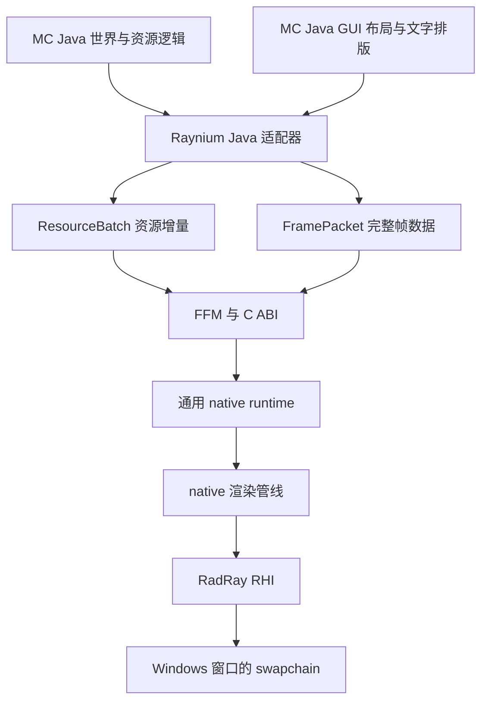
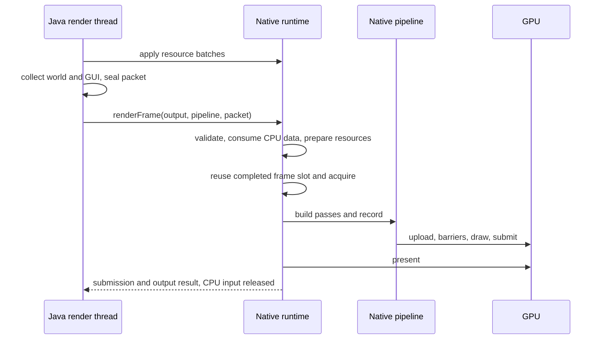

# Raynium 实现设计

Raynium 的 Java 层把 Minecraft 的资源、场景和界面转换为通用数据；native runtime 管理 GPU 资源和帧生命周期；具体 native 管线组织绘制并通过 RadRay RHI 输出画面。

状态：runtime 的 RHI 设备会话和 Java 生命周期已实现；资源、管线与 MC 渲染接管仍为实施提案。`rayniumruntime.dll` 的构建、FFM 加载、ABI 检查和 Release 打包已接入并完成本机基础验证；临时探针已删除，ABI 为 `3`。操作及范围见 [Native 工程操作](native-development.md)，跨语言契约的实施建议见 [FFM 互操作](ffm-interop.md)。已确认平台为 Windows，渲染层面向 RadRay RHI，Raynium 不分别实现 Vulkan 和 D3D12 接入。其余具体接口和实施顺序是下面提出的默认方案。MC 源码基线为本机生成的 26.3 源码，整理日期为 2026-10-26。

职责边界见 [渲染接入设计](rendering-design.md)，已有模组的做法见 [接入调研](native-mod-research.md)。本文负责说明实现方式和先后依赖。

native 功能、内部所有权和完整帧入口进一步定义于 [Native runtime 功能设计](native-runtime-design.md)。runtime 对宿主公开一次完成 acquire 到 present 的 RenderFrame，内部 token 不跨越 Java 调用边界。

## 整体实现路线

建议采用“持久资源增量 + 完整帧数据”的提交方式。网格、纹理、材质有稳定句柄，变化时更新；每帧提交相机、需要绘制的实例、动态几何和界面数据。native 无需保存 Minecraft 世界，也无需每帧向 Java 查询模型或方块。

建议使用 Java 25 FFM 调用窄 C ABI。第一版由 Java 渲染线程同步进入 native，native 在返回前消费 CPU 输入，GPU 执行保持异步。这样可以直接满足 RadRay RHI 的 CPU 调用串行化约束，并避免过早引入第二条渲染线程及跨线程 Java 对象生命周期。

主路线由 native 经 RHI 创建 swapchain、执行全部接管的 pass 并 present。Java 继续维护 SDL 窗口、输入和 GUI 布局，最终也把 GUI 几何交给 native。GL 共享纹理互操作不作为前置条件。开发中可以暂时保留部分原版 GPU 工作，但只有世界、手持物、屏幕效果、GUI 和呈现全部迁移后，才算完成渲染系统替换。



## 模块与所有权

以下是渲染阶段的组件划分。基础 bridge 已存在；`NativeBridge` 的加载与 ABI 检查职责目前由 `NativeLibrary`、`NativeLibraryLocator`、`NativeBindings`、`NativeManifest` 承担，`NativeRuntime` 已拥有 native runtime 与 DLL，其余渲染组件尚未实现。

| 组件 | 所属 | 责任 |
| --- | --- | --- |
| `RayniumClientContext` | Raynium Java | 持有当前会话、各适配器和 native runtime，统一启停 |
| `NativeBridge` | Raynium Java | 加载 DLL、FFM 调用、ABI 协商及诊断读取 |
| `ResourceRegistry` | Raynium Java | MC 资源身份到 native 句柄的映射及资源重载代次 |
| `TerrainAdapter` | Raynium Java | 标脏、区块任务、网格结果和可见区块列表 |
| `FeatureAdapter` | Raynium Java | 实体、方块实体、粒子等模型求值与顶点收集 |
| `GuiAdapter` | Raynium Java | GUI 元素、字形、裁剪矩形、物品预览和模糊边界 |
| `FramePacketWriter` | Raynium Java | 将本帧结果写入连续 native 内存 |
| `WindowBridge` | Raynium Java | SDL 窗口到 HWND、尺寸、最小化和关闭通知 |
| `rayniumruntime` | Raynium native | C ABI 校验及调用转换，不解释 MC 场景 |
| `RayniumRuntime` | Raynium native | 已创建设备/Direct 队列；资源表、上传、在途帧、延迟释放与输出目标后续加入 |
| `ForwardPipeline` | Raynium native 拟新增管线 | 材质、pass、shader、透明、后处理和 GUI 绘制 |

runtime 当前位于 Raynium 的 native 工程，`.h` / `.cpp` 同名配对；管线后续加入，不要求先在 RadRay 新建模块：

```text
Raynium/
  src/client/java/dev/raynium/
    client/ bridge/ resource/ terrain/ feature/ gui/ frame/ mixin/
  native/include/raynium/bridge.h
  native/include/raynium/runtime.h
  native/src/bridge.cpp
  native/src/runtime.cpp
  src/test/java/dev/raynium/bridge/  # JUnit 配置、ABI 和 runtime 测试
```

当前依赖为 `rayniumruntime → RadRay::render/core`。未来管线依赖 runtime 与 shader 支持层。shadercompiler 只出现在离线 shader 构建工具中。通用模块不依赖 Minecraft、Fabric、SDL Java 绑定或 FFM。

runtime 采用实例所有权：资源表、帧池、管线和诊断队列都由 runtime 持有。Java runtime 挂在客户端实例生命周期内；不新增全局资源注册表、全局回调或共享静态缓存。

## 通用数据契约

### 网格与实例分开

`MeshDesc` 描述顶点布局、顶点与索引数据、包围盒和 submesh 范围。`DrawItem` 引用 mesh、submesh、material，并携带变换、稳定实例 ID 和渲染属性。一个 mesh 可被多个实例复用，一个区块的不同材质层可对应不同 submesh。

runtime 只验证布局、范围和资源类型。具体管线声明支持哪些顶点语义与格式，并据此创建 RHI vertex binding。第一版限定三角形列表和 `uint16/uint32` 索引；Java 将 MC 的 quad、strip 等拓扑转换为三角形，不能把 MC 的枚举值直接传给 RHI。

建议提供两种入口：

| 入口 | 使用场景 | 生命周期 |
| --- | --- | --- |
| 持久 `MeshHandle` | 地形、可复用模型部件 | 显式创建、替换和释放 |
| `TransientMeshSlice` | 首版实体动画结果、粒子、文字、GUI | 只在所属 FramePacket 内有效 |

先复用 Java 已有模型求值，把动态结果写入连续顶点池。后续确认瓶颈后，再把稳定模型部件缓存为 mesh，并逐帧提交部件变换。默认不把实体动画或骨骼求值移入 native。

### 顶点属性和坐标

第一套管线接受 Position、Color、UV0、Normal，以及可选的辅助 UV/颜色属性。MC 灯光坐标、覆盖层和 tint 的解释留在 Java 适配器与选定材质契约之间，runtime 公共 API 不出现 `BlockState`、`RenderType`、方块 ID 或区块坐标。

26.3 的 `DefaultVertexFormat.BLOCK` 没有 Normal。直接复制编译结果可以完成首版纹理和顶点光照显示；需要真实方向光或法线材质时，应在 `SectionCompiler` 的 quad 输出阶段保存模型法线，或为缺失法线的三角形生成几何法线。不能把重建出的几何法线当成原模型自定义法线。液体单独处理其斜面法线。

建议 native 管线采用右手、Y 向上、相机朝向负 Z 的规范空间，矩阵使用列向量与明确的列主序内存布局；深度范围为 0 到 1，反向深度清零并使用 Greater/GreaterEqual。Java 在适配边界转换 MC 的投影约定，后端所需的屏幕 Y 调整集中处理一次。

区块顶点保持局部坐标，Java 用 double 计算世界位置减去相机原点，再写入 float 变换。不能先把数千万级世界坐标转成 float。当前和上一帧变换分别相对于各自的帧原点，与各自的 view/projection 配对使用。

### 纹理和材质

`TextureDesc` 至少包含尺寸、维度、格式、mip 数、采样用途和颜色空间；区域更新包含 mip、layer、矩形、row pitch 和字节范围。上传路径验证边界和整数溢出，runtime 负责满足 RHI 上传行距要求。

首版保留 MC 的图集及 UV，不按方块拆成海量纹理。Java 维护图集布局、动画帧和资源包代次；native 只接收普通纹理及更新。图集改变后，依赖旧 UV 的 mesh 必须与旧图集一起退役，不能只替换纹理句柄。

材质分两层：runtime 提供材质句柄、纹理引用、参数块和管线 schema ID；具体管线定义参数含义。建议首套 schema 覆盖：

- 基础颜色纹理和因子、顶点色、法线来源、可选自发光。
- Opaque、AlphaTest、AlphaBlend、Additive 等表面类型，以及 alpha cutoff、双面属性。
- 可选的烘焙光照查找纹理和辅助 UV；光照查找表的内容由 Java 准备。
- 独立的覆盖颜色、选择高亮等通用属性；MC 的伤害闪烁和发光规则由 Java 转换。

shader 变体、PSO、附件格式、blend/depth 状态由 native 管线根据 schema 选择。Java 不提交 MC shader 路径或原版 RenderPipeline 对象。

### 每帧数据

```text
FramePacket
  Header: schemaVersion, byteSize, frameId, historyResetFlags
  Views[]: viewId, matrices, previousMatrices, viewport, camera parameters
  Environment: light/fog/sky parameters
  DrawItems[]: mesh/submesh/material, transforms, stableId, visibility flags
  TransientGeometry: vertex/index byte ranges
  Lights[]
  OverlayDraws[]: geometry/material, scissor, ordering, target/view reference
  PipelineInputs: versioned optional inputs required by the selected pipeline
```

Java 每帧提交完整的候选绘制列表。删除一个实例只需下帧不再提交它；删除实例不等于释放其 mesh。稳定 ID 用于运动历史和诊断，不要求 native 保存实体层级。

第一版 Java 提交上一帧变换，native 不维护一份并行的 MC 场景状态。瞬态变形网格若没有上一帧顶点，则明确标为无有效 motion vector；不能仅用物体变换假装支持完整时序运动。

应用侧视锥裁剪和 LOD 留在 Java。加入阴影后，输入必须同时包含主视图可见物体与阴影候选物体，不能只提交相机视锥内对象。Java 提供足够的候选范围，native 管线按具体光源和 shadow pass 做精确筛选。

世界、第一人称手持物、GUI 物品预览使用不同 view。不同投影的数据不能被合并为同一批世界几何。

## 跨语言接口

### 选择 FFM 和 C ABI

Java 25 提供 `Linker`、`MemorySegment` 和 `Arena`。FFM 可以调用普通 C 导出函数，便于让 native 核心保持独立，也方便以后用 C++ 小程序驱动同一套 runtime。JNI 仍可替换 Java 绑定，不改变 C ABI 和渲染数据模型。[JDK 25 FFM 文档](https://docs.oracle.com/en/java/javase/25/docs/api/java.base/java/lang/foreign/package-summary.html)

第一版不逐顶点跨 FFI，不从 native 调回 Java 获取场景，也不从 GPU 完成线程调用 Java。诊断采用有界缓冲区，由 Java 主动读取。

开发启动参数显式允许绑定所在模块的 native access；若 Fabric 加载的绑定处于 unnamed module，使用 `--enable-native-access=ALL-UNNAMED`。DLL 的加载 arena 和 downcall handle 至少活到 runtime 销毁完成，不能依赖 GC 决定 GPU 资源或动态库的关闭时机。

以下为现有入口与未来扩展；资源、帧和输出入口仍是草案。当前 ABI 的权威说明见 [Native 工程操作](native-development.md#c-abi-与内存边界)：

| 操作 | 输入与结果 | 语义 |
| --- | --- | --- |
| `rn_query_abi` | ABI 版本、布局信息、特性位 | 加载后先协商，不匹配则不启用渲染替换 |
| `rn_create_runtime` | struct_size、后端 → 不透明 runtime | 已实现：仅创建设备与 Direct 队列，不接受窗口或创建管线 |
| `rn_apply_resources` | 批量资源命令 → 每项状态、句柄 | 创建、区域更新、替换及逻辑删除 |
| `rn_pump_resources` | 上传预算 → 进度/背压结果 | 不渲染画面时也能推进已接受资源 |
| `rn_render_frame` | output、pipeline、FramePacket → 提交/输出结果 | 消费 CPU 数据，内部完成 acquire、录制、submit 与 present |
| `rn_read_diagnostics` | 调用方缓冲区 → 条目 | 错误、能力与运行统计 |
| `rn_resize_output` | 尺寸、呈现策略 → 状态 | 在完整帧调用之间改变输出 |
| `rn_destroy_runtime` | runtime | 已实现：等待队列、销毁设备/环境；Java 随后卸载 DLL |

backend 不进入 Raynium 的材质、帧包或 Mixin 分支。runtime 的设备工厂集中调用 RadRay 现有设备创建接口，并消费 RadRay 的设备配置；不能假定当前 RHI 已经有一个无需实现的默认设备工厂。

### ABI 约束

入口采用 C linkage、固定宽度整数、opaque runtime 和明确的输入输出容量，不传 C++ 容器、引用、异常或 Java 对象。批量数据采用一段内存加 offset/count；首版支持 Windows x64、小端。逐项定义字段宽度、对齐和 stride，不能直接把 C++ 编译器布局当成 wire 格式。

结构定义以一份 ABI 描述为权威，生成或集中维护两侧布局；`rn_query_abi` 返回协议版本及布局指纹。序列化格式修改必须升级版本，不能静默改变同名结构大小。

资源句柄建议使用 64 位的 index + generation，0 表示空。句柄只在所属 runtime 内有效，按资源种类和代次检查；跨 runtime 传递不受支持。代次耗尽时退役槽位，避免旧句柄重新变为有效。

`rn_apply_resources` 返回逐项结果，第一版不承诺整个批次原子成功。新纹理先创建并取得句柄，再创建引用它的材质；Java 只发布成功且依赖完整的资源组合。创建失败时保留旧资源或使用明确的 missing material。

当前状态只分 `RN_STATUS_OK` / `RN_STATUS_FAILED`，ABI 不匹配、无效数据、资源不足等具体原因写在诊断字符串中，不继续扩展状态枚举。native 不通过新增 `catch (...)` 把任意异常转成成功或空结果；实施时遵守 RadRay 的异常约束，C 边界不允许 C++ 异常外溢。

### CPU 内存寿命

所有入口只在调用期间借用传入内存。返回前，native 已完成读取或复制到自己持有的 CPU/upload 内存；返回不代表 GPU 完成。Java 可在返回后复用输入 packet，不能据此释放 native GPU 资源。

渲染线程的帧 arena 按帧复用。区块工作线程产出的数据通过拥有者明确的队列转交；不能把工作线程 `Arena.ofConfined()` 的 segment 直接交给渲染线程访问。可采用可跨线程访问且显式关闭的 arena，或由队列持有的直接缓冲区，消费完成后归还池。

第一版接受一次有界 CPU 数据复制，以换取简单可靠的寿命契约。以后如需异步借用或零复制，应新增明确的完成通知接口，不改变既有同步消费语义。

## 帧执行与 GPU 生命周期

建议首版只有一条 graphics/direct queue，两个在途帧槽。Java 工作线程只准备 CPU 数据，所有 RHI 创建、映射、录制、提交、查询和释放均在渲染线程串行执行。[RadRay RHI 契约](../../RadRay/docs/architecture/render-rhi.md)



每个帧槽拥有 command allocator/buffer、临时 descriptor、上传区、瞬态顶点区及本帧资源引用。等该槽 fence 完成后才能重置旧录制、结束 command epoch，再复用参数集与资源。runtime 为每个 GPU 资源记录最后使用的提交序号；逻辑删除立即使公开句柄失效，已有材质、帧或录制引用继续保活实际对象，直到依赖退出后才最终释放。

资源更新和绘制在同一队列按序提交，配合显式 barrier。纹理原地更新不得覆盖尚未完成的先前读取；单队列顺序解决 GPU 执行先后，CPU 上传区仍必须等对应 fence 后才能覆盖。未来加入独立传输队列时需要重新设计跨队列依赖，不能直接沿用这套假设。

区块 mesh 替换采用新建后交换句柄，旧 mesh 延迟释放。材质替换也先构造新版本，再更新 Java 映射。这样失败的更新不会破坏仍可显示的旧版本。

输入校验和大部分准备工作放在 acquire 之前。已经 acquire 后若主录制可安全放弃且设备仍健康，使用预备清屏路径正常 present；不能泄漏 frame token。当前 RHI 部分执行错误会直接终止进程，不能承诺统一可恢复的设备丢失处理；可观察到故障时停止继续提交，不能在可能永久不完成的 fence 上无限等待。

RadRay 的 swapchain frame 是一次性所有权：present 消费后不重用、不重试同一个 token。最小化或尺寸为 0 时不 acquire；Java 的游戏更新、资源完成队列和窗口事件仍继续处理。

## Windows 窗口与呈现

MC 26.3 的 `Window.handle()` 返回 SDL window 指针。Java `WindowBridge` 通过 SDL 窗口属性取得 `SDL_PROP_WINDOW_WIN32_HWND_POINTER`，把 HWND 作为不拥有的宿主窗口句柄交给 runtime。RHI 当前 Windows swapchain 接收 HWND，不能直接传 SDL 指针。[SDL 窗口属性](https://wiki.libsdl.org/SDL3/SDL_GetWindowProperties)

Java 拥有窗口和输入事件，runtime 拥有 swapchain。退出必须先关闭 runtime，再销毁 SDL 窗口。resize 使用 framebuffer 像素尺寸，GUI scale 留在 Java；VSync 和输出格式的支持情况由 runtime 按 RHI 能力报告。

同一窗口只保留一个呈现所有者。启用 Raynium 时，在原版 `device.createSurface(...)` 的创建位置接管窗口输出，避免同时建立并使用原版 surface 与 RHI swapchain。若过渡版本已经创建原版 surface，必须先正常结束其 acquired frame 并关闭，再交给 native。

Java frame controller 在 native 模式下隔离原版 surface 的配置、acquire、blit 和 present 调用，保留窗口配置采集与 CPU 帧逻辑，最终调用一次 `rn_render_frame`。原版依赖 `GpuSurface.isAcquired()` 的控制条件也要一并替换，不能伪造 acquired 状态继续走旧路径。`Minecraft.renderFrame` 中获取原版 mainRenderTarget 并 blit 的整段代码要绕过；不向 MC 暴露 RHI texture 或 native frame token。

长期由 Java 收集 GUI，native 执行 GUI pass，因此主路线不需要跨 API 纹理共享或 GPU → CPU → GPU 逐帧回读。若后续为兼容特定模组引入共享图像，应作为独立的可选 RHI interop 扩展评估，不让后端对象泄漏到 Java 场景接口。

## MC 26.3 的具体接入

Mixin 只负责转接和局部替换，业务逻辑放在 adapter 中。按职责集中到少量 Mixin，使用精确方法描述和预期命中数量；版本变化导致注入位置不匹配时应停止启用该路径，不能悄悄漏接。

### 主帧循环

以下行号对应本机 [Minecraft.java](../.gradle/mc-source-26.3/client/net/minecraft/client/Minecraft.java)。

| 节点 | 当前行为 | Raynium 改动 |
| --- | --- | --- |
| 构造函数 552 | `device.createSurface(window.handle(), ...)` | 接入 native 输出控制，保持 SDL 窗口归 Java |
| `renderFrame` 1293–1327 | surface 配置与 acquire | 保留尺寸、最小化和 VSync 采集；实际 acquire 延后到 native RenderFrame 内 |
| 1329–1353 | 时间、GUI/world update、pick、extract | 保留 CPU 行为；隔离其中对原版 GPU 计时器的依赖 |
| 1374 | pending render tasks | 过渡期逐项保留需要的任务，最终把已迁移上传改为资源批次 |
| 1376 | `gameRenderer.render()` | 调用 Raynium 帧收集与 native 管线执行 |
| 1393–1401 | mainRenderTarget → surface blit | 绕过整段旧目标读取与 blit，native 管线直接写输出 |
| 1404–1423 | GPU timer、Tracy frame capture、submit、present | GPU 计时和截图改接 runtime；唯一 submit/present 归 native |
| 1426–1448 | endFrame、限帧、FPS、耗时记录 | 保留 CPU 收尾；替换依赖原版 GPU 对象的部分 |

不直接取消整个 `Minecraft.renderFrame` 后只调用 native。那会漏掉时间推进、GUI 更新、拾取、extract、限帧和调试收尾。建议保留 CPU 骨架，通过成组的调用替换接入；若注入过于零碎，再将这部分整理为明确针对 26.3 的 frame controller，并完整列出保留的行为。

### 世界维护与几何提交

[LevelRenderer.render](../.gradle/mc-source-26.3/client/net/minecraft/client/renderer/LevelRenderer.java) 同时做世界绘制与维护。203 行收集 feature，205 行 prepare，208–296 行主要是原版 GPU 帧图及收尾，298 行编译区块，305 行上传，314 行更新遮挡图，319–320 行触发玩家所在区块已编译的回调。

native 模式拆为三个步骤：

1. 保留相机重定位、Java 可见性、区块调度和已完成结果的发布。
2. 复用 `submitFeatures` 的模型提交入口，把 `SubmitNodeStorage` 导向 Raynium CPU 收集器；绕过原版 GPU prepare 和帧图。
3. 保留遮挡图、区块就绪回调、状态栈和帧末清理。旧 GPU 上传入口替换成 Raynium 资源完成队列处理。

`submitFeatures` 会清空实体和方块实体 RenderState 列表。必须在当前调用内求值或复制所需数据，不能把这些可复用 Java 对象保存到下帧或 native 线程。

### 地形编译和区块生命周期

[SectionCompiler.compile](../.gradle/mc-source-26.3/client/net/minecraft/client/renderer/chunk/SectionCompiler.java) 的 64–72 行是方块 quad 与液体顶点出口。首版建议复用原版 CPU 编译，取得 `Results` 后转换 mesh；需要法线等额外语义时，再把捕获位置前移到 quad 输出。

[SectionRenderDispatcher.CompileTask.doTask](../.gradle/mc-source-26.3/client/net/minecraft/client/renderer/chunk/SectionRenderDispatcher.java) 在 431–432 行得到结果，450 行构造 `CompiledSectionMesh`，481 行进入 UberBuffer，487 行关闭 MeshData。因此应在编译完成之后、原版 GPU 分配之前接走结果，复制/转移到自有 CPU 缓冲后再释放 MC 的 MeshData。

区块记录建议为：

```text
SectionRecord
  worldEpoch, sectionPosition, slotGeneration, requestedRevision
  installedRevision, nativeMeshHandles, materialEpoch
  visibilitySet, blockEntityList, compile/fade metadata
```

worker 输出必须携带上述身份与 revision。渲染线程发布前再次确认世界、位置、槽代次和资源包代次仍一致。过期结果释放 CPU 内存，不上传 GPU。相同区块的重复标脏合并，只允许最新有效结果替换当前 mesh。

编译未完成时继续显示旧 mesh。新资源被 native 接受、其上传能按序先于绘制执行后，再原子发布新的区块记录。空区块也要发布合法的“已编译为空”状态，并保留方块实体和可见性信息。

建议实现 Java `RayniumSectionMesh`，承载 `SectionMesh` 查询所需的可见性、层信息、方块实体及时间，不伪造 MC GPU 上传成功标志。所有原版层绘制与 GPU slice 查询必须在 native 模式绕开。就绪判断映射到 Raynium 已安装的结果；遮挡更新和 `onSectionMeshUpdate` 继续获得准确通知。

最终还要停止创建原版 dispatcher 的 staging/UberBuffer。只取消 draw 或 upload 会留下大量无用分配；这属于地形接管的完成条件。第一步允许同时捕获并保留原版行为来定位数据问题，但双份资源不能成为正式默认路径。

完成队列按字节限制容量，上传预算按每帧字节数与耗时配置。队列拥堵时合并旧任务、限制新任务调度，避免工作线程无限生产。同步编译路径也必须遵守同一发布规则，不能在渲染线程自旋等待自己消费队列。

### 实体与动态 feature

[ModelFeatureRenderer.prepareModel](../.gradle/mc-source-26.3/client/net/minecraft/client/renderer/feature/ModelFeatureRenderer.java) 依次设置 pose、处理 UV/decal 包装、`model.setupAnim(state)`、`model.renderToBuffer(...)`。这些是应保留的 Java 模型求值步骤，输出改成 Raynium 的 `VertexConsumer`。

第一版建议直接消费 typed submit，按 feature 类型调用已有模型和文字求值 API。不要照搬整个 `FeatureRenderDispatcher.prepareFrame`：它在 105 行上传 staged vertex buffer；`RenderTypeFeatureRenderer.Group` 还会调用 `RenderType.prepare()`，已包含原版 GPU 管线准备。

具体拆分为 `ModelSubmitAdapter`、`BlockModelSubmitAdapter`、`TextSubmitAdapter`、`ParticleSubmitAdapter`、`PrimitiveSubmitAdapter`。它们把 RenderType 的纹理、透明、双面、overlay 等语义转换成管线材质，而不是传递原版 pipeline。

顺序敏感的透明组、see-through 和 always-on-top 属性要显式保留。原版单个 feature 可能产生多个材质段，不能按“一个实体一次 draw”假定其结构。自定义 feature 未有适配器时报告具体类型，不能默默丢失并宣称兼容所有模组。

### 纹理动画与光照

资源入口以 `TextureAtlas.upload`、`TextureManager.register/release`、`DynamicTexture.upload` 等高层生命周期为主，维护像素/纹理身份和资源包代次；纹理上传调用可用作补漏和诊断，不承担全部语义。

26.3 的 [TextureAtlas.uploadAnimationFrames](../.gradle/mc-source-26.3/client/net/minecraft/client/renderer/texture/TextureAtlas.java) 在 231–246 行开启 RenderPass，[SpriteContents.AnimationState.drawToAtlas](../.gradle/mc-source-26.3/client/net/minecraft/client/renderer/texture/SpriteContents.java) 在 372–389 行绘制或插值动画帧。只拦截 `writeToTexture` 会漏掉这些更新。

建议首版由 Java 选择动画帧并在需要时生成对应 mip 的像素区域更新。若 CPU 插值成为瓶颈，再增加通用的纹理区域复制/混合输入，由 native 管线执行；帧序列和动画时间仍由 Java 决定。

[Lightmap.render](../.gradle/mc-source-26.3/client/net/minecraft/client/renderer/Lightmap.java) 也会执行 GPU pass。首版可由 Java 根据原版已提取的光照参数生成小尺寸查找纹理，作为通用材质输入；之后加入物理光照时明确决定烘焙光照的作用。不能把 MC 的 GPU lightmap pass 当作仍在 Java 的纯 CPU 逻辑直接保留。

### 手持物和屏幕效果

`GameRenderer.renderLevel` 在世界绘制之后还调用 `render3dHud`。手持物使用独立投影，并会清深度。取消整个 renderLevel 会一并取消这部分。

将手持物几何作为独立 view 提交，native 管线安排其深度和合成顺序。受伤、摇晃、恶心等相机变换由 Java 求值；颜色处理、雾、轮廓和全屏效果由 native pass 执行。不能保留旧 `applyPostEffects` 再对 native 结果执行一次相同效果。

### GUI 和预览

[GuiRenderer](../.gradle/mc-source-26.3/client/net/minecraft/client/gui/render/GuiRenderer.java) 的 `addElementToMesh` 在 219–234 行取得 pipeline、纹理、scissor 并调用 `GuiElementRenderState.buildVertices`。建议在该语义层收集顶点、材质和裁剪矩形，避免进入原版 staged buffer 上传。

GUI 的布局、文字排版、字形选择、物品模型求值继续留在 Java。native 的 overlay pass 负责 GPU 绘制，保留排序边界和裁剪；不能任意按材质重新排序 alpha GUI。GUI 坐标按 framebuffer 和 GUI scale 显式换算。

`GuiRenderer.prepare` 先处理 picture-in-picture、物品 atlas 和文字，再区分 BEFORE_BLUR / AFTER_BLUR。完整迁移需覆盖：

| 内容 | Java 输出 | native 执行 |
| --- | --- | --- |
| 基础图形、图片、文字 | 有序几何、纹理、scissor | Overlay pass |
| 物品 atlas、超大物品 | 模型几何、view 和预览资源请求 | 离屏 preview pass，再供 overlay 采样 |
| 实体等画中画 | 独立 view、几何和目标引用 | 对应离屏 pass |
| GUI 模糊 | 模糊边界与参数 | 在指定批次之间执行 blur |
| 标题背景全景 | 相机参数、纹理或通用背景输入 | native 背景 pass |

预览目标作为逻辑 `PreviewHandle` 由 Java 引用，native 持有实际图像。预览缓存按物品状态和资源包代次失效。不能跨语言提交 MC `RenderTarget` 或 GL texture ID。

## 第一套 native 管线

首套管线建议从光栅 forward 开始，先证明通用输入和接管边界。光追、复杂时序算法和大型 render graph 不作为第一帧的前提。

runtime 提供帧资源、上传、附件池、命令和同步基础设施；管线决定每个 pass 的输入输出、材质变体及排序。首版用固定 pass 序列和显式资源访问表，后续确有多管线共享需求时再扩展 frame graph。

目标 pass 顺序如下，按实施阶段逐项启用：

1. 资源上传与必要的纹理更新。
2. 可选阴影；首版允许没有该 pass。
3. 背景/天空、opaque 和 alpha-test，输出 HDR color 与 depth。
4. 透明与粒子；建议第二阶段使用 weighted blended OIT，接受与原版排序结果不同的透明表现。折射和特殊混合后续独立支持。
5. 雾、轮廓和所需屏幕效果，读取相应深度或对象属性。
6. 第一人称 view，使用独立深度策略与约定的效果顺序。
7. 色调映射，产生符合输出颜色约定的世界颜色。
8. GUI 预览资源、overlay 批次与其模糊边界；预览在第一次采样前完成，结果可缓存。
9. 输出转换与 present。

世界材质的 sRGB 纹理采样后转为线性，HDR 中间结果保持线性；输出编码只做一次。GUI 颜色、预览颜色、截图和 swapchain 的约定一并定义，避免世界正常而文字过亮。深度贴图和 HDR 结果不经 CPU 逐帧回读。

shader 使用 RadRay 的 shader 工具链离线生成产物。native 管线加载产物并构建明确的 binding layout 与 PSO；render 模块继续只消费字节码和布局。Java 不在运行时拼接 HLSL，不自动启动 DXC。[Shader pipeline](../../RadRay/docs/architecture/shader-pipeline.md)

## 重载和故障状态

建议 Java 会话状态为 `Disabled → Initializing → Active → Closing → Closed`，初始化失败回到 Disabled；运行中设备故障进入 Failed。只有 ABI、输出和首套管线初始化完成后，才激活对应的绘制抑制。

开发阶段的原版模式和 native 模式按启动配置选择。接管后直接“关掉 Mixin”不能恢复已停用的 MC GPU 资源，第一版不提供无条件热切回原版。初始化前失败可以保留原版；运行中恢复需要明确的重建流程或重启客户端。

| 事件 | Java 处理 | native 处理 |
| --- | --- | --- |
| 区块卸载/槽迁移 | 改代次、取消旧任务、移除实例和句柄引用 | 按最后使用 fence 延迟释放 |
| 切世界 | 增加 worldEpoch，清理场景，丢弃旧结果 | 接收释放，重置对应时序历史 |
| 资源包重载 | 构建新资源代次，匹配新图集的 mesh 完成后切换 | 新旧资源并存至旧引用退役 |
| resize | 在完整帧调用之间通知新像素尺寸 | 确保内部 token 已终结，等待相关使用并结束录制引用，再重建输出 |
| 相机瞬移/投影突变 | 设置 history reset、无效 motion 标志 | 清理时序缓冲 |
| 最小化 | 继续游戏/资源 CPU 更新，跳过画面提交 | 不 acquire，不制造零尺寸图像 |
| 退出 | 停止生产任务，释放待提交 CPU 数据 | 正常设备排空后释放，再允许销毁窗口 |

资源包重载可先采用有 loading screen 的一致性切换，不必首版实现完全无停顿热重载。旧 atlas 与旧 mesh 成组保留到切换点，不能混用新图集和旧 UV。

## 实施顺序与完成条件

每一步先形成独立可观察结果，再扩大接管范围。下表是后续开发的验收设计，本次不执行构建、运行或游戏验证。

| 阶段 | 实现内容 | 完成条件 |
| --- | --- | --- |
| 0 通用 runtime 最小闭环 | RHI 设备/输出、固定三角形管线、资源表、两帧寿命；独立宿主程序 | 不依赖 MC 能显示纹理网格，resize/释放行为正确 |
| 1 ABI 和 Java 驱动 | DLL 加载、ABI 协商、资源批次、FramePacket、返回状态 | Java 能驱动同一 runtime；返回后复用输入不会破坏画面 |
| 2 MC 窗口与基础 GUI | SDL → HWND、原版 surface 接管、基础 GUI 顶点与字形 | native 输出到 MC 窗口，基础菜单/加载画面可见，呈现只发生一次 |
| 3 地形闭环 | atlas、CPU 编译结果、区块记录、相机、opaque/cutout | 走动、放置/破坏方块、区块卸载和重建正确；去除对应原版 GPU 堆 |
| 4 动态世界 | 实体、方块实体、粒子、流体、动画纹理、基础透明 | 动态几何及资源寿命正确，切世界不出现旧结果 |
| 5 效果与完整 GUI | 手持物、轮廓、光照/雾、预览、画中画、模糊、截图 | 常用游戏视图与界面完整；原版对应 pass 停用 |
| 6 清除残余 GPU 路径 | 初始化、后台上传、截图/计时、旧 shader/target/buffer 构造审计 | native 模式下不再依赖原版 GPU 绘制或呈现，RHI 成为唯一 GPU 执行入口 |
| 7 性能与扩展管线 | mesh 复用、实例批处理、上传优化、阴影/光追等 | 根据测量决定，通用接口不掺入 MC 世界逻辑 |

阶段 2 的基础 GUI 不包含全部 3D 预览和效果，阶段 3 也不等于游戏全部可用。未支持内容要在开发状态中明确列出，不以重复绘制原版世界掩盖缺口。

阶段 6 特别检查 `RenderBuffers`、`StagedVertexBuffer`、lightmap、uniform ring、GPU timer、图集动画和 GUI preview 等构造或后台路径。它们可能在取消 draw 后仍分配或访问 GPU。按组件改为延迟创建或替换 CPU 数据出口；确需保留 MC 类型身份的地方用 Java 适配对象表示，不能建立一个把任意 GPU 操作吞掉的假设备来宣称完成替换。

## 建议的首批开发任务

第一批只实现可驱动的通用基础：

1. 已完成 C ABI 布局、状态、FFM 所有权、设备/Direct 队列及 MC 生命周期接入。
2. 在 Raynium 的 `RayniumRuntime` 增加资源句柄表与两个帧槽。
3. 加入一套只绘制纹理三角形/网格的 native 管线及离线 shader 产物。
4. 用独立宿主传入 HWND、一个 mesh、一张纹理、一个 view 和 draw item。
5. Java 以相同资源和帧数据调用它，再开始 MC 窗口与基础 GUI 接管。

此时不做实体兼容、复杂透明、光追或帧图框架。首批结果的价值是确认 runtime 真能消费通用数据，Java 内存返回时机明确，RHI 帧与资源寿命闭合；后续每一种 MC 内容都只是增加适配器和管线能力。

## 后续验证与观察点

协议层重点覆盖越界 offset/count、无效资源类型、过期 generation、重复释放、ABI 不匹配和输入复用。资源寿命重点覆盖 GPU 在途替换、resize、部分批次失败及退出。MC 侧重点覆盖区块槽复用、切世界期间任务完成、图集重载、最小化、GUI scale 改变和透明/预览顺序。

性能记录包含 CPU 模型求值/转换/打包时间、每帧 FFI 次数、资源与动态顶点上传字节、队列积压字节、等待帧槽时间、GPU pass 时间及资源峰值。指标由宿主和 profiler 收集，不为测试给生产对象加入专用观测字段。native 使用 RadRay 统一 profiler 宏。

构建继续遵守显式依赖准备：不在 Gradle 配置、CMake configure 或游戏启动时自动下载依赖。所有后续下载走 `127.0.0.1:10808`。CMake 生成 bridge DLL，Gradle 的显式任务负责 stage 和打包；开发通过指定 native payload 目录加载内容副本，避免锁住 linker 输出。具体任务、FFM 加载与分发见 [RadRay 构建与 native 加载](native-integration.md)，shader 包在后续管线阶段加入。
