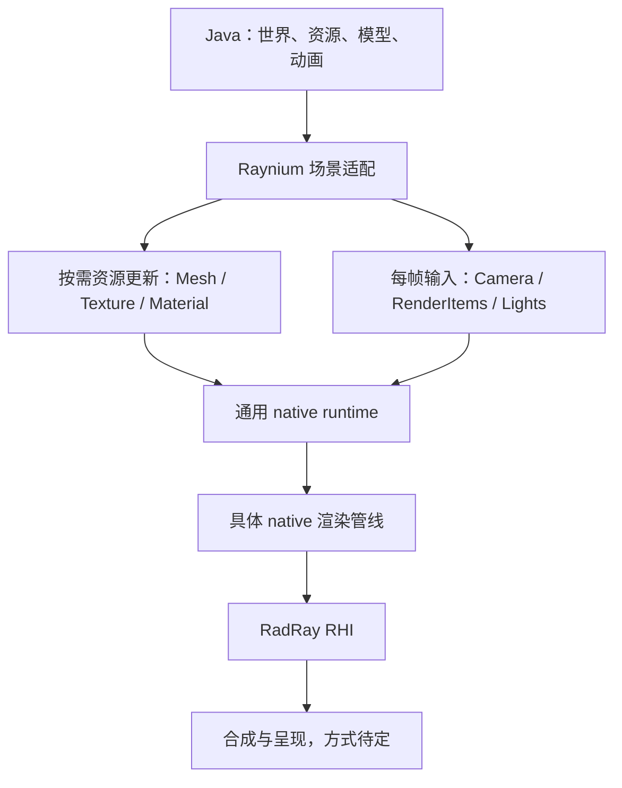

# Raynium 渲染接入设计

Raynium 负责把 Minecraft 的场景转换为通用渲染输入。native runtime 接收网格、纹理及每帧数据，在 native 内执行渲染管线，再调用 RadRay RHI。

状态：职责边界已确认，设备与 Direct 队列初始化、Java 生命周期已实现；本文的资源与渲染接管设计尚未实现。本文中的接口名称和数据结构是设计候选，不代表已确定的 ABI。基线为 2026-10-26；当前客户端仍使用原版渲染。

具体模块、接口、26.3 注入位置和实施顺序见 [实现设计](implementation-design.md)。该文为下一步实施提案，本页保留已确认的边界与决策状态。

runtime 的功能边界、资源依赖和帧执行服务详见 [Native runtime 功能设计](native-runtime-design.md)。

## 已确认的职责边界

- native runtime 应具有通用性，接受通用网格、纹理等渲染数据。
- 渲染管线位于 native，按管线组织渲染并调用 RHI。
- MC 游戏逻辑、世界和资源语义、模型求值及其余应用侧工作保留在 Java。
- Raynium 的 Java 适配层负责 MC 与通用渲染输入之间的转换。
- 首个实施平台为 Windows，渲染层面向 RadRay RHI；Raynium 不分别设计 Vulkan 和 D3D12 后端接入。

| 层 | 职责 |
| --- | --- |
| MC 与 Java 场景逻辑 | 世界与区块管理、资源解析、方块模型求值、网格生成、实体动画、场景变化 |
| Raynium Java 适配层 | MC 资源与通用资源的身份映射、格式转换、场景收集、资源更新与帧输入提交 |
| 通用 native runtime | GPU 资源、上传与释放、帧执行基础设施、调用具体渲染管线 |
| 具体 native 渲染管线 | pass、shader、渲染目标、材质处理、绘制组织、阴影、光照、后处理和历史缓冲 |
| RadRay RHI | 设备、资源、命令、提交及显式同步的后端抽象 |

Java 提交本帧需要渲染的内容，native 管线决定如何绘制这些内容。MC 的区块对象、方块 ID、资源包规则和 Java 模型对象不应成为通用 runtime 的公共契约。

CPU 场景遍历、模型动画、视锥裁剪和 LOD 等应用侧工作按当前方向留在 Java。阴影 pass 的对象选择、GPU 可见性优化等管线内部工作，需要在具体管线设计时明确边界；尚未选定其算法。

## 数据流



区块变化产生网格增量，纹理变化产生资源更新，动态场景产生逐帧输入。这三类数据的频率和生命周期不同，应分别表达。

## 候选接口分组

### 持久资源

Java 提交网格、纹理和材质描述，native 创建资源并返回句柄。未变化的资源继续被引用，更新和删除显式提交。

候选操作包括创建/更新/释放网格、纹理和材质。句柄布局、版本规则、更新是否原地执行、纹理区域上传和失败返回方式尚待设计。

材质不是一组孤立的纹理句柄。具体管线还需要明确材质模型、参数布局、透明属性及 shader 变体的解释方式。通用 runtime 提供承载机制，具体 native 管线定义所需契约，Java 将 MC 材质转换为该契约。

### 每帧输入

以下只表达所需信息，不是最终数据布局：

```text
FrameInput
  Camera
    view / projection / position
  RenderItems[]
    MeshHandle
    MaterialHandle
    currentTransform
    previousTransform 或 stableInstanceId
    通用渲染属性
  Lights[]
  EnvironmentParameters
```

需要进一步决定：可见对象全量列表还是实例增量；上一帧变换由 Java 提交还是 native 按稳定 ID 保存；是否存在独立的阴影候选集；对象属性如何与管线输入版本关联。

Java 不需要生成逐 pass 的 RHI 命令。例如一个透明网格进入哪些 pass、使用何种透明算法、需要哪些中间纹理，由 native 管线决定。

### 管线和帧生命周期

Java 选择管线、修改管线参数、通知窗口变化并提交一帧。native 管线组织 pass 和依赖，runtime 负责资源执行生命周期。

候选操作包括创建执行上下文、选择管线、更新参数、提交帧、resize 和关闭。具体管线插件形式、帧图实现和 present 所有者尚未确定。

帧输入应尽量在执行前准备完整，避免 native 在每个 pass 中回调 Java 查询可变的 MC 状态。

## 所有权与执行约束

以下是接口设计必须解决的问题，具体机制尚未确定。

| 对象 | 需要定义的契约 |
| --- | --- |
| Java 提交的 CPU 数据 | 调用期间借用、同步复制，或异步转移所有权；必须明确何时可以复用/释放 |
| native GPU 资源 | 逻辑删除与 GPU 最后一次使用完成分离，不能仅按 Java 方法返回时机销毁 |
| 帧输入 | native 异步使用期间保持有效，不能直接长期引用会被 MC 清空和复用的 RenderState |
| 区块/世界身份 | 槽位复用、卸载、切世界后如何识别并淘汰旧任务 |
| 历史数据 | resize、相机跳变、世界切换和管线变化时如何失效 |
| 共享图像 | 创建、导入、每帧同步、resize 和关闭分别由哪一侧负责 |

批量提交和明确的数据布局是候选方向；传递 native 地址不等于整个上传链路零复制。

RadRay 当前 RHI 的 CPU 调用必须由调用方串行化，包括不同对象上的创建、录制、提交、查询和销毁。runtime 必须安排统一的 RHI 执行顺序。Java 工作线程可以并行准备 CPU 数据，但不能据此假定可以并行调用 RHI。GPU 在途依赖、资源状态和跨队列同步也需要调用方管理。权威约束见相邻工程的 [RHI 与后端](../../RadRay/docs/architecture/render-rhi.md)。

## MC 接入节点

这些节点来自已有模组的实践；26.3 源码中的具体接入位置及需要保留的维护逻辑见 [实现设计](implementation-design.md#mc-263-的具体接入)。

| 节点 | Java 适配工作 | 交给 native 的信息 |
| --- | --- | --- |
| 初始化 | 取得窗口和设备相关配置，建立调用桥 | 通用执行上下文参数 |
| 资源更新 | 解析 MC 资源、追踪图集和动画纹理变化 | 纹理、材质及更新数据 |
| 区块生命周期 | 追踪标脏、重建、卸载和槽位迁移 | 网格新增/更新/删除 |
| 地形构建 | 复用或替换 MC 网格生成出口 | 通用顶点、索引、材质引用 |
| 动态场景 | 相机、实体、方块实体、手持物、粒子和天气转换 | 每帧相机、渲染实例和特效输入 |
| 世界绘制 | 抑制已接管的原版 draw，继续必要的更新调度 | 执行本帧管线的请求 |
| UI 与呈现 | 按选定方案保留或适配 UI 输出 | 合成输入、输出目标或呈现请求 |
| 失效与退出 | resize、资源重载、切世界和关闭通知 | 对应的更新、失效和释放请求 |

取消原版世界绘制时，必须处理原函数内同时存在的区块重建、上传和其他维护工作。26.3 的具体位置见 [渲染流程](minecraft-26.3-rendering.md)。

## 尚待确定

| 事项 | 当前状态 |
| --- | --- |
| Java/native 绑定 | JNI、FFM 或组合方案未选定 |
| 跨语言 ABI | 句柄、结构布局、版本协商、错误返回和批量接口未确定 |
| 场景提交模型 | 全量帧列表、持久实例增量和混合方案未确定 |
| 材质契约 | 通用描述与具体管线参数的边界未确定 |
| native 执行线程 | Java 渲染线程同步调用或独立 native 执行线程未确定 |
| UI 保留方式 | GL 共享图像互操作、RenderPearl 适配或移植 UI 等方案待比较 |
| 窗口与 present | 唯一呈现所有者及 swapchain 集成方式未确定 |
| 平台与图形接口 | Windows + RadRay RHI 已确认；具体后端由 RadRay 管理，不作为 Raynium 的分支设计 |
| 首个渲染管线 | 光栅、光追、pass 结构和 shader 资产流程未确定 |

完整 RenderPearl backend 适配仍可作为保留原版绘制路径的候选方式，不是当前已经选定的前置工作。

实现提案优先让 Java 导出世界和 GUI 数据，由 native 经 RHI 统一渲染和呈现。GL 共享图像仅作为可选兼容路径，不是主路线的实施前提。

现有 RHI 公开接口尚没有 Remix/Radiance 所使用的跨 API 外部图像及 semaphore 导入/导出能力；若选择类似的 UI 互操作方案，需要补足该能力。Windows swapchain 使用原生 HWND，不能把 MC 26.3 的 SDL window 指针直接当作 HWND 传入。

